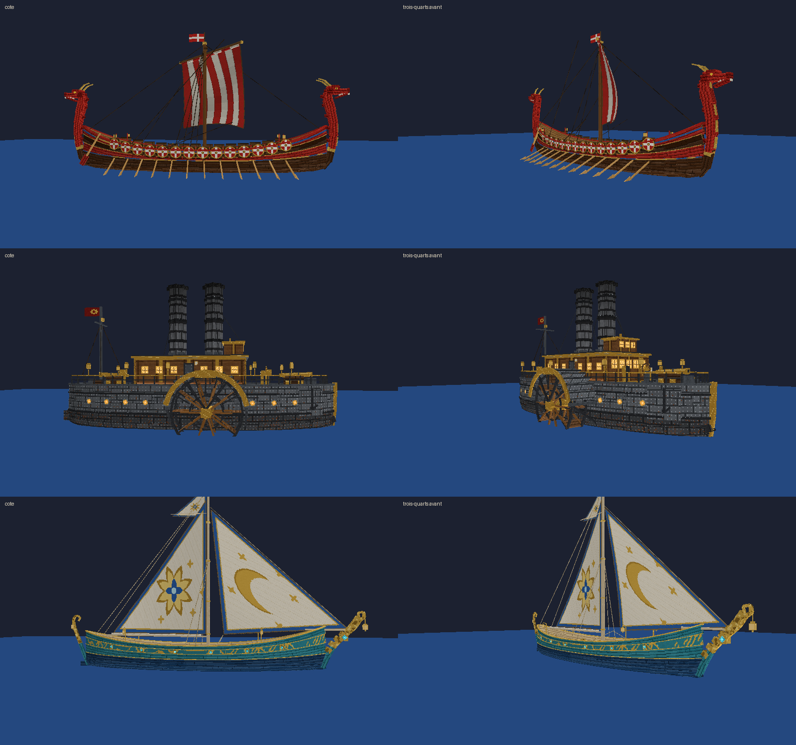
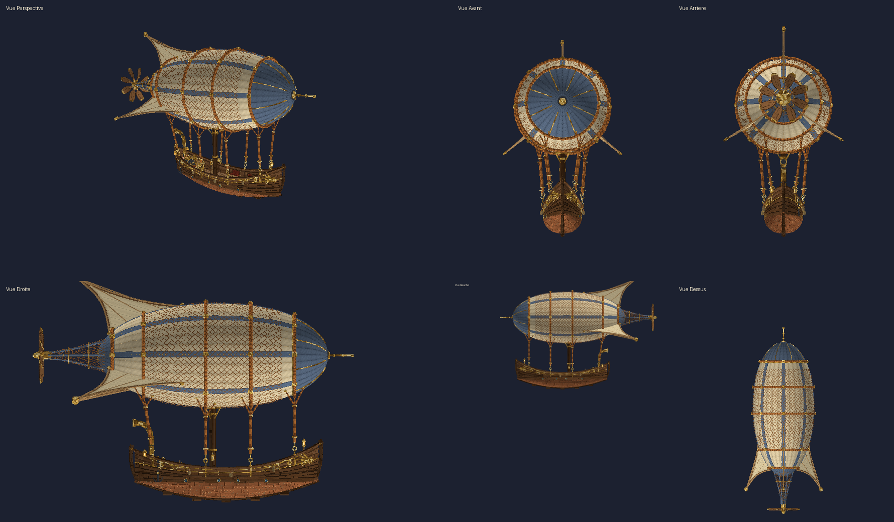
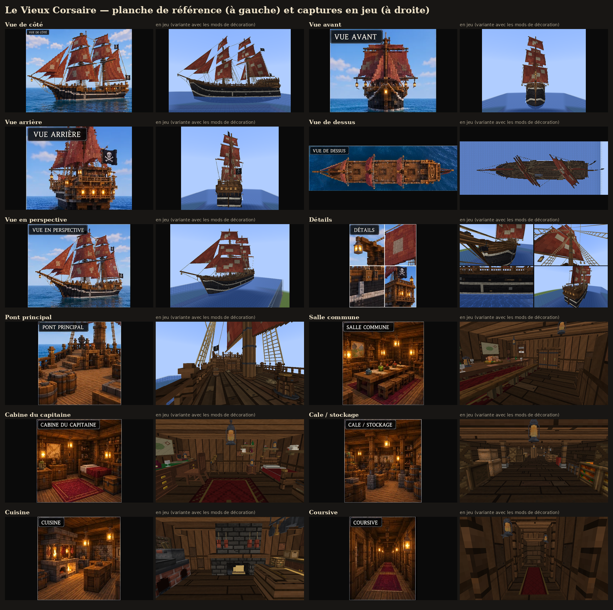
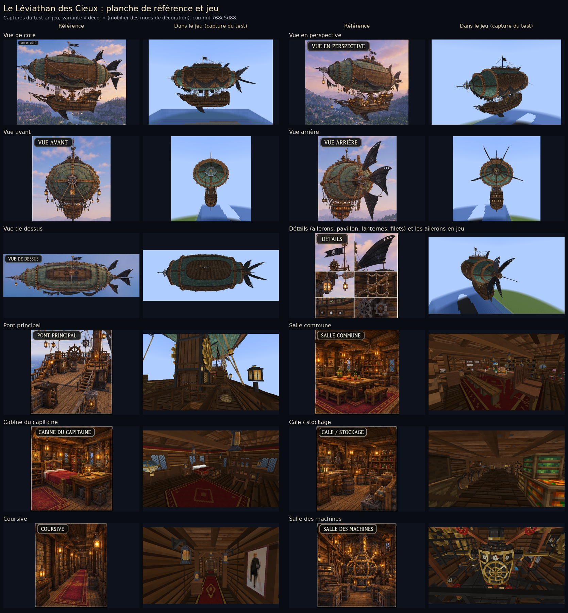

# Medieval Ships — navires médiévaux navigables (Fabric 1.21.11)





Six navires, un **dirigeable volant** et le **Nautilus**, un sous-marin dont on parcourt les salles en
plongée. Ce sont de **véritables entités**, pas des constructions en blocs :

| | Galère médiévale | Grand galion | Grand vaisseau de guerre |
|---|---|---|---|
| Objet / commande | *Galère médiévale*, `galley` | *Grand galion*, `galleon` | *Grand vaisseau de guerre*, `warship` |
| Taille | 20 blocs (22 hors tout), 5 de large, mât de 13 blocs | 35 blocs (43 avec beaupré et balcon), 9 de large, 28 de haut | 55 blocs (≈ 67 avec beaupré et galeries), 13 de large, coque de 12 blocs, 42 de haut |
| Propulsion | 16 rames + voile latine | 3 mâts, voiles carrées gonflées, latine, 2 focs | 3 mâts à 3 voiles carrées chacun, latine d'artimon, 3 focs, civadière |
| Places assises | 9 (barreur + 8 bancs) | 16 (barre, pont, gaillards avant et arrière, grande cabine) | 24 (barre, 12 affûts de canon du pont, gaillard d'avant, gaillard d'arrière, dunette, grande cabine) |
| Maniement | vif : accélère vite, pivote presque sur place | lourd : lente accélération, forte inertie, larges virages | très lourd : ≈ 17 s pour prendre son allure, > 40 blocs d'erre, très larges virages |
| Particularités | rames animées, tente de poupe | grande cabine et balcon accessibles, escaliers, dunette au toit rouge, sabords décoratifs, drapeaux à emblème | 3 ponts (pont principal, gaillard d'arrière, dunette) + gaillard d'avant, grande cabine accessible, 58 canons décoratifs (prêts pour le combat), haute poupe à trois étages de fenêtres et galeries, écume à la proue |

| | Galère médiévale rouge | Bateau à roue à vapeur | Voilier elfique |
|---|---|---|---|
| Objet / commande | *Galère médiévale rouge*, `medieval_galley` | *Bateau à roue à vapeur*, `steam_paddleboat` | *Voilier elfique*, `elven_sailboat` |
| Taille | 28 blocs hors tout (coque de 26), 5 de large, coque de 3 blocs, 15 de haut | 22 blocs, 8 de large (12 avec les roues), coque de 5 blocs, 12 de haut | 30 blocs hors tout (coque de 24), 6 de large, coque de 4 blocs, 21 de haut |
| Propulsion | 24 rames + grande voile carrée rayée rouge et blanc | machine à vapeur : une roue à aubes de chaque côté, deux cheminées | un grand mât, trois voiles triangulaires |
| Places assises | 10 (barreur + 8 bancs de nage + proue) | 8 (barre, bancs le long du rouf, 2 servants de canon, poupe) | 8 (barre, 6 bancs à coussins, proue) |
| Maniement | vive et maniable : accélère vite, vire court, les rames la font pivoter à l'arrêt | accélération progressive, très maniable à basse vitesse, bonne marche arrière, pas de voile à carguer | rapide et fluide : grande vitesse, longue erre, virages doux |
| Particularités | coque en croissant, tête de dragon sculptée à la proue et sa queue enroulée à la poupe, 28 boucliers ronds à croix blanche, drapeau rouge à croix blanche | coque blindée rivetée, proue renforcée à éperon, rouf aux fenêtres éclairées, roues qui tournent avec la vitesse (en arrière en marche arrière), fumée des cheminées, écume et gerbes à la roue, battement de la machine, 2 canons en laiton, rambarde à lanternes | coque turquoise et or, gemmes lumineuses, longue proue sculptée en volute avec sa lanterne, poupe recourbée, rose des vents dorée et croissant de lune brodés sur les voiles, volutes et ailes dorées, lanternes qui se balancent |

| | Dirigeable steampunk |
|---|---|
| Objet / commande | *Dirigeable steampunk*, `steampunk_airship` |
| Taille | ballon de 19 × 8,5 blocs, nacelle de 15 × 3,6 blocs suspendue 5 blocs dessous, 27 blocs hors tout, 18 de haut |
| Propulsion | **il vole** : hélice arrière en bois (tourne avec la vitesse), ailerons qui braquent dans les virages et suivent la montée ou la descente |
| Places assises | 6 (pilote + 5 passagers) ; on peut aussi marcher sur le pont de la nacelle en vol |
| Maniement | un dirigeable, pas un avion : accélération et virages lents, inertie, montée et descente progressives, **vol stationnaire**, l'altitude se maintient seule, plafond réglable |
| Particularités | se pose au-dessus du sol, de l'eau ou d'un toit (clic droit), ne traverse ni le relief ni les bâtiments ; pilote automatique en **3D** sur des itinéraires aériens (décollage, altitude de croisière au-dessus du relief, descente aux escales, cap à l'escale) ; fumée d'échappement, bruit d'hélice, de vent, de moteur et de bois |

| | Le Vieux Corsaire |
|---|---|
| Objet / commande | *Le Vieux Corsaire*, `old_corsair` |
| Taille | coque de 42 blocs (53 avec le beaupré), 10 de large, coque de 9 blocs (quille à la lisse), 38 de haut au grand mât |
| Propulsion | brick à deux mâts : basse voile, hunier et perroquet carrés sur chaque mât (grand-voile ferlée), brigantine, 2 focs, voile d'étai ; voiles brique délavées et rapiécées |
| Places assises | 23 (barre du gaillard d'arrière + bancs et chaises de la salle commune, chaise du bureau du capitaine, tabourets, bancs du pont) |
| Maniement | lourd : lente accélération, forte inertie, larges virages ; voiles carguées à l'arrêt |
| Particularités | vieux navire pirate rapiécé (bordages remplacés, tôles rivetées), pavillons noirs à tête de mort, lanternes ; **intérieur complet où l'on marche en naviguant** : pont principal, gaillard d'arrière, cabine du capitaine, salle commune, cuisine (foyer qui crépite et fume), coursive, postes d'équipage, cale sèche sous la flottaison ; 5 portes ; mobilier des mods de décoration du joueur ; voir [docs/CORSAIR_PLAN.md](docs/CORSAIR_PLAN.md) |

| | Le Léviathan des Cieux |
|---|---|
| Objet / commande | *Le Léviathan des Cieux*, `sky_leviathan` |
| Taille | 65 blocs de la pointe avant à la pointe arrière (67 avec les ailerons), ballon de 52 × 24 × 20 blocs, navire pirate suspendu de 35 blocs (45 avec la poulaine et le beaupré) et 10 de large, 48 de haut avec le pavillon |
| Propulsion | **il vole** : machine à vapeur, ailerons noirs en aile de chauve-souris (gouvernail et profondeur) |
| Places assises | 26 (barre du château arrière + bancs, chaises, fauteuils et tabourets des pièces) ; on marche partout à bord en vol |
| Particularités | **intérieur complet** : pont principal, salle commune, cabine du capitaine, salle des cartes, coursive, poste d'équipage, cambuse, magasin, cale, **salle des machines** (chaudière, pistons et engrenages animés, vapeur, sons), tour à échelle jusqu'au pont d'observation au sommet du ballon ; mobilier des mods de décoration du joueur ; pilote automatique **3D** ; voir [docs/LEVIATHAN_PLAN.md](docs/LEVIATHAN_PLAN.md) |

| | Nautilus — Sous-marin du capitaine Nemo |
|---|---|
| Objet / commande | *Nautilus — Sous-marin du capitaine Nemo*, `nautilus` |
| Taille | 96 blocs de l'éperon à la queue, 14 de large, 17 de haut (quille au projecteur) |
| Propulsion | **il plonge** : hélice, ballasts (Ctrl plonger, Espace remonter), tient sa profondeur seul, jusqu'à 120 blocs |
| Places assises | 28 (barre de la timonerie + 27 chaises, fauteuils et canapés) |
| Particularités | **intérieur complet où l'on marche pendant qu'il navigue et plonge, au sec** : salle à manger, bibliothèque, grand salon (orgue, baies à panneaux de fer), cabines de Nemo et d'Aronnax, timonerie surmontée de la lanterne du projecteur, coursives, escalier en colimaçon, échelles, cuisine, équipage, cales, salle des machines (piles, moteur animé), **sas** qui se remplit et se vide, canot détachable, double fond ; 17 portes étanches animées ; projecteur à faisceau ; mobilier tiré des mods de décoration du joueur s'ils sont installés ; pilote automatique **3D sous-marin** |

Le Nautilus a son guide : [docs/NAUTILUS.md](docs/NAUTILUS.md) (plan des salles, équipements,
commandes `/ship nautilus`, itinéraires sous-marins, mobilier utilisé).

Pilotage du dirigeable : Z/S vitesse, Q/D cap, **Espace monter, Ctrl descendre** (relâchées : il
garde son altitude), Maj quitter le poste ; le tableau de bord du pilote affiche vitesse, altitude,
moteur et pilote automatique. Voir [docs/COMMANDES.md](docs/COMMANDES.md) pour les
itinéraires aériens et [docs/comparaison_dirigeable.png](docs/comparaison_dirigeable.png) pour la
comparaison avec l'image de référence.

Le grand vaisseau de guerre s'appelle aussi `grand_warship` dans les commandes ; son
identifiant interne reste `warship` (navires déjà posés, sauvegardes et configuration intacts).

Pour tous :

* objet dans l'inventaire créatif (onglet *Navires médiévaux* et *Outils*), clic droit sur
  l'eau pour le mettre à l'eau (vérification de la place disponible) ;
* flottaison, inertie, accélération progressive, virages fluides avec perte de vitesse,
  collisions avec le terrain, les quais et les autres navires, impossible de naviguer sur terre ;
* pilotage à la barre (Z/S/Q/D, Espace/Ctrl pour les trois allures, Maj pour quitter) ;
* **marche libre sur le pont pendant la navigation**, collisions multi-volumes (on ne traverse
  ni le pont, ni la coque, ni les châteaux, même en sautant, y compris avec Lithium) ;
* animations synchronisées : voiles au vent et carguées à l'arrêt, barre/gouvernail,
  drapeaux, roulis (+ rames pour la galère) ;
* **pilote automatique PNJ** adapté à chaque navire : itinéraires, escales, aller-retour,
  annonces, évitement d'obstacles, ferries qui continuent sans joueur et reprennent après un
  redémarrage ;
* commandes `/ship` pour les administrateurs ;
* aucune dépendance autre que Fabric API (ni GeckoLib, ni Valkyrien Skies, ni Eureka),
  aucune apparition naturelle.

## Fonctions communes à tous les vaisseaux

* **Aperçu de placement** : en tenant l'objet d'un vaisseau, une silhouette translucide du vaisseau
  apparaît là où le clic droit le posera, orientée comme vous regardez, **verte** s'il y a la place et
  **rouge** sinon. Elle vient du même calcul que le serveur (même visée, même contrôle d'espace :
  relief, bâtiments, autres coques) : vert, le vaisseau est posé exactement là ; rouge, rien n'est posé
  et l'objet est gardé. Seule la coque est dessinée (ni pièces, ni meubles), seulement pour le joueur
  qui tient l'objet, et le contrôle n'est refait que si la visée change.
* **Tableau de bord du pilote** (en haut à gauche, en français) : vitesse, altitude et hauteur sous la
  quille, montée / descente / palier, profondeur (Nautilus), état du moteur et allure, état du pilote
  automatique, touches. Seul le joueur à la barre le voit (et, quand le pilote automatique emmène le
  vaisseau vers une destination, le joueur resté près de la barre) : rien pour les passagers.
* **Inclinaison en virage** des aéronefs, proportionnelle à la vitesse et au taux de virage (virage
  coordonné), purement visuelle : collisions, ponts, pièces et passagers restent à plat, et l'angle
  est borné pour qu'aucun endroit où l'on marche ne paraisse à plus d'un demi-bloc de sa position
  réelle (≈ 6° pour le dirigeable steampunk, ≈ 1° pour l'immense Léviathan des Cieux). Réglable par
  vaisseau (`bankAngle` du bloc `flight`, 0 = désactivé). Un joueur debout ou qui marche sur le pont
  pendant les virages reste sur le pont (testé en jeu sur le dirigeable steampunk et le Léviathan).
* **Permissions de placement** : `placeRequiresAdmin` (tous les vaisseaux réservés aux
  administrateurs), `placeAdminOnly` (certains vaisseaux seulement, ex. `["sky_leviathan"]`),
  `placeAllowedPlayers` (joueurs autorisés malgré tout). `/ship` et la récupération d'un navire
  restent réservés aux administrateurs.
* **Destinations** pour le pilote automatique, en plus des itinéraires : `/ship goto <x y z>`,
  `/ship goto destination <nom>`, `/ship goto visee`, destinations enregistrées
  (`/ship destination add|remove|list`), et pour **les joueurs à bord** `/pilote goto …`,
  `/pilote stop`, `/pilote destinations`. Le vaisseau y va seul (évitement des obstacles, altitude
  au-dessus du relief et des bâtiments, ralentissement à l'approche, arrêt sur le point, un aéronef se
  pose à sa garde au-dessus du sol), et un clic droit sur la barre rend la main. Un joueur ne peut pas
  dérouter un ferry ni passer outre le joueur qui tient la barre. Détails :
  [docs/COMMANDES.md](docs/COMMANDES.md#destinations-aller-à-un-point).
* **Intérieurs praticables en vol** : on marche sur les ponts et dans les pièces pendant que le
  vaisseau vole ou navigue grâce au système du mod (grille intérieure de collisions qui suit la coque,
  transport des joueurs et des entités à bord), **pas** Valkyrien Skies, qui n'est ni requis ni utilisé.

La version 1.8.2 embellit le navire suspendu du Léviathan des Cieux : poupe bombée qui monte en surplomb avec deux galeries superposées à balustres, onze fenêtres plombées éclairées, ornements et engrenages de laiton, lanternons ; ventre profond et arrondi, tonture relevée, proue ronde à longue poulaine ajourée, préceintes courbes, hublots cerclés de laiton, garde-corps à balustres tournés ; on peut marcher sur la dunette prolongée.

La version 1.8.1 corrige le Léviathan des Cieux : le pilote qui lâche la barre est bien déposé sur le château arrière, et l'échelle de la tour mène de nouveau au pont d'observation même quand le dirigeable tourne (les parois de la coque ne se laissent plus traverser pendant un virage) ; documentation et planches comparatives des deux nouveaux véhicules.

La version 1.8.0 ajoute deux nouveaux véhicules, reproduits d'après leurs planches de référence : **Le Vieux
Corsaire** (`old_corsair`), un vieux brick pirate rapiécé aux voiles brique, dont on parcourt le pont, la
cabine du capitaine, la salle commune, la cuisine, la coursive, les postes d'équipage et la cale pendant qu'il
navigue, et **Le Léviathan des Cieux** (`sky_leviathan`), un immense dirigeable pirate steampunk (ballon, navire
suspendu, salle des machines animée) ; tous deux meublés avec les mods de décoration du joueur, animés et
compatibles avec le pilote automatique (itinéraires maritimes pour le corsaire, aériens en 3D pour le
Léviathan).

La version 1.7.20 : voiles du galion et du grand vaisseau gonflées en courbe lisse (sans damier ni marches), drapeaux du galion qui ondulent, grands fanaux de poupe à huit pans, gouvernail du galion affiné ; hélice du dirigeable à pales vrillées, lanternes ouvragées, emblème d'engrenage ailé à la proue, sacs de lest ronds ; galère rouge : écailles continues sur le cou et la queue du dragon, rayures de voile droites, boucliers ronds.

La version 1.7.19 : le joueur qui tient la barre se tient debout à la roue (au lieu d'être assis), et quitter un siège fait descendre juste à côté de ce siège au lieu de téléporter à la barre.

La version 1.7.18 : le grand vaisseau de guerre en détail : peintures et dorures plus fines, sculptures en relief (acanthes, volutes, Renommées ailées et statues à la poupe), poupe sans bords dentelés, canons ronds sur de vrais affûts à roues, mantelets ouverts rouges, cabestan, caillebotis, beffroi et sa cloche, habitacle, hunes rondes à rambarde dorée, nouveau lion couronné en figure de proue, rideaux dans la grande cabine, voiles à bandes de ris.

La version 1.7.17 : le galion en détail : textures plus fines (veinage, dorure sculptée, vitraux en losanges, pont en long), 10 canons de bronze sur affûts, cabestan rond, chaloupe, tonneaux cerclés, roue de barre ronde et habitacle, hunes rondes, caps de mouton et cadènes, ancres neuves, grande chambre avec rideaux de velours, banquette et fauteuils. Le dirigeable meublé : tapis, bancs capitonnés, caisses et lanternes sur le pont, poste de pilotage avec manomètres, transmetteur d'ordres et tabouret, salle des machines avec foyer rougeoyant, pistons, bielles et tuyaux de vapeur, coque doublée de cuivre rivetée avec hublots et volutes dorées.

La version 1.7.16 : tous les véhicules sont lissés et arrondis. Galion et grand vaisseau de guerre : coques plus fluides (plus de couples et de virures, bouchain arrondi, rentrée), poupes et galeries bombées, et les changements de niveau du pont (gaillards, dunette) se font en longues courbes en S au lieu de marches carrées ; la maisonnette du galion devient un étage de château à toit-pont bombé ; proues retravaillées, mâts et vergues ronds. Dirigeable : ballon plus lisse au nez arrondi, ailerons courbes, nacelle ronde, cordages, rambardes, chaudière et tuyaux ronds. Petits bateaux : coques arrondies, poteaux, mâts, cheminées et tourelles ronds, textures plus fines, voiles aux bords courbes avec bandes de ris, sculptures (dragon, volutes elfiques, dais doré de la galère). Nautilus : toit de la timonerie arrondi sans arête, pied évasé dans le pont.

La version 1.7.15 : la salle des machines est plus fournie : conduites de vapeur et d'air (cuivre, laiton, fer) le long de la paroi tribord au-dessus du moteur, qui descendent vers un panneau de vannes à volants ; tableaux de manomètres et bobines de Ruhmkorff le long de la passerelle ; membrures de bois cerclées de laiton sur les parois.

La version 1.7.14 : en plongée, l'hélice laisse un sillage de bulles quand le Nautilus avance, et de l'air s'échappe en bulles du pont quand il plonge ; la mer vue par les vitres est un peu plus transparente (on distingue mieux le fond et les poissons au loin).

La version 1.7.13 : la queue comme sur la planche : deux nageoires seulement, au-dessus et au-dessous de l'hélice, qui naissent de la coque (leur bord d'attaque prolonge la ligne du dos et du ventre par-dessus l'anneau de l'hélice jusqu'aux pointes de la queue de poisson) ; les ailerons latéraux sont retirés.

La version 1.7.12 :
* l'échelle de la timonerie ne bloque plus la coursive avant : son poteau ne descend plus dans le couloir (on passe à côté vers les deux cabines ; on monte en sautant sur l'échelle, puis en avançant dans le puits) ;
* le tapis de la timonerie laisse voir la trappe ;
* vue par les vitres et les hublots en plongée : le bleu clair de la mer que voit un nageur (le brouillard n'est plus presque noir, l'eau derrière la vitre est bleue et lumineuse) ;
* arrière plus fidèle : queue de poisson plus large en cuivre bordée de bronze, fuseau de queue qui porte les ailerons derrière l'hélice, tirants depuis l'anneau de l'hélice.
* moins de lag : les pièces fixes du modèle ne sont plus recalculées à chaque image, les tranches des plaques fines ne sont plus dessinées, et de loin (au-delà de 48 blocs) l'intérieur et les meubles ne sont plus dessinés, ni les petits détails extérieurs au-delà de 80 blocs.

La version 1.7.11 : derrière la timonerie, la pente en diagonale de la planche (carénage riveté du toit jusqu'au pont, arête à pointes, main courante, manche à air ; on peut y monter) ; sur le pont, garde-corps de laiton le long des bords, bittes d'amarrage et manches à air. Textures de la coque refaites : cuivre martelé plus riche avec patine et reflets, dessous bien plus sombre (bronze foncé, joints sombres), vitres plus profondes ; pointes en bronze, arche plus épaisse et rivetée, joints rivetés sur les ailerons, croix de laiton dans la vitre de la grande baie.

La version 1.7.10 :
* timonerie arrondie, dedans et dehors, comme sur la planche : plan arrondi (les collisions le suivent), paroi lambrissée courbe avec plinthe et rambarde de laiton, nervures de bois, fenêtres octogonales, pupitres à instruments de chaque côté de la barre, lanternes, tapis ; coque extérieure plus ronde, lampes aux angles avant ;
* avant : lame sous la proue jusqu'à l'éperon, bordée de laiton, avec ses pointes ; lampes de chaque côté de la proue ;
* arrière : l'hélice dans un anneau de protection sur quatre bras.

La version 1.7.9 : une rangée de fenêtres-meurtrières à cadre de laiton le long des deux épaules de la plate-forme, sous le bord du pont, et un joint riveté qui les suit, comme sur la planche.

La version 1.7.8 :
* la cage du projecteur, grosse et carrée derrière la timonerie, devient une petite lanterne ronde posée sur le toit de la timonerie (tambour de cuivre cerclé de laiton, coupole et évent, lentille vers l'avant), comme sur la planche ;
* flancs plus détaillés : barres de plongée à l'avant, rangée de petites fenêtres rectangulaires dans le haut de la coque, N doré dans un anneau près de la proue, feux de position rouge (bâbord) et vert (tribord) sur la timonerie.
* encore plus proche de la planche : bordé riveté plus serré, grande baie dans un cadre octogonal de bronze riveté à nervures en croix, rangée de fenêtres rectangulaires en bas de coque, arche à pointes plus lisse terminée par une lampe allumée dans sa cage, épi de petites pointes sur le dos et sous la proue, coque en deux tons (cuivre clair au-dessus du bourrelet, brun sombre dessous), éperon rond cerclé de laiton, nervures de laiton sur les ailerons de queue, sangles rivetées sur la timonerie.

La version 1.7.7 :
* hublots vus de l'intérieur : seul le manchon rond est visible (les parois carrées du trou ne sont plus dessinées), boulons et crabots plus fins ;
* coque plus fidèle à la planche : cuivre plus clair, bordé riveté en grandes tôles (joints en relief, sans quadrillage) et bourrelet de ceinture le long de chaque flanc ;
* tenues de plongée : poids de plomb en cœur devant et derrière, couteau à la ceinture, sortie d'air sur le casque, bottes en acier lisse.

La version 1.7.6 continue les finitions du Nautilus :
* tenues de plongée refaites : corps, bras et jambes en toile arrondie, genouillères, gants, bottes lestées arrondies à sangles de laiton, ceinture de plombs, bouteille d'air Rouquayrol cylindrique à sangles et tuyau jusqu'au casque, support à potence ;
* hublots : visière de laiton au-dessus de chaque hublot à l'extérieur, crabots de serrage et charnière à l'intérieur ;
* hélice à pales vrillées et moyeu arrondi.

La version 1.7.5 retravaille le sas et les finitions du Nautilus :
* sortie du sas : le tunnel vers la mer fait 2 blocs de large et 2,5 de haut, s'ouvre par une vraie ouverture dans la coque (cadre de laiton) et plus aucun hublot ne passe devant ;
* les vannes du sas sont sur de vrais panneaux de commande (manomètre, volant rouge pour remplir, volant de laiton pour vider, étiquettes), loin de la porte, dans le sas et dans le couloir ;
* scaphandres et casques de rechange : casques ronds et lisses, hublots ronds à barreaux, plastron bombé boulonné ;
* hublots vus de l'intérieur plus fins et ronds, fenêtres de la timonerie rondes (le trou carré est caché), ailerons arrière en profil d'aile, cône arrière plus lisse.

La version 1.7.4 continue le Nautilus :
* extérieur lisse : la coque, le capot et la timonerie n'ont plus de quadrillage de plaques, la coque a plus de facettes, la timonerie est arrondie avec un toit bombé ;
* hublots extérieurs ronds, à collerette de laiton boulonnée ;
* vue trouble à travers les vitres en plongée : voiles d'eau de mer derrière les vitres et brouillard sous-marin plus dense ;
* trappes texturées (panneau étanche, couronne de laiton, volant, crabots) et trous d'échelle de 2 blocs de large (panneau d'accès, timonerie, canot) ;
* le sas des scaphandres est équipé : banc, étagère de casques de rechange, chaussures lestées, lampes Ruhmkorff, râtelier de fusils électriques, tuyau d'air enroulé ; un hublot ne traverse plus le sas.

La version 1.7.3 améliore encore le Nautilus :
* toutes les portes des salles font 2 blocs de large, avec deux battants en acajou (hublot à collerette de laiton, panneaux moulurés dorés, ferrures de bronze rivetées) dans un cadre de laiton ;
* les petits passages sont élargis : devant le sas, entre le couloir et la coursive du pont inférieur, palier de l'escalier ;
* par les baies et les hublots, la mer se voit comme quand on nage : brouillard et teinte bleue sous l'eau ;
* les tableaux sont les tableaux vanilla de Minecraft ;
* les matériaux sont affinés : or, laiton et acier polis avec un reflet doux au lieu de taches, tuyaux d'orgue à reflet cylindrique, velours à plis, cuir capitonné patiné, parquet en vannerie dans les salons, carrelage jointoyé ;
* les deux grandes baies du salon sont bordées d'un manchon rond et lisse (boiserie, nervures et large moulure dorées) au lieu d'un trou en escalier ;
* le grand salon est enrichi : vasque en tridacne géante avec sa fontaine, fauteuils et longues-vues tournés vers les baies, palmiers, pilastres cannelés, corniche et rosaces dorées.

La version 1.7.2 corrige et enrichit le Nautilus :
* les hublots, vus de l'intérieur, ont un manchon de cuivre, une collerette de laiton boulonnée et une vitre, au lieu d'un trou carré ;
* le canapé du salon est remis dans le bon sens ;
* les vitrines qui bloquaient la porte de l'escalier sont retirées, et le palier derrière cette porte est assez grand pour passer ;
* l'escalier en colimaçon est refait : marches en bois à nez de laiton, colonne ronde, rampe en spirale sur balustres ;
* les cabines et le quartier de l'équipage sont plus meublés (armoires, horloges, porte-manteaux, bibliothèque, fauteuil, tapis, échiquier, cadres, deux couchettes de plus).

La version 1.7.1 améliore le Nautilus :
* l'ordre de plongée referme lui-même les panneaux ouverts, et les messages au pilote ne sont plus masqués par la jauge de profondeur ;
* les couloirs sont plus larges ;
* les murs intérieurs sont lisses (peinture, boiseries, damas), et leur texture court d'un bloc à l'autre sans répétition visible ;
* l'extérieur est caréné : capot à épaules arrondies, timonerie arrondie à toit bombé, capot du projecteur arrondi, quilles et ailerons lisses, coque plus ronde ;
* le mobilier est retravaillé : orgue monumental, globe, scaphandres, lustres, plafonniers, fauteuils, Chesterfield et canot.

La version 1.7.0 ajoute le **Nautilus** (`nautilus`), reproduit d'après la planche de référence,
sans rien changer aux autres navires : intérieur parcourable et étanche, plongée, sas, panneaux
des baies, projecteur, lumières, canot, commandes `/ship nautilus`, itinéraires sous-marins.
La version 1.6.1 améliore le dirigeable (hélice à 8 pales en pagaie, nez à nervures en laiton et
collier doré, cerclages et suspentes plus épais terminés par des chaînes de maillons dorés,
volant d'inertie, tuyau en laiton, couleurs plus chaudes) et donne du relief aux voiles de la
galère, du galion et du vaisseau (ombre vers les bords, coutures et ralingue plus visibles).
La version 1.6.0 ajoute le **dirigeable steampunk** (`steampunk_airship`), un véhicule volant
reproduit d'après l'image de référence, avec sa propre physique de vol, ses itinéraires aériens
en 3D et son pilote automatique, sans rien changer aux six navires.
La version 1.5.6 aménage encore les grandes cabines du galion et du vaisseau : lambris à lisse
dorée, lustres à bougies, carré autour du mât d'artimon et buffets dans le vaisseau.
La version 1.5.5 orne les tambours des roues du bateau à vapeur d'un éventail doré et refait ses
cheminées en viroles de fer rivetées.
La version 1.5.4 sculpte un vrai lion couronné à la proue du galion et du vaisseau, une volute
dorée à celle de la galère, et donne au galion les dorures polies et les voiles patinées du
vaisseau.
La version 1.5.3 refait la tête du dragon de la galère rouge, donne à tous les navires les
lanternes du bateau à vapeur, prolonge le pont jusqu'à la proue et la poupe, et fait suivre les
écoutes quand les voiles sont carguées (plus de cordage qui s'arrête dans le vide).
La version 1.5.2 supprime tout scintillement des textures (z-fighting) sur les six navires,
raccorde la proue et la poupe de la galère, de la galère rouge et du voilier elfique à leur coque
(plus aucun vide entre les deux), garde les voiles du voilier elfique établies à l'arrêt (un ancien
fichier de configuration est mis à jour automatiquement) et refait les lanternes et les textures
du bateau à vapeur.
La version 1.5.1 soigne encore l'aspect des quatre navires de l'image : le bateau à vapeur a
**une roue à aubes de chaque côté**, des canons sur barbettes, une rambarde sur le rouf et des
cheminées couronnées ; le voilier elfique porte une rose des vents dorée, des volutes et des ailes
dorées ; la galère rouge porte la tête du dragon à la proue (crête et moustaches dorées) et sa queue à la poupe, sa voile des bandes
de ris ; les sabords du vaisseau de guerre sont encadrés d'or, sa coque peinte prend la lumière et ses voiles ont des laizes, une patine et des renforts cousus ; le voilier elfique a une coque bleu nuit semée d'étoiles, des voiles aux coutures rayonnantes et un pont incrusté d'or.
La version 1.5.0 ajoute la galère rouge, le bateau à roue à vapeur et le voilier elfique, d'après
l'image de référence ; le galion et le vaisseau de guerre flottent plus haut sur une coque plus
profonde et plus arrondie, et leurs voiles sont orientées et plus gonflées. La galère d'origine
n'a pas changé (géométrie vérifiée au millième de bloc).
La version 1.3.0 ajoute le grand vaisseau de guerre sans rien changer aux deux premiers navires.
La version 1.2.0 avait ajouté le grand galion **sans rien changer à la galère** : même modèle, mêmes
textures, mêmes animations, mêmes réglages, mêmes commandes ; les galères déjà posées dans le
monde et les ferries existants continuent de fonctionner (un test vérifie que la géométrie de
la galère est identique, au millième de bloc, à celle de la version 1.1.1).

## Installation

Serveur **et** clients : `medieval-ships-1.8.2.jar` + [Fabric API](https://modrinth.com/mod/fabric-api)
0.141.6+1.21.11 (ou plus récent pour 1.21.11), Fabric Loader ≥ 0.18, Java 21.

## Compilation

```
./gradlew build          # jar dans build/libs/
./gradlew test           # tests unitaires (physique, collisions, pilote auto, modèle)
./gradlew runClient      # client de développement
./gradlew runServer      # serveur dédié de développement
```

Les versions sont dans `gradle.properties` (Yarn `1.21.11+build.6`, Loom 1.14.10,
Fabric API 0.141.6+1.21.11). Si Gradle ne trouve pas une version, prenez la plus récente
pour 1.21.11 sur <https://fabricmc.net/develop>.

## Documentation

* [Guide des commandes administrateur](docs/COMMANDES.md)
* [Le Nautilus : salles, équipements, commandes, itinéraires sous-marins](docs/NAUTILUS.md)
* [Créer un ferry automatique](docs/FERRY.md)
* [Modèle Blockbench, textures et animations](docs/MODELE.md)
* [Architecture technique (marche sur le pont, collisions, IA, performances)](docs/ARCHITECTURE.md)
* [Tests effectués et non effectués](docs/TESTS.md)

## Configuration

`config/medievalships.json` (créé au premier lancement, rechargeable avec `/ship reload`) —
la configuration par défaut se trouve dans [`config/medievalships.json`](config/medievalships.json).
Elle a deux parties : `server` (réglages communs) et `ships` (un bloc par navire, `galley`,
`galleon`, `warship`, `medieval_galley`, `steam_paddleboat` et `elven_sailboat` ; les blocs des
nouveaux navires sont ajoutés automatiquement à un fichier existant). Un ancien fichier (version 1.0/1.1, réglages « à plat ») est converti
automatiquement : ses valeurs deviennent celles de la galère.

**`server`**

| Clé | Défaut | Rôle |
|---|---|---|
| `announceDepartures`, `announceRadius` | true, 40 | annonces de départ / d'arrivée |
| `chunkLoadAutopilotShips`, `chunkLoadRadius` | true, 2 | garder chargés les chunks des ferries |
| `adminPermissionLevel` | 2 | niveau requis pour `/ship` et la récupération des navires |
| `placeRequiresAdmin` | false | réserver la mise à l'eau aux administrateurs (et aux joueurs de `placeAllowedPlayers`) |
| `placeAdminOnly` | `[]` | vaisseaux réservés aux administrateurs, ex. `["sky_leviathan"]` |
| `placeAllowedPlayers` | `[]` | joueurs (pseudo ou UUID) autorisés à placer même quand c'est réservé aux administrateurs |
| `playerDestinations` | true | les joueurs à bord peuvent donner une destination (`/pilote goto`) |
| `playerDestinationMaxDistance` | 5000 | distance maximale d'une destination donnée par un joueur non administrateur |

**`ships.galley` / `ships.galleon` / `ships.warship`**

| Clé | Galère | Galion | Vaisseau | Rôle |
|---|---|---|---|---|
| `slowSpeed` / `normalSpeed` / `fastSpeed` | 2.5 / 5.5 / 8.5 | 2 / 4.5 / 7.5 | 1.8 / 3.8 / 6.5 | allures (blocs/s) |
| `reverseSpeed` | 1.8 | 1.0 | 0.8 | marche arrière |
| `acceleration`, `braking` | 0.9, 1.8 | 0.35, 0.6 | 0.22, 0.4 | blocs/s² |
| `waterDrag` | 0.18 | 0.07 | 0.05 | perte de vitesse en roue libre (plus bas = plus d'inertie) |
| `maxTurnRate`, `minTurnFactor` | 16, 0.3 | 8, 0.1 | 5.5, 0.08 | rotation max (°/s), part disponible à l'arrêt |
| `helmRate`, `helmReturnRate`, `turnResponse`, `turnSpeedLoss` | 1.6, 1, 1.6, 0.22 | 0.9, 0.6, 0.6, 0.12 | 0.6, 0.4, 0.4, 0.08 | réactivité de la barre, inertie de rotation, ralentissement en virage |
| `waveRocking` | 1.0 | 1.0 | 1.0 | amplitude du roulis visuel (0 = désactivé ; les grands navires roulent naturellement moins) |
| `aiWaypointRadius`, `aiStopRadius`, `aiLookahead`, `aiProbeDistance` | 7, 2, 12, 36 | 12, 3, 22, 64 | 18, 4, 32, 90 | pilote automatique : rayons, anticipation, portée de détection |
| `aiDefaultWaitSeconds`, `aiStuckSeconds`, `aiTurnAroundSpeed` | 300, 6, 0.4 | 300, 10, 2 | 300, 15, 2.4 | attente par défaut, détection de blocage, vitesse en demi-tour |
| `furlSailWhenStopped` | true | true | true | carguer les voiles à l'arrêt |

**`ships.medieval_galley` / `ships.steam_paddleboat` / `ships.elven_sailboat`** (mêmes clés)

| Clé | Galère rouge | Bateau à vapeur | Voilier elfique |
|---|---|---|---|
| `slowSpeed` / `normalSpeed` / `fastSpeed` | 2.8 / 6 / 9.5 | 2.2 / 5 / 7.5 | 3 / 6.8 / 10.5 |
| `reverseSpeed` | 2.0 | 2.5 | 1.5 |
| `acceleration`, `braking` | 1.1, 2.0 | 0.5, 1.4 | 0.8, 1.2 |
| `waterDrag` | 0.2 | 0.12 | 0.1 |
| `maxTurnRate`, `minTurnFactor` | 18, 0.35 | 13, 0.5 | 13, 0.15 |
| `helmRate`, `helmReturnRate`, `turnResponse`, `turnSpeedLoss` | 1.8, 1, 1.8, 0.22 | 1.4, 1, 1.3, 0.15 | 1.2, 0.8, 1.1, 0.1 |
| `waveRocking` | 1.0 | 0.8 | 0.9 |
| `aiWaypointRadius`, `aiStopRadius`, `aiLookahead`, `aiProbeDistance` | 8, 2, 14, 40 | 9, 2, 16, 48 | 9, 2, 16, 48 |
| `aiDefaultWaitSeconds`, `aiStuckSeconds`, `aiTurnAroundSpeed` | 300, 6, 0.4 | 300, 8, 1 | 300, 6, 1.2 |
| `furlSailWhenStopped` | true | false (pas de voile) | false (voiles toujours établies ; un ancien fichier est mis à jour automatiquement) |

**`ships.steampunk_airship`** : mêmes clés de vitesse, d'inertie et de pilote automatique
(vitesses 2,5 / 5 / 8 blocs/s, accélération 0,55, virage maximal 12°/s, peut tourner sur place),
plus un bloc **`flight`** propre aux aéronefs (ajouté automatiquement à un fichier existant) :

| Clé de `flight` | Défaut | Rôle |
|---|---|---|
| `climbSpeed` / `descendSpeed` | 1.6 / 1.3 | vitesses de montée et de descente (blocs/s) |
| `verticalAcceleration` | 0.9 | accélération verticale (blocs/s²) : montée et descente progressives |
| `maxAltitude` | 300 | plafond : hauteur (Y) que le haut du dirigeable ne dépasse jamais |
| `aiClearance` | 5 | pilote automatique : hauteur gardée sous la quille au-dessus du relief et des bâtiments |
| `aiApproachDistance` | 26 | pilote automatique : distance d'une escale où il commence à descendre à sa hauteur |
| `aiLandingClearance` | 1.2 | pilote automatique : hauteur gardée sous la quille en descendant à une escale |
| `sway` | 1.0 | balancement visuel de la nacelle (0 = aucun) |
| `bankAngle` | 6.0 | inclinaison maximale en virage (degrés, visuelle ; bornée selon la taille du vaisseau ; 0 = aucune) |

**`ships.nautilus`** : mêmes clés de vitesse, d'inertie et de pilote automatique (vitesses 2 / 4,5 / 7
blocs/s, accélération 0,35, virage maximal 6°/s), plus un bloc **`dive`** propre aux sous-marins :

| Clé de `dive` | Défaut | Rôle |
|---|---|---|
| `riseSpeed` / `diveSpeed` | 1.1 / 1.1 | vitesses de remontée et de plongée (blocs/s) |
| `verticalAcceleration` | 0.35 | accélération verticale (blocs/s²) : les ballasts répondent lentement |
| `maxDepth` | 120 | profondeur maximale sous la surface |
| `aiClearance` | 3 | pilote automatique : eau gardée sous la quille au-dessus du fond |
| `aiCruiseDepth` | 24 | pilote automatique : profondeur de croisière des étapes sans profondeur indiquée |
| `aiApproachDistance` | 40 | pilote automatique : distance d'une escale où il remonte à sa profondeur |

## Le Vieux Corsaire (`old_corsair`)



Vieux brick pirate d'un capitaine expérimenté : coque noire à bandes crème, rapiécée (bordages remplacés
d'autres essences, tôles rivetées, plaque crème en travers des bandes), château arrière à galeries et fenêtres
éclairées, deux mâts aux voiles carrées brique délavées et rapiécées de beige, brigantine, focs, beaupré à
lanternes, pavillons noirs à tête de mort. Le guide complet (pose, pilotage, pièces, portes, sièges,
itinéraires, réglages, mobilier pièce par pièce, rapport de test) est dans
[docs/CORSAIR_PLAN.md](docs/CORSAIR_PLAN.md).

* **Obtenir / poser** : objet *Le Vieux Corsaire* (créatif) ou `/ship give old_corsair` ; clic droit sur
  l'eau : il est mis à l'eau seulement s'il y a assez d'eau profonde et de place pour toute la coque, la quille
  (3,4 blocs sous la flottaison), le beaupré et le gui (≈ 55 × 10 blocs).
* **Piloter** : clic droit sur la roue du gaillard d'arrière (le pilote se tient debout derrière la roue) ;
  Z/S vitesse (S ralentit puis recule), Q/D barre, Espace / Ctrl allure supérieure / inférieure, Maj quitter.
  Lourd : il met longtemps à prendre son erre et à s'arrêter, vire large, ralentit en virage.
* **À bord** : clic droit sur la coque pour monter ; on marche sur le pont, le gaillard d'arrière et dans toutes
  les pièces pendant la navigation (la cale reste sèche sous la flottaison) ; escaliers entre les niveaux ;
  portes au clic droit (cabine du capitaine à deux battants, salle commune, cuisine, deux postes d'équipage) ;
  23 places assises (Maj pour se lever, on se relève à côté du siège).
* **Animations et effets** : voiles qui respirent au vent et se carguent à l'arrêt, cordages lâches (bras des
  vergues, étais entre les mâts, garde de la corne, haubans du bout-dehors) qui se balancent, roue et safran qui suivent la barre,
  deux pavillons noirs qui ondulent, lanternes qui se balancent, roulis et tangage légers avec gîte dans les
  virages, écume à l'étrave et sillage ; sons de vieille coque qui grince, de gréement, de toile, de vague
  d'étrave, et le feu de la cuisine qui crépite et fume.
* **Pilote automatique** : itinéraires maritimes (`/ship route create <nom> [pingpong|loop|once]`,
  `addpoint`, `addstop <nom> [secondes] [nom]`, `edit <nom> <n°> speed|wait|yaw`, `assign`) ; il quitte le
  port, suit l'itinéraire en évitant côtes et rochers, anticipe les virages, ralentit, accoste, attend et repart.
* **Réglages** : bloc `ships.old_corsair` de `config/medievalships.json` (vitesses 1,8 / 4,2 / 7 blocs/s,
  marche arrière 0,9, accélération 0,28, virage maximal 7°/s, roulis 0,8).

## Le Léviathan des Cieux (`sky_leviathan`)



Immense dirigeable pirate steampunk : un ballon en œuf de plaques turquoise et de grands panneaux de bois,
cerclé, drapé de toiles noires, une ferrure à engrenage et pointe au nez, des ailerons noirs en aile de
chauve-souris à la queue, et dessous, pendu à ses chaînes, cordages et filets, un vrai navire pirate aux
voiles noires. Le guide complet (pose, pilotage, pièces, portes, sièges, itinéraires, réglages, mobilier,
limites) est dans [docs/LEVIATHAN_PLAN.md](docs/LEVIATHAN_PLAN.md).

* **Obtenir / poser** : objet *Le Léviathan des Cieux* (créatif) ou `/ship give sky_leviathan` ; clic droit
  sur le sol, l'eau ou un toit : il apparaît au-dessus, s'il y a la place pour tout le vaisseau
  (≈ 67 × 25 × 48 blocs).
* **Piloter** : clic droit sur la roue du château arrière ; Z/S vitesse, Q/D cap, **Espace monter, Ctrl
  descendre** (relâchées : il garde son altitude), Maj quitter. Très lourd : forte inertie, larges virages,
  changements d'altitude progressifs, il se stabilise seul.
* **À bord** : clic droit sur la coque pour monter ; on marche sur les ponts et dans toutes les pièces en
  vol ; portes et trappes au clic droit ; échelles de la tour (jusqu'au pont d'observation) et de la cale ;
  26 places assises.
* **Animations et effets** : ailerons qui suivent la barre et la montée / descente et frémissent au vent,
  voiles noires qui respirent, pavillon pirate, banderoles et draperies qui se balancent, engrenages de la
  tour et de la salle des machines et pistons qui tournent avec la vitesse (immobiles à l'arrêt), chaudière
  qui vibre, vapeur aux soupapes, aux vannes, aux tuyaux de la tour et aux évents, sons de machine (vanilla),
  léger flottement du vaisseau.
* **Pilote automatique** : itinéraires aériens 3D (`/ship route create <nom> air`, `addstop`, `addpoint`,
  `edit … altitude|speed|wait|yaw`, `assign`), comme le dirigeable steampunk.
* **Réglages** : bloc `ships.sky_leviathan` de `config/medievalships.json` (vitesses 2 / 4,2 / 6,8 blocs/s,
  accélération 0,3, virage maximal 6,5°/s) et son bloc `flight` (montée 1,2, descente 1,0, marge de 8 blocs
  au-dessus du relief pour le pilote automatique).

## Structure du projet

```
blockbench/galley.bbmodel        galère éditable (texture intégrée, 6 animations)
blockbench/galleon.bbmodel       grand galion éditable (2 textures intégrées, 4 animations)
blockbench/warship.bbmodel       grand vaisseau de guerre éditable (2 textures intégrées, 4 animations)
blockbench/medieval_galley.bbmodel   galère rouge éditable (texture intégrée, 5 animations)
blockbench/steam_paddleboat.bbmodel  bateau à roue à vapeur éditable (texture intégrée, 3 animations)
blockbench/elven_sailboat.bbmodel    voilier elfique éditable (texture intégrée, 5 animations)
blockbench/steampunk_airship.bbmodel dirigeable steampunk éditable
blockbench/nautilus.bbmodel          Nautilus éditable (texture intégrée, 23 animations : hélice, moteur, barre, 17 portes, panneaux, eau du sas)
src/main/resources/.../interiors/    salles du Nautilus (grille des cloisons, portes, échelles, sas) et mobilier
config/medievalships.json        configuration par défaut
docs/                            documentation et aperçu
src/main/java/.../core           navigation en Java pur (testée)
src/main/java/...                entité, commandes, données, réseau, mixin
src/client/java/...              rendu, visée, transport du joueur sur le pont
src/test/java/...                tests JUnit
tools/                           générateurs des modèles et rendu d'aperçu (Python)
```
