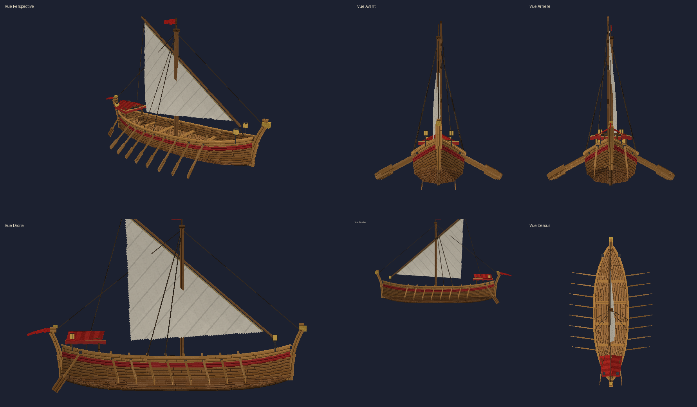
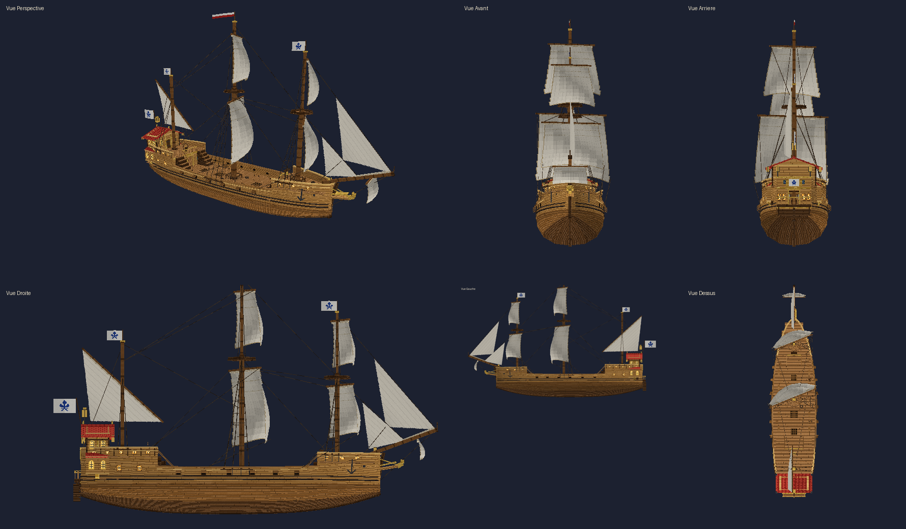
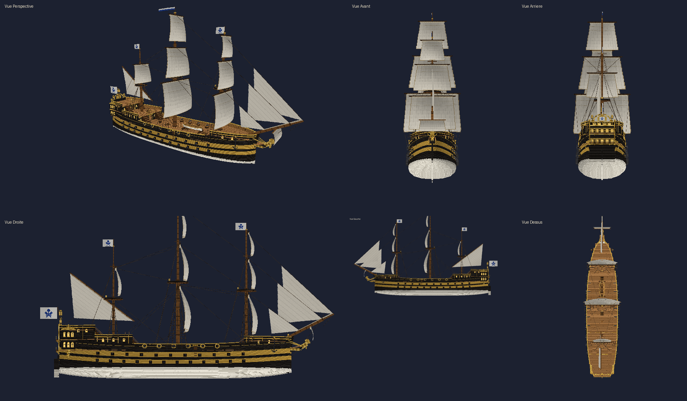

# Medieval Ships — navires médiévaux navigables (Fabric 1.21.11)





Trois navires qui sont de **véritables entités navigables**, pas des constructions en blocs :

| | Galère médiévale | Grand galion | Grand vaisseau de guerre |
|---|---|---|---|
| Objet / commande | *Galère médiévale*, `galley` | *Grand galion*, `galleon` | *Grand vaisseau de guerre*, `warship` |
| Taille | 20 blocs (22 hors tout), 5 de large, mât de 13 blocs | 35 blocs (43 avec beaupré et balcon), 9 de large, 28 de haut | 55 blocs (≈ 67 avec beaupré et galeries), 13 de large, coque de 12 blocs, 42 de haut |
| Propulsion | 16 rames + voile latine | 3 mâts, voiles carrées gonflées, latine, 2 focs | 3 mâts à 3 voiles carrées chacun, latine d'artimon, 3 focs, civadière |
| Places assises | 9 (barreur + 8 bancs) | 16 (barre, pont, gaillards avant et arrière, grande cabine) | 24 (barre, 12 affûts de canon du pont, gaillard d'avant, gaillard d'arrière, dunette, grande cabine) |
| Maniement | vif : accélère vite, pivote presque sur place | lourd : lente accélération, forte inertie, larges virages | très lourd : ≈ 17 s pour prendre son allure, > 40 blocs d'erre, très larges virages |
| Particularités | rames animées, tente de poupe | grande cabine et balcon accessibles, escaliers, dunette au toit rouge, sabords décoratifs, drapeaux à emblème | 3 ponts (pont principal, gaillard d'arrière, dunette) + gaillard d'avant, grande cabine accessible, 58 canons décoratifs (prêts pour le combat), haute poupe à trois étages de fenêtres et galeries, écume à la proue |

Pour les trois :

* objet dans l'inventaire créatif (onglet *Navires médiévaux* et *Outils*), clic droit sur
  l'eau pour le mettre à l'eau (vérification de la place disponible) ;
* flottaison, inertie, accélération progressive, virages fluides avec perte de vitesse,
  collisions avec le terrain, les quais et les autres navires, impossible de naviguer sur terre ;
* pilotage à la barre (Z/S/Q/D, Espace/Ctrl pour les trois allures, Maj pour quitter) ;
* **marche libre sur le pont pendant la navigation**, collisions multi-volumes (on ne traverse
  ni le pont, ni la coque, ni les châteaux, même en sautant, y compris avec Lithium) ;
* animations synchronisées : voiles au vent et carguées à l'arrêt, barre/gouvernail,
  drapeaux, roulis (+ rames pour la galère) ;
* **pilote automatique PNJ** adapté à chaque navire : itinéraires, escales, aller-retour,
  annonces, évitement d'obstacles, ferries qui continuent sans joueur et reprennent après un
  redémarrage ;
* commandes `/ship` pour les administrateurs ;
* aucune dépendance autre que Fabric API (ni GeckoLib, ni Valkyrien Skies, ni Eureka),
  aucune apparition naturelle.

La version 1.3.0 ajoute le grand vaisseau de guerre sans rien changer aux deux premiers navires.
La version 1.2.0 avait ajouté le grand galion **sans rien changer à la galère** : même modèle, mêmes
textures, mêmes animations, mêmes réglages, mêmes commandes ; les galères déjà posées dans le
monde et les ferries existants continuent de fonctionner (un test vérifie que la géométrie de
la galère est identique, au millième de bloc, à celle de la version 1.1.1).

## Installation

Serveur **et** clients : `medieval-ships-1.3.1.jar` + [Fabric API](https://modrinth.com/mod/fabric-api)
0.141.6+1.21.11 (ou plus récent pour 1.21.11), Fabric Loader ≥ 0.18, Java 21.

## Compilation

```
./gradlew build          # jar dans build/libs/
./gradlew test           # tests unitaires (physique, collisions, pilote auto, modèle)
./gradlew runClient      # client de développement
./gradlew runServer      # serveur dédié de développement
```

Les versions sont dans `gradle.properties` (Yarn `1.21.11+build.6`, Loom 1.14.10,
Fabric API 0.141.6+1.21.11). Si Gradle ne trouve pas une version, prenez la plus récente
pour 1.21.11 sur <https://fabricmc.net/develop>.

## Documentation

* [Guide des commandes administrateur](docs/COMMANDES.md)
* [Créer un ferry automatique](docs/FERRY.md)
* [Modèle Blockbench, textures et animations](docs/MODELE.md)
* [Architecture technique (marche sur le pont, collisions, IA, performances)](docs/ARCHITECTURE.md)
* [Tests effectués et non effectués](docs/TESTS.md)

## Configuration

`config/medievalships.json` (créé au premier lancement, rechargeable avec `/ship reload`) —
la configuration par défaut se trouve dans [`config/medievalships.json`](config/medievalships.json).
Elle a deux parties : `server` (réglages communs) et `ships` (un bloc par navire, `galley`,
`galleon` et `warship`). Un ancien fichier (version 1.0/1.1, réglages « à plat ») est converti
automatiquement : ses valeurs deviennent celles de la galère.

**`server`**

| Clé | Défaut | Rôle |
|---|---|---|
| `announceDepartures`, `announceRadius` | true, 40 | annonces de départ / d'arrivée |
| `chunkLoadAutopilotShips`, `chunkLoadRadius` | true, 2 | garder chargés les chunks des ferries |
| `adminPermissionLevel` | 2 | niveau requis pour `/ship` et la récupération des navires |
| `placeRequiresAdmin` | false | réserver la mise à l'eau aux administrateurs |

**`ships.galley` / `ships.galleon` / `ships.warship`**

| Clé | Galère | Galion | Vaisseau | Rôle |
|---|---|---|---|---|
| `slowSpeed` / `normalSpeed` / `fastSpeed` | 2.5 / 5.5 / 8.5 | 2 / 4.5 / 7.5 | 1.8 / 3.8 / 6.5 | allures (blocs/s) |
| `reverseSpeed` | 1.8 | 1.0 | 0.8 | marche arrière |
| `acceleration`, `braking` | 0.9, 1.8 | 0.35, 0.6 | 0.22, 0.4 | blocs/s² |
| `waterDrag` | 0.18 | 0.07 | 0.05 | perte de vitesse en roue libre (plus bas = plus d'inertie) |
| `maxTurnRate`, `minTurnFactor` | 16, 0.3 | 8, 0.1 | 5.5, 0.08 | rotation max (°/s), part disponible à l'arrêt |
| `helmRate`, `helmReturnRate`, `turnResponse`, `turnSpeedLoss` | 1.6, 1, 1.6, 0.22 | 0.9, 0.6, 0.6, 0.12 | 0.6, 0.4, 0.4, 0.08 | réactivité de la barre, inertie de rotation, ralentissement en virage |
| `waveRocking` | 1.0 | 1.0 | 1.0 | amplitude du roulis visuel (0 = désactivé ; les grands navires roulent naturellement moins) |
| `aiWaypointRadius`, `aiStopRadius`, `aiLookahead`, `aiProbeDistance` | 7, 2, 12, 36 | 12, 3, 22, 64 | 18, 4, 32, 90 | pilote automatique : rayons, anticipation, portée de détection |
| `aiDefaultWaitSeconds`, `aiStuckSeconds`, `aiTurnAroundSpeed` | 300, 6, 0.4 | 300, 10, 2 | 300, 15, 2.4 | attente par défaut, détection de blocage, vitesse en demi-tour |
| `furlSailWhenStopped` | true | true | true | carguer les voiles à l'arrêt |

## Structure du projet

```
blockbench/galley.bbmodel        galère éditable (texture intégrée, 6 animations)
blockbench/galleon.bbmodel       grand galion éditable (2 textures intégrées, 4 animations)
blockbench/warship.bbmodel       grand vaisseau de guerre éditable (2 textures intégrées, 4 animations)
config/medievalships.json        configuration par défaut
docs/                            documentation et aperçu
src/main/java/.../core           navigation en Java pur (testée)
src/main/java/...                entité, commandes, données, réseau, mixin
src/client/java/...              rendu, visée, transport du joueur sur le pont
src/test/java/...                tests JUnit
tools/                           générateurs des modèles et rendu d'aperçu (Python)
```
