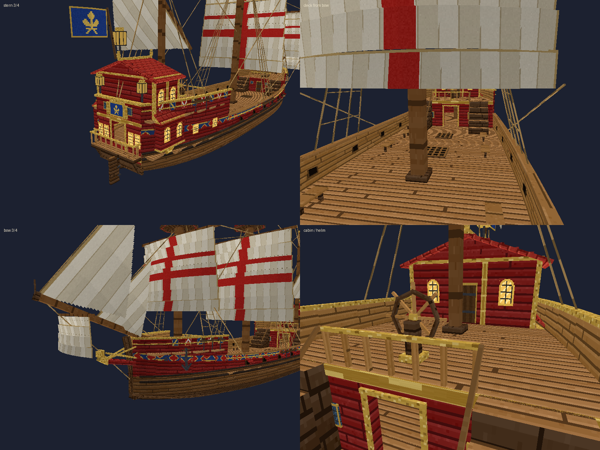
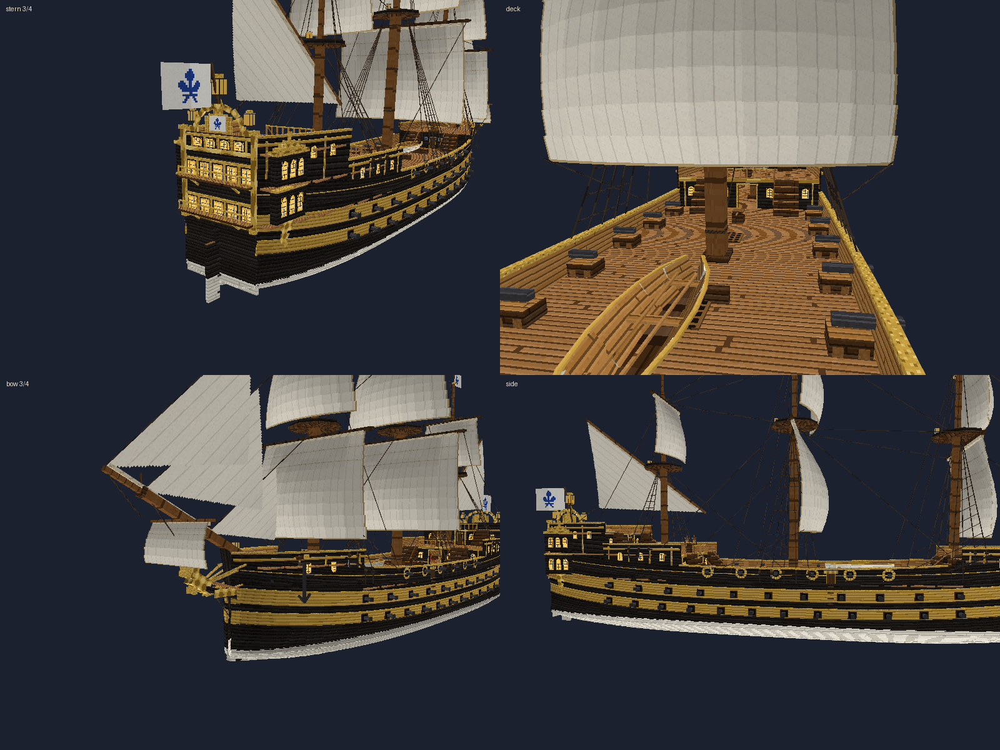

# Modèles 3D, textures et animations

Le mod contient trois navires, chacun avec son propre fichier Blockbench, ses textures et ses
animations : la **galère médiévale**, le **grand galion** et le **grand vaisseau de guerre**.
Le moteur de rendu est commun.

# Galère médiévale


## Fichiers

| Fichier | Rôle |
|---|---|
| `blockbench/galley.bbmodel` | Modèle éditable dans Blockbench (format *Generic Model / free*, texture intégrée, 6 animations). |
| `src/main/resources/assets/medievalships/models/entity/galley.bbmodel` | Copie chargée par le mod. |
| `src/main/resources/assets/medievalships/textures/entity/galley.png` | Texture 256 × 256. |
| `tools/generate_galley.py` | Générateur du modèle, de la texture et des animations. |
| `tools/ship_details.py`, `tools/interior_texture.py` | Objets du pont et mobilier des cabines, textures des vitres vues de l'intérieur et du mobilier (communs aux 3 navires). |
| `tools/preview.py` | Rendu logiciel des 6 vues (`docs/preview.png`), même logique que le mod. |

## Décomposition de l'image de référence

| Élément | Réalisation |
|---|---|
| Coque brune allongée, proue et poupe relevées | 15 tronçons × 2 bords × 5 bordages inclinés qui suivent un profil arrondi (largeur, quille et tonture calculées), + lisse, quille, étrave et étambot courbes |
| Bordures supérieures en bois clair | bordage supérieur clair + lisse (« rail ») plus claire |
| Bande rouge foncé | un bordage rouge sur toute la longueur, qui suit la tonture |
| Pont ouvert | pont principal + plates-formes surélevées à la poupe et à la proue |
| Mât central, voile triangulaire beige, cordages, drapeau rouge | mât de 13 blocs, antenne latine inclinée, voile triangulaire **gonflée** (42 panneaux qui suivent le ventre de la toile, toile crème propre), 10 cordages sombres, flamme rouge animée |
| 8 rames par côté | 16 os indépendants, pale élargie |
| Cabine de poupe, toit en tissu rouge, poste de pilotage, barrières | 4 poteaux, toit rouge en bâtière avec lambrequins festonnés, barrière à balustres avec passage, tabouret du barreur, deux avirons de gouverne |
| Proue décorée, petit espace surélevé | figure de proue, plate-forme avant |
| Lanternes (vues avant/arrière), longue flamme rouge de poupe | 4 lanternes lumineuses, flamme en 3 segments animés |
| Sous le dais | tapis d'Orient, deux coussins rouges, coffre du capitaine avec sa carte marine, jarre d'eau |
| Détails | **éperon de bronze** à la ligne de flottaison, deux **ancres** à jas pendues à la proue avec leur câble, **râtelier à cabillots** au pied du mât (cordages tournés dessus), tonneau, **amphores**, glènes de cordage, seau |

Dimensions : coque de 20 blocs (21,8 avec étrave et étambot), 5,1 de large, 2,8 à 3,8 de haut
de la quille au bastingage, 14,6 blocs du niveau de l'eau au sommet du drapeau.

Optimisation : 516 cubes, aucun bloc de « remplissage » ; les planches sont dans la texture
(densité 16 pixels par bloc comme Minecraft), pas modélisées une à une.

## Modifier le modèle dans Blockbench

1. Ouvrir `blockbench/galley.bbmodel` (Blockbench 4.10 ou plus récent).
2. Modifier formes, UV, texture ou animations.
3. *Fichier → Enregistrer* puis copier le fichier dans un pack de ressources :
   `assets/medievalships/models/entity/galley.bbmodel` (et la texture dans
   `assets/medievalships/textures/entity/galley.png`).
4. En jeu, **F3 + T** recharge le modèle.

Règles à respecter :

* Les **noms des groupes** utilisés par les animations doivent être conservés :
  `oar_l1`…`oar_l8`, `oar_r1`…`oar_r8`, `sail`, `yard`, `rudder_p`, `rudder_s`, `flag`,
  `flag_tip`, `streamer_1`…`streamer_3`.
* Les **noms des animations** sont lus par le mod : `row`, `sail_wind`, `sail_furl`, `steer`,
  `flag_wave`, `streamer_wave`.
* Les cubes dont le nom commence par `glow` sont rendus pleinement éclairés (lanternes).
* Seuls les cubes sont pris en charge (pas les « mesh »), les valeurs d'animation doivent être
  des nombres (pas d'expressions Molang).
* La proue regarde le **nord** de Blockbench (−Z) ; le niveau de l'eau est à Y = 0.

**Important** : les collisions du pont ne viennent pas du modèle mais de la forme de coque
définie dans `core/HullProfile.java` (identique à `tools/hull_profile.py`). Si vous changez
beaucoup la largeur ou la hauteur du pont, adaptez aussi ces deux fichiers.

## Animations

| Animation | Utilisation en jeu |
|---|---|
| `row` (2 s, boucle) | cycle d'aviron : attaque, propulsion, dégagement, retour. Sa vitesse suit la vitesse du navire ; quand le navire s'arrête, les rames ralentissent puis reviennent progressivement au repos. |
| `sail_wind` (3 s, boucle) | légère ondulation de la voile sous le vent. |
| `sail_furl` (1 s) | voile carguée le long de la vergue : jouée quand le navire est à l'arrêt depuis 5 s (option `furlSailWhenStopped`), déroulée au départ. |
| `steer` (2 s) | t = 0 : barre à bâbord, t = 1 : barre au centre, t = 2 : barre à tribord ; suit la barre, qui revient progressivement au centre. |
| `flag_wave`, `streamer_wave` | drapeau et flamme de poupe au vent. |

Le roulis, le tangage et la gîte dans les virages sont ajoutés par le moteur de rendu.

Toutes les animations sont pilotées par l'état synchronisé (vitesse, barre, voile) : tous les
joueurs du serveur voient les mêmes mouvements.

## Régénérer le modèle

```
python3 tools/generate_galley.py   # modèle + texture
python3 tools/preview.py           # aperçu docs/preview.png
```
(Python 3 avec `numpy` et `Pillow`). Attention : la régénération écrase les modifications
faites à la main dans Blockbench.

# Grand galion




## Fichiers

| Fichier | Rôle |
|---|---|
| `blockbench/galleon.bbmodel` | Modèle éditable dans Blockbench (2 textures intégrées, 4 animations). |
| `src/main/resources/assets/medievalships/models/entity/galleon.bbmodel` | Copie chargée par le mod. |
| `textures/entity/galleon.png` | Texture 512 × 512 (coque, châteaux, toit, voiles…). |
| `textures/entity/galleon_flag.png` | **Texture des drapeaux** (64 × 64) : emblème remplaçable. |
| `textures/item/galleon.png` | Icône de l'objet *Grand galion*. |
| `tools/galleon_shape.py` | Forme de coque et plan du navire, identiques au code Java des collisions. |
| `tools/generate_galleon.py`, `tools/galleon_texture.py` | Générateurs du modèle, des textures et des animations. |

## Ce qui est modélisé

| Élément | Réalisation |
|---|---|
| Coque arrondie et lisse (pas en escalier) | 28 tronçons × 2 bords × 7 bordages **inclinés** qui suivent des sections arrondies (quille, bouchain, flanc, léger rentré en haut) ; œuvres vives sombres, **bois naturel doré** comme sur la photo de référence (pas de peinture), deux préceintes noires, moulure en bois clair sous le plat-bord |
| Dimensions | coque 35 blocs (≈ 43 avec le beaupré et le balcon), 9 de large, ≈ 6,4 de la quille au haut des châteaux, ≈ 28 de la quille au sommet du grand mât |
| Ponts | pont principal, **gaillard d'avant** (+2 blocs), **gaillard d'arrière** (+2,6) au-dessus de la grande cabine, escaliers des deux bords, barrières à balustres |
| Château arrière | murs en bois naturel doré avec poteaux sombres et **fenêtres à croisillons éclairées** le long des gaillards, **bouteilles** (galeries de quart fermées) aux deux angles avec fenêtres cintrées éclairées, tableau arrière plat avec fenêtres de galerie et **grandes armes** (l'emblème du pavillon dans un cadre doré couronné), **balcon accessible**, corniche dorée, 3 grandes lanternes |
| Cabine | **grande cabine accessible** sous le gaillard d'arrière (porte dans la cloison, chaises = places assises, lanternes, coffre, poutres) ; **dunette** à colombages en bois naturel, **grand toit de tuiles rouges** débordant avec **4 lanternes** à ses angles (décorative, fermée), fenêtres cintrées éclairées, épis de faîtage |
| Gouvernail et barre | roue de barre sur piédestal (os `helm_wheel`) et gouvernail sur le tableau (os `rudder`) |
| Mâture | 3 mâts (misaine, grand mât en deux parties avec hunes, artimon) + beaupré avec **civadière**, vergues avec voile carguée en rouleau, porte-haubans et caps-de-mouton sur la coque |
| Voiles | voiles carrées **gonflées et courbées** (toile crème unie comme sur la photo, **gonflée dans les deux sens** : 54 panneaux par voile carrée qui se raccordent, la tête reste sur la vergue ; carguées, les voiles disparaissent dans leur rouleau), voile latine d'artimon, **2 focs** triangulaires |
| Cordages | haubans avec enfléchures, étais, bras, écoutes, sous-barbe (≈ 60 cordages) |
| Drapeaux | pavillons **blancs à fleur de lys bleue** en tête de mât, flamme blanche et rouge au grand mât, grand pavillon de poupe — tous sur la texture `galleon_flag.png` |
| Gréement | cordages goudronnés sombres |
| Sabords | 12 sabords décoratifs (6 par bord) avec mantelets ouverts : os `gunport_l1`…`gunport_l6`, `gunport_r1`…`gunport_r6` ; os vides `cannon_l1`…`cannon_r6` à l'emplacement des futurs canons |
| Proue | éperon rouge et doré, figure de proue dorée, ancres, écubiers, lanterne de proue |
| Intérieur de la grande cabine | **fenêtres visibles de l'intérieur** (vitres claires à croisillons sur les flancs, le tableau arrière et la cloison), tapis d'Orient, table à cartes (carte marine, compas à pointes sèches, chandelier) et table à dîner (assiettes, gobelets, bouteille) devant les deux chaises, couchette, bibliothèque, râtelier d'armes, globe sur le coffre, deux tableaux, deux lanternes suspendues aux baux |
| Détails du pont | **râteliers à cabillots** au pied du grand mât et du mât de misaine (cabillots et retombées de cordage), **cloche** du bord sur le gaillard d'avant, tonneaux cerclés de fer, caisses sanglées, glènes de cordage, seau |

Optimisation : 1683 cubes (≈ 9000 faces), aucune géométrie cachée inutile ; 56 os.

## Changer l'emblème des drapeaux

Remplacez `assets/medievalships/textures/entity/galleon_flag.png` dans un pack de ressources
(même taille, 64 × 64) :

* zone `0,0 → 64,40` : le pavillon (fleur de lys bleue sur fond blanc par défaut) ;
* zone `0,40 → 64,48` : la flamme du grand mât.

L'emblème apparaît aussi sur les grandes armes du tableau arrière. Aucune modification du modèle n'est nécessaire, **F3 + T** recharge la texture.

## Animations du galion

| Animation | Utilisation en jeu |
|---|---|
| `sail_wind` (3,6 s, boucle) | le ventre des voiles « respire » et les voiles ondulent ; d'autant plus que la voilure est établie. |
| `sail_furl` (1 s) | voiles carguées sur leurs vergues (focs et latine ramassés) à l'arrêt, déployées au départ. |
| `steer` (2 s) | roue de barre (± 150°) et gouvernail (± 30°), comme pour la galère (0 = bâbord, 1 = centre, 2 = tribord). |
| `flag_wave` (1,2 s, boucle) | les 4 drapeaux flottent (deux segments chacun). |

Le roulis visuel est plus lent et plus faible que celui de la galère (navire lourd), et la gîte
dans les virages est calculée par le moteur de rendu.

## Collisions du galion

Comme pour la galère, les collisions ne viennent pas du modèle : elles sont définies dans
`core/Ships.java` (`Ships.GALLEON`, classe `GalleonLayout`) et reprises par
`tools/galleon_shape.py`. Volumes : coque pleine sous les ponts, murailles, gaillard d'avant,
plancher du gaillard d'arrière, cloison de cabine avec sa porte, tableau arrière avec la porte
du balcon, balcon et sa balustrade, dunette et son toit, escaliers, barrières, 3 mâts.
Un test (`GalleonTest`) vérifie que les deux fichiers donnent les mêmes valeurs.

## Régénérer le galion

```
python3 tools/generate_galleon.py
python3 tools/preview.py blockbench/galleon.bbmodel - docs/preview_galleon.png --scale=1.75
```

# Grand vaisseau de guerre




## Fichiers

| Fichier | Rôle |
|---|---|
| `blockbench/warship.bbmodel` | Modèle éditable (2 textures intégrées, 4 animations). |
| `models/entity/warship.bbmodel` | Copie chargée par le mod. |
| `textures/entity/warship.png` | Texture 512 × 512. |
| `textures/entity/warship_flag.png` | **Drapeaux** (64 × 64, fleur de lys bleue sur fond blanc) : emblème remplaçable, aussi affiché sur les armes de la poupe. |
| `textures/item/warship.png` | Icône de l'objet. |
| `tools/warship_shape.py` | Forme et plan, identiques au code Java des collisions (test `WarshipTest`). |
| `tools/generate_warship.py`, `tools/warship_texture.py` | Générateurs (réutilisent les outils du galion). |

## Ce qui est modélisé (d'après l'image de référence)

| Élément | Réalisation |
|---|---|
| Coque | 29 tronçons × 2 bords × 10 bordages **inclinés** sur des sections arrondies : œuvres vives **blanches**, bandes **noires** et **ocre** alternées qui **suivent la tonture** (elles remontent vers la proue et la poupe, comme les rangées de sabords), fines moulures dorées entre les bandes, œuvres mortes noires, trois préceintes, plat-bord doré, peinture à reflets (lumière sur l'arête de chaque bordage, fil du bois), dorures polies, rentré de la muraille, porte d'entrée dorée avec ses marches sur chaque bord |
| Dimensions | coque 55 blocs, ≈ 67 avec beaupré, bout-dehors et galeries ; 13 de large ; 12 blocs de la quille au couronnement ; 42 jusqu'au sommet du grand mât |
| Ponts | pont principal (canons sur affûts), gaillard d'avant, **gaillard d'arrière** au-dessus de la grande cabine, **dunette** au-dessus de la chambre du conseil ; 3 escaliers doubles, barrières à balustres |
| Canons | **58** : 12 + 11 par bord dans deux rangées de sabords de la coque (**cadres dorés**, doublure rouge), 6 par bord sur affûts au pont principal, encadrés de **guirlandes dorées** (les 12 affûts sont des sièges) ; un os par canon `cannon_l1`…`cannon_l29`, `cannon_r1`…`cannon_r29` |
| Poupe | les **bandes de la coque font le tour de la voûte** (noir, ocre, préceintes, moulure dorée), **deux canons de retraite** dans leurs sabords à guirlandes, tableau de nom sculpté ; tableau très haut, chaque fenêtre dans un **cadre doré avec appui et clé sculptée**, trois étages de fenêtres éclairées (cintrées en haut) avec pilastres, corniches et frises sculptées dorées, **colonnes dorées** aux angles, **couronnement sculpté** en arc autour des grandes armes, **deux galeries** à balustres avec bandeau sculpté, retours latéraux, poteaux d'angle et consoles dorées, **deux statues dorées** (renommées à trompette) de part et d'autre des armes devant un fond sculpté, bouteilles d'angle sur deux étages (pilastres dorés entre les fenêtres, qui suivent le rétrécissement de la coque sans dépasser dans les cabines) coiffées de **dômes dorés** à épi, culs-de-lampe sculptés, 3 grandes lanternes à potences dorées, pavillon de poupe |
| Grande cabine | accessible par la porte de la cloison ; **fenêtres des deux côtés et au fond, visibles aussi de l'intérieur** (5 fenêtres par bord encadrées d'or, 5 au tableau arrière, 6 dans la cloison) ; **table du conseil** de 4,4 blocs sur un grand tapis avec 8 chaises rouges, 2 candélabres allumés, carte marine et couverts ; **lit du capitaine** à ciel rouge, bureau avec chaise, globe et chandelier, bibliothèque, râtelier d'armes, coffres, 4 tableaux, lanternes suspendues ; les 2 chaises des flancs restent les places assises |
| Mâture | 3 mâts en trois parties (bas-mât, mât de hune, perroquet) avec hunes éclairées d'une lanterne et barres de flèche, vergues sombres ; **3 voiles carrées par mât** à l'avant et au centre, hunier et latine à l'artimon ; beaupré, bout-dehors, civadière, **3 focs** |
| Voiles | toile crème naturelle (laizes de teintes légèrement différentes, bas un peu patiné, taches d'usure discrètes, **renforts cousus aux coins**, coutures fines, bandes de ris et garcettes, ralingues), **gonflées dans les deux sens** (72 bandes par voile carrée qui se raccordent, la tête reste sur la vergue) |
| Gréement | **cordages goudronnés sombres** : haubans avec enfléchures et caps-de-mouton sur porte-haubans, galhaubans, étais, bras, écoutes, sous-barbe |
| Proue | éperon avec volutes dorées, grand **lion de proue** doré couronné, lisses de poulaine courbes dorées, bossoirs à masques dorés avec ancres, écubiers, lanterne |
| Châteaux | murailles noires à **pilastres dorés**, fenêtres cintrées éclairées, bande ocre et lisse dorée |
| Pont | **chaloupe** sur ses chantiers au milieu du pont (avec bancs et avirons, solide), cabestan, caillebotis, affûts |
| Détails du pont | **râteliers à cabillots** aux trois mâts, **clocher** du bord sur le gaillard d'avant, **hamacs roulés** rangés sur le plat-bord du pont principal, tonneaux, caisses sanglées, glènes de cordage, seaux |

Optimisation : 3201 cubes (≈ 16 900 faces), ce qui reste raisonnable pour un navire de cette
taille (le rendu est calculé par le client, sans aucun coût serveur) ; le gréement est simplifié
(cordages droits), les voiles sont des bandes qui se raccordent exactement.

## Animations du vaisseau

Les mêmes que le galion : `sail_wind`, `sail_furl` (voiles ramassées dans leur rouleau à l'arrêt),
`steer` (double roue de barre et gouvernail), `flag_wave`. En plus, le rendu ajoute un roulis et
un tangage plus lents et plus faibles (navire très lourd) et de l'**écume à la proue** et un léger
sillage, proportionnels à la vitesse (quelques particules vanilla par tick, seulement près des joueurs).

## Régénérer le vaisseau

```
python3 tools/generate_warship.py
python3 tools/preview.py blockbench/warship.bbmodel - docs/preview_warship.png --scale=2.7
```

# Galère médiévale rouge (`medieval_galley`)

D'après l'image de référence (« 3. Galère médiévale »).

## Fichiers

| Fichier | Rôle |
|---|---|
| `blockbench/medieval_galley.bbmodel` | Modèle éditable (texture intégrée). |
| `src/main/resources/assets/medievalships/models/entity/medieval_galley.bbmodel` | Modèle chargé par le mod. |
| `.../textures/entity/medieval_galley.png` | Texture 256 × 256. |
| `tools/medieval_galley_shape.py` | Forme et plan, identiques au code Java (`Ships.medievalGalley()`, test `NewShipsTest`). |
| `tools/generate_medieval_galley.py`, `tools/medieval_galley_texture.py` | Générateurs. |

## Ce qui est modélisé

| Élément de l'image | Réalisation |
|---|---|
| Coque très longue et étroite, extrémités très relevées | 20 tronçons × 2 bords × 8 bordages inclinés ; la tonture en croissant monte de 2,2 blocs aux deux bouts et les bordages la suivent |
| Coque rouge et brun foncé, bordures bleues, décorations dorées | œuvres vives brun foncé, bordé rouge, préceinte sombre, liston bleu sous le plat-bord rouge, filets dorés entre les bordages |
| Sculptures rouges aux extrémités | comme sur un drakkar, **la tête du dragon à la proue et sa queue à la poupe**. Queue (os `dragon_tail`) : l'étambot monte en une queue écailleuse qui s'amincit, se recourbe au-dessus du navire et retombe, cerclée de trois anneaux dorés, avec une crête dorsale et une pointe dorée en fer de lance. Tête : cou épais qui monte de l'étrave, crête dorsale, mâchoire ouverte, dents, langue, yeux d'or à pupille fendue, cornes dorées, nageoires, **crête dorée** de quatre pointes sur le crâne, **moustaches dorées** qui retombent du museau, plaques dorées sous les yeux |
| Boucliers ronds alignés | 14 boucliers par bord (rouges, croix blanche, cerclage doré, umbo), jointifs le long du plat-bord |
| Nombreuses rames | 12 rames par bord, chacune un os animé, sortant sous les boucliers |
| Grande voile rectangulaire rayée, mât central | voile carrée gonflée à 9 laizes verticales rouges et blanches (rouge aux bords), têtière renforcée, **deux bandes de ris** avec leurs garcettes, sur une vergue orientée, mât de 13 blocs |
| Drapeau, cordages | drapeau rouge à croix blanche à deux segments animés ; étai, pataras, haubans, bras et écoutes |
| Pont ouvert | pont, coursive centrale, 11 bancs de nage, tabouret et aviron de gouverne du barreur, tonneaux, coffre, glènes, 4 lanternes sur poteaux |

Animations : `row` (24 rames), `sail_wind`, `sail_furl`, `steer` (aviron de gouverne), `flag_wave`.

# Bateau à roue à vapeur (`steam_paddleboat`)

D'après l'image de référence (« 2. Bateau à roue à vapeur »). Fichiers : `steam_paddleboat.*`,
`tools/paddleboat_shape.py`, `tools/generate_paddleboat.py`, `tools/paddleboat_texture.py`.

| Élément de l'image | Réalisation |
|---|---|
| Coque blindée, basse et massive, plaques gris foncé rivetées | bordé en plaques rivetées (texture), bandes rivetées, plaques plus sombres et rouillées près de l'eau, hublots éclairés à cerclage de laiton, double blindage aux épaules |
| Proue renforcée | étrave en laiton et éperon en fer à la flottaison |
| Rouf, fenêtres, ouvertures et trappes | rouf en panneaux de bois cerclés de laiton, fenêtres éclairées, portes en fer, manomètres, tuyau de cuivre ; passerelle sur le toit entourée d'une **rambarde à lanternes d'angle**, claires-voies vitrées, sifflet ; panneaux de cale à caillebotis |
| Deux cheminées | deux cheminées verticales en briques grises cerclées de fer, l'une derrière l'autre, sommet noirci et évasé coiffé d'une **couronne** et d'un anneau de laiton, tuyaux de vapeur, haubans |
| Grandes roues à aubes latérales | **une roue de chaque côté** (bâbord et tribord, symétriques) : rond parfait (2 jantes de 20 segments, 2 couronnes intérieures, 20 rayons), 10 aubes radiales, moyeu en laiton ; elle tourne autour de son axe ; axe fixe de la coque au palier extérieur, palier et entretoises ; tambour en arc (tôles + arc doré) qui la couvre ; elle ne touche pas la coque (0,2 bloc d'écart) et plonge d'environ 0,9 bloc dans l'eau |
| Canons sur le pont | deux canons en laiton sur affût de bois à roues, posés sur des **barbettes** surélevées (plate-forme circulaire blindée, rambarde de laiton, marches), à la proue (vers l'avant) et à la poupe (vers l'arrière) |
| Rambardes métalliques, lanternes | rambarde en fer à main courante de laiton tout autour, 10 lanternes sur poteaux |
| Éléments mécaniques | manches à air en laiton, télégraphe des machines, cabestan, ancres, mât de signaux et son pavillon (rouage doré sur fond rouge) |

Animations : `paddle` (les deux roues, un tour par boucle, jouée avec la **vitesse signée** : la roue
tourne plus vite quand le bateau accélère et en arrière en marche arrière ; le générateur vérifie
le sens de rotation), `steer` (roue de barre et gouvernail), `flag_wave`. Effets côté client,
seulement près du joueur : fumée des cheminées (plus épaisse en marche), écume et gerbes à la
roue, battement de la machine et crépitement du foyer (sons vanilla).

# Voilier elfique (`elven_sailboat`)

D'après l'image de référence (« 4. Voilier elfique »). Fichiers : `elven_sailboat.*`,
`tools/elven_shape.py`, `tools/generate_elven.py`, `tools/elven_texture.py`.

| Élément de l'image | Réalisation |
|---|---|
| Coque longue et fine, bleu turquoise et or | coque élancée (30 blocs hors tout, 6 de large), œuvres vives bleu nuit **semées de minuscules étoiles argentées**, flancs turquoise, bandeau de filigrane doré, **volutes dorées** (5 par bord), filets et plat-bord dorés, léger rentré |
| Ornements elfiques | gemmes turquoise lumineuses serties d'or le long des flancs ; nageoires dorées sur l'étrave ; **ailes dorées** déployées le long des flancs à la proue et à la poupe |
| Proue très élancée | longue proue en volute dorée qui s'avance de 3 blocs, grosse gemme de chaque côté, lanterne suspendue à son extrémité |
| Poupe légèrement relevée | étambot recourbé en crosse dorée, lanterne suspendue |
| Grand mât central, voiles triangulaires | grand mât à bagues dorées et pomme ; grand-voile sur bôme, foc vers la proue, petit hunier triangulaire ; toile crème à bordure bleue et filet d'or, **coutures qui rayonnent depuis le point de drisse**, renforts cousus aux trois coins ; or poli à reflets doux, sculptures dorées à feuilles ombrées |
| Symboles solaires et lunaires | **dans la texture** : grande **rose des vents** dorée à huit branches (quatre longues, quatre diagonales, or à deux tons) à cœur bleu et petites étoiles sur la grand-voile, croissant de lune doré et étoiles sur le foc, étoile sur le hunier |
| Lanternes suspendues, cordages | 4 lanternes à potences dorées + celles de la proue et de la poupe, chacune sur son os ; étai, pataras, haubans, écoutes |
| Pont ouvert | pont clair **incrusté de filets d'or**, bancs dorés à coussins bleus, coffre, barre à roue sur piédestal doré |

Animations : `sail_wind`, `sail_furl`, `steer`, `flag_wave` (flamme), `lantern_sway` (les
lanternes se balancent doucement, chacune avec sa phase).

# Vérifications communes

* `python3 tools/sail_check.py warship|galleon|elven|medieval_galley` : vérifie qu'**aucune voile
  n'en traverse une autre** (chaque laize est une boîte orientée ; les parties transparentes des
  voiles triangulaires sont ignorées). Les cinq croisements trouvés en 1.5.0 (misaine/focs et
  foc/civadière sur le vaisseau et le galion, grand-voile/hunier du voilier) sont corrigés.
* Galion et vaisseau de guerre (1.5.0) : ils flottent plus haut (eau à −1,5 et −1,1 bloc sous
  l'origine du modèle) sur une coque plus profonde dont les fonds arrondis se voient au-dessus de
  l'eau ; leurs vergues sont orientées de 22° et leurs voiles plus gonflées, la bordure inférieure
  incurvée. Le vaisseau a désormais les pavillons rouges à croix blanche et les balustrades
  rouges de la nouvelle image (`warship_flag.png` reste remplaçable par un pack de ressources).
