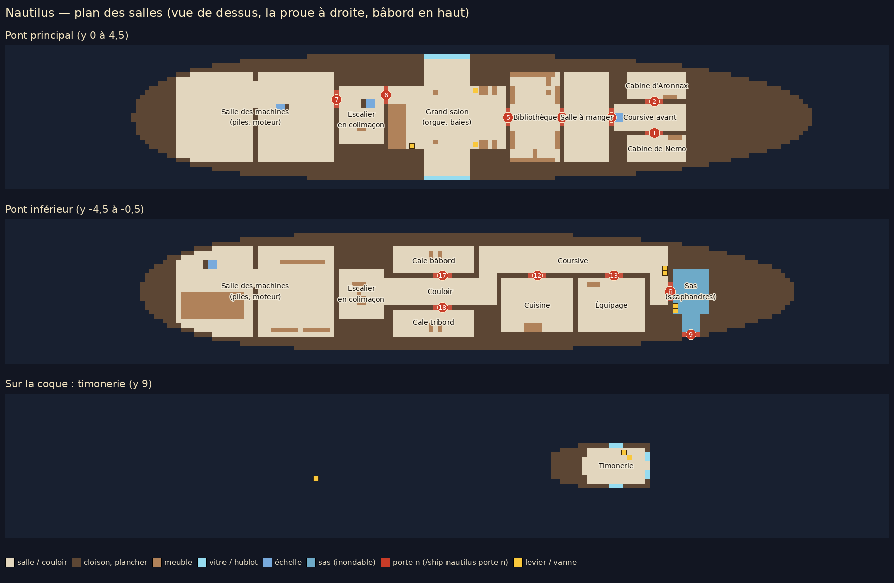

# Nautilus — Sous-marin du capitaine Nemo

Le Nautilus est le huitième navire du mod Medieval Ships (identifiant `nautilus`). C'est un sous-marin steampunk de **96 × 14 × 17 blocs** (de l'éperon à la queue × largeur × hauteur de la quille au sommet de la cage du projecteur), reproduit d'après la planche de référence fournie (vues extérieures et 15 panneaux d'intérieur).

On le pilote comme les autres navires, mais il plonge, tient sa profondeur et remonte. Ses salles sont **réellement parcourables** pendant qu'il navigue ou plonge, et elles restent sèches sous l'eau.



Comparaison avec la planche de référence (captures du test automatique dans le vrai jeu) :
[extérieur](comparaison_nautilus_exterieur.png), [les 15 panneaux de l'intérieur](comparaison_nautilus_interieur.png).

## Obtenir et placer le Nautilus

* `/ship give nautilus [joueurs]` donne l'objet « Nautilus — Sous-marin du capitaine Nemo ». `/ship spawn nautilus` le fait apparaître à la position de la commande.
* Clic droit avec l'objet sur une étendue d'eau. Il faut assez d'eau libre pour la coque : environ 96 × 15 blocs et une dizaine de blocs de profondeur. Sinon, le message « Pas assez d'eau libre ici… » s'affiche et l'objet n'est pas consommé.
* Le Nautilus apparaît en surface, panneau fermé, sas vide, lumières allumées et projecteur éteint.
* Il n'y a **aucune apparition naturelle**.

## À bord

* **Monter à bord** : clic droit sur la coque depuis l'extérieur. Le joueur est déposé sur la plate-forme (le dessus de la coque), en face de l'endroit cliqué.
* **Panneau d'accès** (porte 0) : sur la plate-forme. Une échelle descend au pont principal.
* **Portes** : clic droit pour ouvrir ou fermer. Les 18 portes sont étanches et animées, et elles bloquent réellement le passage une fois fermées. Les portes des salles font 2 blocs de large, à deux battants en acajou (hublot, panneaux moulurés, ferrures de bronze) dans un cadre de laiton ; les panneaux et les trappes font 1 bloc.
* **Échelles** : on les monte et descend comme des échelles vanilla (touche avancer, saut).
* **Escalier en colimaçon** : il relie le pont inférieur au pont principal.
* **Sièges** : clic droit sur une chaise, un fauteuil ou un canapé pour s'asseoir (30 places), puis Maj pour se lever.
* **Barre** : dans la timonerie, sur la plate-forme. Clic droit sur la roue pour prendre la barre.

On marche librement dans toutes les salles pendant que le sous-marin avance, tourne ou plonge : les joueurs et les entités sont emportés avec la coque. L'intérieur est sec en plongée : pas de noyade, pas de nage. Par les baies et les hublots, la mer se voit comme quand on nage : un brouillard bleu qui se referme avec la distance. Il laisse nets les 6 premiers blocs, donc la salle elle-même reste claire. L'eau du monde n'est pas modifiée ; ce sont les compartiments du navire qui sont étanches.

### Les salles (d'après la planche)

| Pont | Salles |
|---|---|
| Principal (y 0 à 4,5) | Coursive avant, cabine de Nemo (austère : lit de fer, cartes, instruments), cabine du professeur Aronnax (lit, bureau, livres), salle à manger (longue table, vaisselle, buffets, lustres), bibliothèque (rayonnages sur trois côtés, globe, bureau), grand salon (orgue monumental, vasque en tridacne géante avec sa fontaine, vitrines de coraux et de perles, canapé et fauteuils rouges, fauteuils et longues-vues tournés vers les deux grandes baies, palmiers, pilastres cannelés, corniche dorée, tableaux), escalier en colimaçon, salle des machines (piles électriques, moteur à pistons) |
| Inférieur (y -4,5 à -0,5) | Coursive, cuisine, quartier de l'équipage, cales bâbord et tribord, couloir, sas des scaphandres, bas de la salle des machines |
| Double fond (y -7 à -5) | Boyau technique entre les ballasts, accessible par une trappe secrète (porte 15) |
| Sur la coque (y 9) | Timonerie (barre, compas, transmetteur d'ordres, cadrans, porte-voix, 4 hublots), cage du projecteur, logement du canot |

## Piloter

| Touche | Action |
|---|---|
| Z / S | En avant / en arrière |
| Q / D | Barre |
| Espace | Remonter (vider les ballasts) |
| Ctrl | Plonger (remplir les ballasts) |
| Maj | Quitter la barre |

* Sans touche, le Nautilus **tient sa profondeur**. Près de la surface, il y reste à flot.
* Il ne monte jamais plus haut que la surface et ne plonge jamais dans le fond : les mouvements verticaux sont refusés comme les collisions horizontales.
* La profondeur maximale est de 120 blocs sous la surface (réglable).
* **Panneaux ouverts** : à l'ordre de plongée, l'équipage referme lui-même le panneau d'accès (0) et la trappe du canot (16). Si quelqu'un se tient dans l'ouverture, le Nautilus refuse de plonger et le dit au pilote. Si le fond est trop proche pour descendre, un message le signale.
* Les panneaux de la coque (0 et 16) ne s'ouvrent qu'en surface.
* La barre d'action indique la profondeur, l'état (plonge, remonte, immersion stable, en surface) et la vitesse.

## Les équipements (leviers et vannes)

Clic droit sur le levier ou la vanne. Une aide s'affiche quand on les vise.

| Équipement | Où | Effet |
|---|---|---|
| **Panneaux des baies du salon** | Leviers près de chaque baie | Deux vantaux de fer glissent sur des rails en laiton et ferment (ou rouvrent) les deux grandes baies. |
| **Projecteur** | Levier de la timonerie | Allume la lentille et un faisceau lumineux translucide vers l'avant. |
| **Lumières du bord** | Levier de la timonerie et levier du salon | Éteint ou rallume les lampes, lustres et appliques. Lumières éteintes en plongée, les salles sont dans le noir. |
| **Sas** | Vanne rouge (remplir) et vanne de laiton (vider), dans le sas et dans la coursive devant sa porte | Le sas se remplit ou se vide en 6 secondes. L'eau monte réellement : on est sous l'eau dans la partie noyée et au sec au-dessus. |
| **Canot** | Levier sur la plate-forme, devant son logement | En surface, le canot est mis à l'eau le long de la coque (un bateau vanilla nommé « Canot du Nautilus »). Le même levier le rembarque s'il est à moins de 12 blocs : son équipage remonte sur la plate-forme. |

### Sécurités du sas

* La porte intérieure (8) ne s'ouvre que si le sas est vide.
* La porte extérieure (9) ne s'ouvre sur la mer que si le sas est plein. Hors de l'eau, elle s'ouvre librement.
* On ne remplit pas le sas porte intérieure ouverte, et on ne le vide pas porte extérieure ouverte.

Pour sortir en plongée :

1. Entrer dans le sas et fermer la porte 8.
2. Remplir le sas (vanne rouge), puis ouvrir la porte 9 et sortir à la nage.
3. Au retour, fermer la porte 9, vider le sas (vanne de laiton), puis ouvrir la porte 8.

## Commandes (administrateurs)

Toutes ces commandes visent le Nautilus où l'on se trouve, celui qu'on regarde, ou le plus proche (32 blocs).

| Commande | Effet |
|---|---|
| `/ship nautilus profondeur <blocs>` (ou `depth`) | Le sous-marin va à cette profondeur et la tient. |
| `/ship nautilus profondeur surface` / `libre` | Remonte en surface / rend les ballasts au pilote. |
| `/ship nautilus ballasts remplir` / `vider` (ou `ballast fill` / `empty`) | Descend jusqu'au fond (au plus 120 blocs) / remonte en surface. |
| `/ship nautilus lumieres on` / `off` (ou `lights`) | Lumières du bord. |
| `/ship nautilus projecteur on` / `off` (ou `floodlight`) | Projecteur. |
| `/ship nautilus volets on` / `off` (ou `shutters`) | Panneaux des baies ouverts / fermés. |
| `/ship nautilus sas remplir` / `vider` | Vannes du sas (mêmes sécurités qu'à la main). |
| `/ship nautilus canot lancer` / `rembarquer` / `remplacer` | Le canot. `remplacer` remet un canot neuf dans son logement si l'ancien est perdu ou détruit. |
| `/ship nautilus porte <n> ouvrir` / `fermer` | Une porte (numéros sur le plan ; mêmes règles qu'à la main). |
| `/ship nautilus etat` | Profondeur, ordre de profondeur, eau du sas, portes ouvertes, lumières, projecteur, panneaux, canot. |

Les touches du pilote reprennent la main sur un ordre de profondeur.

## Itinéraires sous-marins (pilote automatique)

Ce sont les itinéraires habituels (voir [FERRY.md](FERRY.md)), créés sans l'option `air` :

```
/ship route create nautile once
/ship route addstop nautile 10 Port          (à la position du joueur)
/ship route addpoint nautile
/ship route addstop nautile 30 Île
/ship route edit nautile 2 profondeur 20      (profondeur de l'étape menant au point 2)
/ship route start nautile                     (en visant le Nautilus)
```

* Sur chaque étape, le Nautilus navigue à la profondeur du point visé (`profondeur`, 0 = en surface). Sans profondeur indiquée, il croise à 24 blocs sous la surface et **remonte aux escales**. Une escale avec une profondeur est une escale sous l'eau.
* Il garde toujours 3 blocs d'eau sous la quille et **remonte au-dessus d'une crête avant de l'atteindre**, en ralentissant ou en s'arrêtant le temps de remonter.
* Il **contourne les hauts-fonds, les récifs et la terre**, et **refuse les passages plus étroits que la coque ou trop peu profonds** : il s'arrête devant au lieu de s'y engager.
* Les réglages sont dans la section `nautilus` de `config/medievalships.json`, sous-section `dive` : `aiCruiseDepth`, `aiClearance`, `aiApproachDistance`, `maxDepth`, `riseSpeed`, `diveSpeed`, `verticalAcceleration`.

## Ce qui est conservé au redémarrage

Le Nautilus sauvegarde dans ses données d'entité :

* la position, le cap, la vitesse et la vitesse verticale ;
* les portes ouvertes ;
* le niveau d'eau du sas et l'ordre des vannes ;
* l'état des lumières, du projecteur, des panneaux et du canot (avec l'identifiant du canot à l'eau) ;
* l'ordre de profondeur ;
* l'itinéraire et l'état du pilote automatique.

## Mobilier : blocs des mods de décoration

Les meubles viennent des mods de décoration du joueur. Ils sont **dessinés** dans les salles, ne sont **pas** posés dans le monde, et suivent la coque. Le mod ne contient ni ne redistribue aucune ressource de ces mods : il cite seulement l'identifiant des blocs, et c'est le jeu du joueur qui fournit leurs modèles et leurs textures.

**Si un de ces mods n'est pas installé**, chacun de ses meubles est remplacé par un volume de remplacement texturé. Les collisions sont les mêmes dans les deux cas. Le serveur n'a pas besoin de ces mods : seul l'affichage, côté client, en dépend.

| Mod | Blocs utilisés | Nombre |
|---|---|---|
| Farmhouse Decorations (fdm 26.4.0) | `bathroom_sink`, `chained_kerosene_lantern` ×18, `coffee_table` ×3, `desk` ×2, `dining_chair` ×13, `dining_table_middle` ×4, `dining_table_side` ×2, `dresser` ×2, `gramophone`, `kerosene_lantern`, `kitchen_antique_oven`, `kitchen_counter` ×3, `kitchen_sink`, `kitchen_wall_cabinet` ×3, `lamp` ×3, `liquor_cabinet` ×2, `night_stand`, `pile_of_books` ×3, `red_wine_bottle` ×2, `seasoning_rack`, `single_bed` ×3, `sofa_left`, `sofa_middle`, `sofa_right`, `standing_lamp` ×2, `tall_bookshelf` ×36, `typewriter`, `wall_shelf`, `wine_glass` ×12 | 125 |
| Furnish (31) | `oak_crate` ×4, `oak_square_table` ×5, `rare_english_plate` ×12, `red_showcase` ×12, `small_locker` ×2, `spruce_crate` ×4, `spruce_stool` ×2 | 41 |
| Farmer's Delight Refabricated (1.21.11-3.6.16) | `cooking_pot`, `cutting_board` ×2, `skillet`, `stove` ×2 | 6 |
| Lands of Icaria (1.0.2) | `cypress_barrel` ×4, `fir_barrel` ×6, `green_storage_vase` ×2 | 12 |
| Mebahel Creatures Dwarven (1.3.3) | `dwemer_metal_pipe` ×2, `dwemer_metal_pipe_gear` ×2 | 4 |

Le reste a été modélisé pour le Nautilus, car ces mods n'ont rien d'approchant :

* l'orgue, la vasque en tridacne, les coraux et les perles des vitrines, les lustres, les cadres dorés, les rideaux, les longues-vues, les palmiers, les pilastres et la corniche ;
* les fauteuils, le globe, le lit de fer de Nemo et ses instruments ;
* la barre, le compas, le transmetteur, les leviers et le porte-voix ;
* le projecteur, les piles, le moteur (pistons, arbre et volant animés), les tuyauteries et les vannes ;
* les scaphandres, les bouteilles et le canot.

Les toiles des cadres sont les **tableaux vanilla** de Minecraft (Lowmist, Sunset, Graham, Wanderer, Tides, Water, Prairie Ride, Passage, Changing, Sea, Alban, Backyard). Elles sont dessinées avec la texture du jeu lui-même, donc un pack de ressources qui change les tableaux les change aussi dans le Nautilus. La carte marine de Nemo reste une carte.

## Limites connues

* Le canot mis à l'eau est un **bateau vanilla** (chêne) nommé « Canot du Nautilus », et non une réplique du modèle du canot.
* Le faisceau du projecteur est un **effet visuel** (cône lumineux translucide). Il n'éclaire pas les blocs du monde : Minecraft n'a pas de lumière dynamique sans mod dédié.
* Lumières éteintes en plongée profonde, les salles sont noires, comme voulu.
* Les commandes `/ship` sont réservées aux administrateurs. Les leviers, vannes, portes et sièges sont utilisables par tous.

## Fichiers

* Modèle Blockbench : `blockbench/nautilus.bbmodel` (copie dans `src/main/resources/assets/medievalships/models/entity/`) ; texture `textures/entity/nautilus.png` (atlas 512 × 512).
* Grille de l'intérieur (cloisons, sols, portes, échelles, sas, meubles) : `interiors/nautilus.grid`. Mobilier, sièges et leviers : `interiors/nautilus_decor.json`.
* Générateurs (Python) :
  * `tools/nautilus_shape.py` : la coque ;
  * `tools/nautilus_interior.py` : les salles ;
  * `tools/nautilus_decor.py` : le mobilier ;
  * `tools/nautilus_furniture.py` : les meubles modélisés ;
  * `tools/nautilus_texture.py` : la texture ;
  * `tools/generate_nautilus.py` : le modèle ;
  * `tools/nautilus_plan.py` : le plan ci-dessus.
* Analyse et choix (contradictions de la planche, mods utilisés) : [NAUTILUS_PLAN.md](NAUTILUS_PLAN.md).
