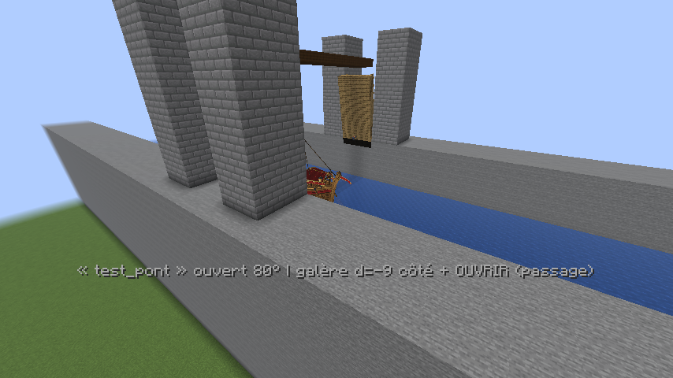
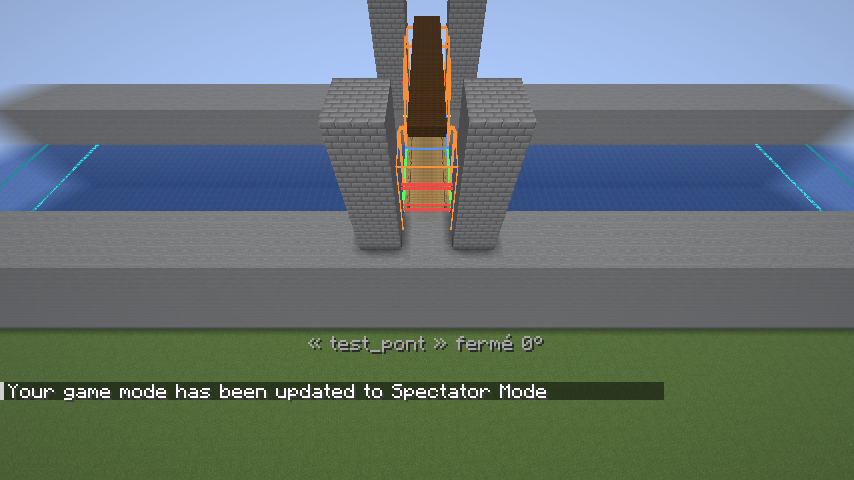
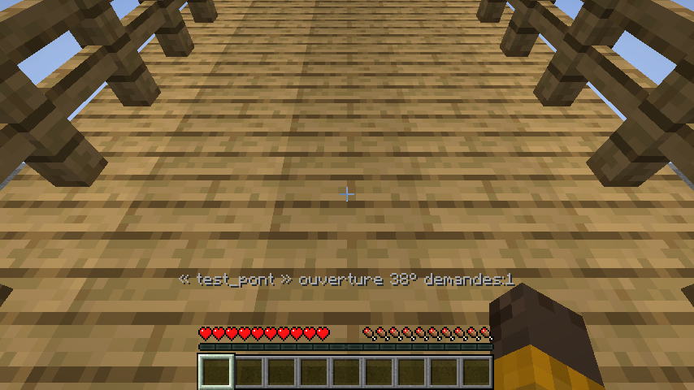
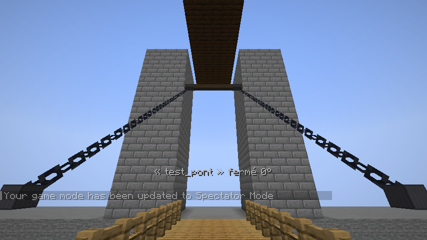
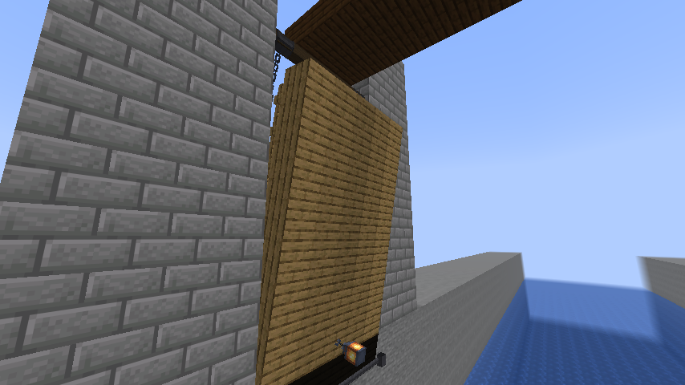
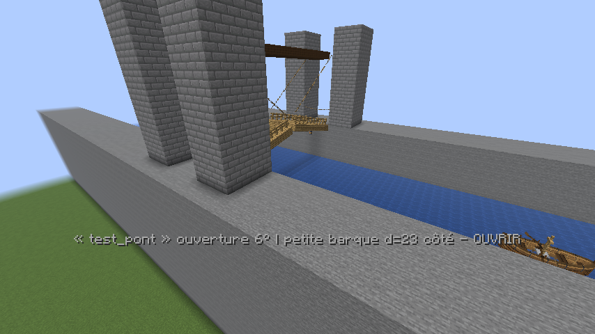

# Pont-levis automatique à deux vantaux (1.24.0)

Un pont **que vous avez déjà construit** (deux tours, une travée en blocs entre les berges) devient un vrai
pont-levis : les **deux moitiés du tablier** que vous sélectionnez pivotent vers le haut depuis leur charnière côté
rive, de façon synchronisée, quand un bateau **qui ne passe pas dessous** arrive à 50 blocs d'un côté **ou** de
l'autre du chenal ; elles redescendent quand les navires qui avaient besoin de l'ouverture ont dégagé la zone. Une
barque qui passe sous le tablier fermé ne déclenche rien : la décision vient de son **gabarit réel** (coque, mât,
superstructure, occupants), pas de son nom. Les tours, berges et passerelles fixes ne sont jamais touchées.

Tout est dans le mod existant (aucune dépendance de plus) et réutilise ses mécanismes : registre des navires,
collisions injectées dans le moteur vanilla (et Lithium), pilote automatique, géométrie des coques.



*Le pont du test en jeu (canal, quatre tours, passerelle fixe en hauteur) ouvert à 80°, une galère sur son pilote
automatique dans le passage ; la ligne de débogage montre l'état, l'angle et le navire pris en compte.*



*`/pontlevis <id> apercu on` : arcs balayés et vantaux levés (orange), barrières (rouge), zones d'approche des deux
côtés du chenal (cyan), passage (rouge), hauteur libre (violet).*









*Pendant la montée, un joueur qui avance depuis la berge est arrêté au bout de celle-ci, devant le vantail qui se dresse.*

## Comment ça marche

* **Fermé** : le tablier est fait de **ses vrais blocs**, exactement ceux de votre construction (on marche dessus,
  les PNJ aussi, l'éclairage et les objets attachés sont ceux du monde). Les blocs de la zone mobile sont
  enregistrés à la conversion et relus à chaque ouverture (un lampadaire ajouté sur le tablier en fait partie).
* **Ouverture** : les blocs des deux moitiés quittent le monde ; chaque vantail devient un ensemble de **boîtes de
  collision** tournées autour de sa charnière, recalculées à chaque tick avec l'angle du moment, sur le serveur
  (PNJ, créatures, coques des navires) comme sur chaque client (le joueur local, simulé par son client) ; les
  clients dessinent les blocs capturés tournés du même angle (`submitBlock`, comme le jeu dessine un bloc). Pas de
  `block_display`, pas de centaines d'entités : **zéro entité**, un paquet par changement d'état, l'angle est
  calculé par chacun à partir du tick de départ du mouvement. Le mouvement est **amorti** : départ lent, pleine
  vitesse au milieu, arrivée lente (un tablier lourd sur son treuil), la durée d'un mouvement interrompu étant
  proportionnelle au chemin restant ; collisions et dessin suivent exactement la même courbe.
* **Charnières et mécanisme** (dessinés dès la conversion, dans tous les états) : un **axe en fer forgé** court le
  long de chaque ligne de charnière, avec un palier de part et d'autre du tablier ; une **poutre de treuil** en chêne
  noir traverse au-dessus de la charnière, côté rive, d'une tour à l'autre (un demi-bloc au-delà du tablier de chaque
  côté, pour entrer dans les tours qui l'encadrent), à la hauteur de la longueur du vantail + 1,5 par défaut
  (réglable : `/pontlevis <id> chaines <hauteur>`, `off` pour masquer poutre, tambours et chaînes, l'axe reste) ;
  deux **tambours** à flasques y sont montés, et de chacun descend une **chaîne** jusqu'à une manille au coin du bout
  libre du vantail. Les chaînes sont dessinées comme le jeu dessine son bloc de chaîne (deux bandes croisées, les
  vrais maillons), comptées depuis la manille : quand le vantail monte, la chaîne raccourcit et ses maillons
  **s'enroulent dans le tambour**. Tendues en diagonale pont fermé, presque verticales pont ouvert. Pendant la
  manœuvre, deux **poteaux** de chêne noir à capuchon de fer et une chaîne qui pend entre eux barrent chaque bout du
  tablier côté rive, exactement là où se trouve la barrière que les joueurs sentent. Une lanterne ou une torche du
  tablier levé garde sa propre lumière (hors du monde, elle n'éclaire plus les blocs, mais elle n'est pas éteinte).
  De la poussière du matériau du tablier s'échappe aux charnières pendant le mouvement et à l'arrivée, avec le choc
  du bois et de la ferrure.
* **Ouvert** : les vantaux sont dressés le long des tours (angle réglable, 80° par défaut) : le volume de
  navigation est **réellement libre**, rien ne retient un joueur à l'emplacement de l'ancien tablier.
* **Fermeture** : les vantaux redescendent ; à l'angle 0 les blocs d'origine sont remis **avec leurs états et le
  contenu de leurs block entities**. Une **barrière** invisible (une chaîne dessinée) ferme chaque extrémité du
  tablier côté rive tant que les vantaux ne sont pas redescendus : personne ne s'engage pendant la manœuvre.

Les coques des navires voient aussi les vantaux comme des obstacles (`ShipWorld.blocked`), et le pont fermé est un
obstacle ordinaire fait de blocs.

### États du cycle

| État | Ce qui se passe |
|---|---|
| **FERMÉ** | Blocs en place. Détection des navires dans les deux zones d'approche toutes les 5 ticks. |
| **ATTENTE_SÉCURITÉ** | Un navire a besoin de l'ouverture (ou un ordre a été donné) : cloche discrète, message « quittez le tablier », puis **temps de sécurité** (4 s par défaut). Les vantaux ne partent que si **personne** (joueur, créature, véhicule) n'est sur le tablier ou à cheval sur ses extrémités et si **rien** n'est dans le volume qu'ils vont balayer. Sinon l'attente continue avec un diagnostic toutes les 5 s (« quelqu'un se trouve sur le tablier (Pseudo) »). Si plus aucun navire n'a besoin de l'ouverture, retour à FERMÉ sans bouger. |
| **OUVERTURE** | Les blocs sortent du monde, les vantaux montent à vitesse constante (8 s par défaut), bruits de chaîne et de treuil, grincement. |
| **OUVERT** | Reste ouvert tant qu'un navire exigeant l'ouverture est dans l'approche (+ hystérésis), dans le passage, ou qu'une demande scriptée court. Quand plus rien n'en a besoin : **délai configurable** (5 s), puis fermeture si le volume balayé est libre. **Un navire arrêté dans le passage garde le pont ouvert**, aucun délai ne ferme sur lui. |
| **FERMETURE** | Les vantaux descendent. Un nouveau navire qui a besoin de l'ouverture, ou une entité qui entre dans le volume sous les vantaux, **inverse** proprement le mouvement (les vantaux remontent depuis l'angle où ils sont, sans saut ni claquement). |
| **ERREUR** | Angle 0 atteint mais un bloc étranger occupe l'emplacement du tablier : les blocs ne sont **pas** posés dessus ; les vantaux restent baissés comme boîtes de collision (on marche dessus), la pose est retentée toutes les 3 s, les administrateurs sont prévenus du bloc en cause. Une nouvelle demande rouvre normalement. |

`/pontlevis <id> auto off` **suspend l'automatisme** : le pont garde son état ; `ouvrir` / `fermer` le manœuvrent
en respectant les mêmes sécurités (jamais de fermeture sur une entité).

### Détection à 50 blocs des deux côtés

Le **chenal** est décrit par son axe (le sens de circulation des bateaux sous le pont), son centre, sa largeur
navigable entre les tours, la largeur de la travée le long du chenal, et le niveau de l'eau. Les **deux zones
d'approche** s'étendent sur 50 blocs (réglable) **au-delà de chaque bord du tablier le long du chenal**, sur toute
la largeur navigable (+1 bloc de marge) : « des deux côtés » signifie les deux extrémités du chenal d'où arrivent
les bateaux, pas les deux berges. Tout est calculé à partir de la géométrie réelle : rien n'est déduit de
coordonnées devinées.

* La distance est mesurée du **bord du tablier à la partie la plus proche du navire** (sa proue s'il vient vers le
  pont) : la longueur de la coque et son cap comptent (`ShipGeometry.aiReach/aiBack`, demi-largeur de coque),
  un grand navire n'est pas détecté trop tard.
* **Hystérésis** (8 blocs par défaut) : un navire pris en compte à 50 blocs ne cesse de l'être qu'au-delà de 58.
* Navires **pilotés** (joueur à la barre), **vides mais en mouvement**, **conduits par le pilote automatique**
  (ferries, bateaux de quête) et bateaux **vanilla** (barques, radeaux, avec coffre) sont détectés. Un joueur à
  pied, un objet flottant, une créature, un véhicule hors du chenal navigable (amarré sur une berge) ne le sont pas.
* Un navire **arrêté devant le pont** (pilote à la barre, ou pilote automatique en route) reste détecté. Un navire
  **sans personne**, sans pilote automatique et immobile pendant plus de 60 s (réglable) est considéré amarré :
  ignoré, sauf s'il est dans le passage. Un ferry **à quai** (pilote automatique à l'escale) n'ouvre pas le pont ;
  dès qu'il **fait route**, son itinéraire est regardé : s'il **traverse** la ligne du pont dans les prochains
  tronçons, il est pris en compte, qu'il soit en virage ou non ; un navire piloté n'est pas filtré sur son cap.
* Un **tronçon déchargé** ne prouve pas qu'un bateau a disparu : un navire pris en compte dont le tronçon se
  décharge reste présumé présent pendant 120 s (réglable), indéfiniment s'il était dans le passage ; le pont ne
  se décide pas sur une information incomplète et ses propres tronçons restent chargés (tickets bornés, 5 × 5
  tronçons) tant qu'il n'est pas fermé.

### Gabarit : ouvrir seulement si nécessaire

À la vérification, le mod mesure le **dessous du tablier** au-dessus de la bande navigable (les saillies — lanternes,
poutres — l'abaissent), le **niveau de l'eau**, et en déduit la **hauteur libre**. Pour chaque navire :

* **navires du mod** : le point le plus haut du **modèle** (mâts, châteaux, ballon : `ShipGeometry.topY`, bien plus
  haut que la hitbox de l'entité, qui ne fait que 0,4 bloc), au-dessus de sa ligne de flottaison réelle (un Nautilus
  en plongée est plus bas) ; les **occupants** : têtes des passagers assis et des personnes debout sur les ponts,
  quand elles dépassent ; la **largeur vue des tours** pour son cap du moment (coque, tambours de roues,
  superstructures) ;
* **bateaux vanilla** et véhicules d'autres mods : par **profil** (hauteur, largeur, occupants), voir la
  configuration ; sans profil, un véhicule inconnu est ignoré ;
* **verdict** : `passe sous le pont fermé` si haut + **marge** (0,5 par défaut) ≤ hauteur libre ; `ouverture
  requise` sinon ; `trop large` si la largeur dépasse la largeur navigable : ouvrir ne sert à rien, le pont n'ouvre
  pas pour lui, le pilote automatique l'arrête devant et le pilote joueur est prévenu.

`/pontlevis <id> tester <navire>` affiche la mesure complète et le critère utilisé ; `/pontlevis <id> debug on`
l'affiche en continu dans la barre d'action.

### Pilote automatique et pilotes joueurs

Un navire du mod sur son **pilote automatique** qui a besoin de l'ouverture (ou qui est trop large) est **retenu**
devant le pont tant qu'il n'est pas OUVERT : sa vitesse est bornée par le profil de freinage `v = √(2·a·d)` pour
s'arrêter à `arret` blocs (6 par défaut) du bord du tablier, proue comprise, et son pilote automatique sait qu'il
attend exprès (`Autopilot.externalHold`) : aucune détection de blocage, aucune marche arrière, aucun itinéraire
modifié ; il repart dès l'ouverture. Un **joueur à la barre reste libre** : il est prévenu dans la barre d'action
(« Pont-levis fermé devant vous : il va s'ouvrir, ralentissez » / « trop large »).

Remarque : le pilote automatique des navires considère comme non navigable une colonne dont les deux blocs
au-dessus de l'eau ne sont pas libres ; un tablier à moins de 3 blocs au-dessus de l'eau n'est donc jamais franchi
par un ferry (la vérification le signale).

### Joueurs, état mondial, quêtes

L'état du pont est **global** et le même pour tous : un seul pont, un seul angle, les mêmes boîtes de collision
sur le serveur et sur tous les clients ; un joueur qui rejoint ou change de dimension reçoit tous les ponts de
son monde (angle, mouvement en cours, blocs des vantaux) et voit tout de suite le bon état, sans attendre une
nouvelle ouverture. Les bateaux de quête (`/ship spawn … route …`) sont détectés comme les autres ; pour une scène
dont les acteurs ne sont pas des navires du mod, un script demande l'ouverture au gestionnaire sans rien rendre
visible : `/pontlevis <id> demande <clé> [secondes]` (et `demande annuler <clé>`), ou en Java
`Drawbridges.request(bridge, key, seconds, world)`.

Avant chaque montée : temps de sécurité annoncé, puis refus tant que quelqu'un est sur le tablier (aucune
téléportation, personne n'est projeté à l'eau) ; avant chaque descente et pendant toute la descente : refus ou
inversion si une entité est dans le volume balayé. Les extrémités sont barrées pendant la manœuvre.

### Redémarrage, déchargement

Configuration, blocs capturés et état (angle compris, sauvegardé à chaque transition et chaque seconde en
mouvement) sont dans `data/medievalships_drawbridges.dat`. Au redémarrage, un pont ouvert ou en mouvement
reprend à l'angle sauvegardé **sans collision orpheline** : ses boîtes sont recréées à partir des blocs capturés,
le passage compte comme occupé pendant 5 s (le temps que ses entités se chargent), puis les contrôles habituels
reprennent (un navire dans le passage le garde ouvert, une entité sous les vantaux empêche de fermer). Un pont
sauvegardé fermé sans ses blocs repasse par ERREUR et les repose dès que l'emplacement est libre. Tant que les
tronçons du pont ne sont pas chargés, rien ne change.

## Installation sur votre pont (uniquement le tablier)

Toutes les commandes demandent le niveau `adminPermissionLevel` (celui de `/ship`). `/drawbridge` est un alias.
Rien n'est inventé à partir de coordonnées de capture d'écran : vous visez les blocs, le mod mesure le reste.

```
# 1. un identifiant
/pontlevis creer port_nord

# 2. les deux moitiés mobiles : deux coins (inclus) par vantail. Visez un bloc, ou donnez les coordonnées.
#    Ne sélectionnez que le tablier (planches, garde-corps, chaînes du tablier), jamais les tours ni les
#    passerelles fixes. A et B ne doivent pas se chevaucher ; les blocs d'air de la boîte sont ignorés.
/pontlevis port_nord vantail A pos1          # en visant le coin du tablier côté rive A
/pontlevis port_nord vantail A pos2          # le coin opposé, au milieu du chenal (garde-corps compris en hauteur)
/pontlevis port_nord vantail B pos1
/pontlevis port_nord vantail B pos2

# 3. pivots : automatiques (arête basse, côté rive, de la couche de blocs la plus fournie de la sélection : le
#    plancher, sous les garde-corps et au-dessus des lanternes suspendues ; parallèle au chenal). Pour forcer :
/pontlevis port_nord vantail A charniere haut         # arête haute
/pontlevis port_nord vantail A charniere 120.0 65.0 -40.5   # un point de la ligne de charnière

# 4. le chenal : automatique (axe perpendiculaire à la travée, centre au milieu, largeur = écart des charnières,
#    eau trouvée sous le centre). Pour corriger :
/pontlevis port_nord axe x            # ou z, ou <dx> <dz>, ou auto : le sens de circulation des bateaux
/pontlevis port_nord chenal largeur 14        # largeur navigable entre les tours
/pontlevis port_nord chenal centre            # votre position, ou <x y z>, ou auto
/pontlevis port_nord eau 62                   # ou auto

# 5. réglages (chaque pont a les siens ; défauts dans la configuration)
/pontlevis port_nord approche 50     /pontlevis port_nord hysteresis 8
/pontlevis port_nord angle 80        /pontlevis port_nord duree 8
/pontlevis port_nord delai 5         /pontlevis port_nord securite 4
/pontlevis port_nord marge 0.5       /pontlevis port_nord arret 6
/pontlevis port_nord chaines auto    # poutre de treuil, tambours et chaînes : auto | <hauteur de la poutre> | off

# 6. voir : sélections (vert A / bleu B), charnières (jaune), arcs balayés et vantaux levés (orange), barrières
#    (rouge), zones d'approche des deux côtés (cyan, hystérésis plus sombre), passage (rouge), hauteur libre (violet)
/pontlevis port_nord apercu on

# 7. vérifier : blocs, charnières, chenal, eau, hauteur libre, et le VOLUME BALAYÉ contre les blocs fixes
#    (tours, passerelles, arches) en avant de la charnière. Un conflit est refusé avec les blocs en cause et
#    l'angle sûr. Les blocs DERRIÈRE la charnière (la culée, la tour contre laquelle le tablier s'appuie) ne
#    comptent pas : l'épaisseur du tablier et ses garde-corps y pivotent comme sur un vrai pont à bascule.
/pontlevis port_nord verifier

# 8. convertir : les blocs sont enregistrés, le pont est en service, FERMÉ, ses blocs restent en place
/pontlevis port_nord convertir

# tester un navire précis, suivre la détection, manœuvrer, suspendre
/pontlevis port_nord tester "Le Faucon"      /pontlevis port_nord debug on
/pontlevis port_nord etat
/pontlevis port_nord ouvrir      /pontlevis port_nord fermer      /pontlevis port_nord auto off|on
/pontlevis port_nord demande quete_valombre 120     /pontlevis port_nord demande annuler quete_valombre

# tout remettre : les blocs d'origine reviennent (s'ils étaient levés), seule la zone mobile est touchée ;
# la définition est gardée (re-convertir plus tard), ou supprimée
/pontlevis port_nord restaurer
/pontlevis port_nord supprimer
```

Modifier la définition (sélections, charnières, chenal) demande un pont **non converti** : `restaurer` d'abord.
Les réglages (angle, durées, marge…) se changent à tout moment. Une installation répétée (`restaurer` puis
`convertir`) ne crée aucune entité et ne fait disparaître aucun bloc : la conversion relit le tablier du monde.

## Configuration (`config/medievalships.json`, section `drawbridges`, `/ship reload`)

| Clé | Défaut | Rôle |
|---|---|---|
| `approach`, `hysteresis` | 50, 8 | zone d'approche (blocs) de chaque côté, et marge de maintien |
| `openAngle`, `openSeconds` | 80, 8 | angle des vantaux levés, durée d'un mouvement |
| `closeDelaySeconds` | 5 | attente avant de refermer quand plus rien n'a besoin du pont |
| `warningSeconds` | 4 | annonce avant la montée (le temps de quitter le tablier) |
| `margin` | 0.5 | marge entre le haut du navire et le dessous du tablier |
| `stopDistance` | 6 | où le pilote automatique attend devant le tablier |
| `detectionIntervalTicks` | 5 | fréquence du balayage des zones |
| `idleIgnoreSeconds` | 60 | un navire immobile sans pilote ni pilote automatique est ignoré après ce temps |
| `unloadedGraceSeconds` | 120 | un navire dont le tronçon est déchargé reste présumé présent ce temps |
| `detectionDepth` | 8 | profondeur sous l'eau couverte par la détection |
| `soundVolume`, `announce`, `announceRadius` | 0.6, true, 48 | sons de chaîne / treuil / grincement, annonces |
| `profiles` | `vanilla_boat` | profils de gabarit, voir ci-dessous |

Ces défauts servent aux **nouveaux** ponts ; chaque pont garde ensuite ses propres valeurs (`/pontlevis <id> …`).

**Profils** (`"profiles"`) : une entrée par identifiant de navire du mod (`"galley"`, `"rowboat"`…), par type d'entité
(`"minecraft:oak_boat"`, `"autremod:drakkar"`) ou `"vanilla_boat"` (toutes les barques et radeaux vanilla) :

```json
"profiles": {
  "vanilla_boat": {"height": 0.6, "heightOffset": 0.0, "width": 1.4, "occupants": true, "ignore": false},
  "rowboat":      {"heightOffset": 0.0, "occupants": true},
  "galley":       {"heightOffset": 1.0},
  "autremod:drakkar": {"height": 9.0, "width": 4.0, "occupants": true}
}
```

`height` remplace la hauteur mesurée (au-dessus de l'eau), `heightOffset` s'y ajoute (un mât que la hitbox ignore),
`width` remplace la largeur mesurée, `occupants` ajoute les têtes des passagers, `ignore` retire la famille des
décisions. Un véhicule d'un autre mod sans profil est ignoré ; en donner un suffit à le prendre en compte.

## Limites (honnêtes)

* Les boîtes de collision d'un vantail en mouvement sont les boîtes englobantes des blocs tournés : exactes à 0° et
  90°, un peu plus larges aux angles intermédiaires (jamais plus petites : elles n'ouvrent pas de passage avant
  l'heure). Les blocs sont dessinés tournés exactement.
* Les block entities des blocs du tablier (coffres, enseignes) sont rendues **par leur contenu** à la fermeture
  mais ne sont **pas dessinées** pendant le mouvement (seul le bloc l'est).
* Les aéronefs sont ignorés par les ponts (ils passent au-dessus) ; le Nautilus est mesuré à sa hauteur du
  moment, un pont ne le fait pas plonger.
* Le pont ne « heurte » pas un navire qu'un joueur fait passer sous le tablier fermé malgré l'avertissement : les
  coques du mod ne sondent pas leurs mâts (comportement existant), le mât traverse visuellement le tablier ; le
  pilote automatique, lui, attend.
* Un tablier à moins de 3 blocs au-dessus de l'eau n'est pas franchi par le pilote automatique (règle de
  navigabilité existante), même ouvert : la vérification le signale.
* Le volume balayé est vérifié contre les blocs **à la conversion et à chaque ouverture** (relecture du tablier),
  pas contre une construction ajoutée plus tard dans l'arc pendant que le pont est ouvert : elle serait traversée
  à la fermeture (un bloc posé **à l'emplacement du tablier** est, lui, détecté : état ERREUR).
* L'horloge du client peut avoir quelques ticks d'écart avec celle du serveur : l'animation peut commencer un
  instant plus tôt ou plus tard ; les collisions du joueur local suivent son propre angle, celles des PNJ et des
  navires l'angle du serveur (même formule, même tick de départ).

## Tests

Voir [TESTS.md](TESTS.md#pont-levis-automatique--1240) : tests unitaires du cœur pur (géométrie, zones, gabarit,
cycle), test en jeu (`DrawbridgeGameTest`, en solo avec redémarrage et sur serveur dédié) joué par le vrai client.
