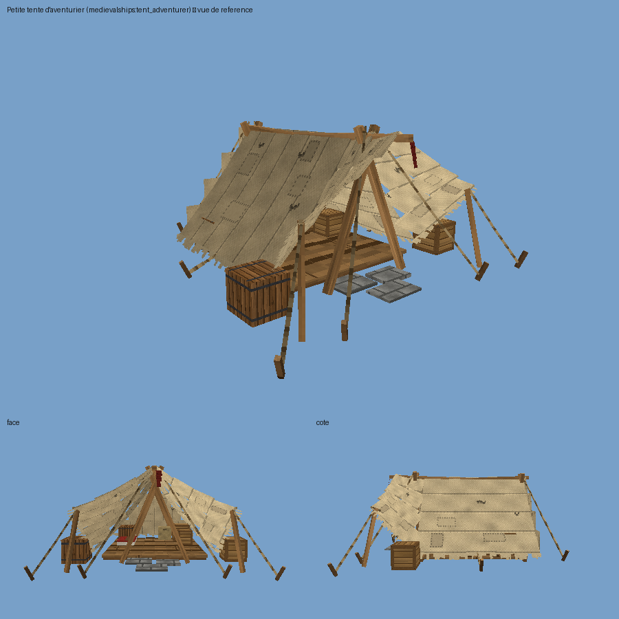

# Tentes médiévales (un bloc = une tente)

Six tentes de décor pour les camps, marchés, ports et zones de quête. **Chaque tente est UN seul bloc** : on
pose le bloc, la tente entière (toile, poteaux, cordes, plancher, lanternes et meubles) est dessinée à partir
de lui, comme les navires sont dessinés à partir de leur entité. Rien n'est posé autour, rien ne « tick ».

| id | nom | état |
|----|-----|------|
| `tent_command` | Grande tente de commandement | à venir (générateur à écrire) |
| `tent_adventurer` | Petite tente d'aventurier | **faite** (`tools/tents/generate_tent_adventurer.py`) |
| `tent_market` | Grand abri de marché | à venir |
| `tent_camp` | Tente triangulaire de campement | à venir |
| `tent_dwelling` | Tente d'habitation | à venir |
| `tent_chief` | Grande tente de chef | à venir |

Les six blocs et objets existent déjà (onglet créatif **Tentes**) ; une tente dont le modèle n'est pas encore
généré pose son bloc d'ancrage sans rien dessiner.

## Poser, retirer

- **Poser** : clic droit au sol avec l'objet. L'entrée de la tente fait face au joueur. Avant de poser, le jeu
  vérifie que tout l'emprise de la tente (tournée selon l'orientation) est libre — air, herbes, fleurs, neige —
  et que le sol est assez plein dessous ; sinon un message rouge en français et rien n'est posé. Une tente
  n'écrase jamais une construction.
- **Retirer** : casser le bloc d'ancrage (le bloc invisible au centre, au sol : visez-le, son contour est un
  bloc entier). En survie il rend l'objet. Ou `/tent remove`.
- **Marcher dedans** : la toile et les cordes ne bloquent pas ; les poteaux, planchers, rambardes et meubles
  solides ont des boîtes de collision (par le mixin de collision des navires : `TentCollisions`).
- **Meubles** : ceux des mods de décoration du serveur (Furnish, Farmer's Delight, Farmhouse Decorations,
  Lands of Icaria) sont dessinés en place, **purement visuels** (pas de coffre ouvrable). Si un mod manque sur
  un client, le bloc vanilla indiqué (`alt`) est dessiné, sinon une boîte de substitution du modèle.
- **Persistance** : c'est un bloc, dans le chunk. Copies WorldEdit/Axiom, multijoueur, serveur dédié : rien de
  spécial (le rendu est côté client uniquement).

## Commandes (admin, comme `/ship`)

- `/tent give <id> [joueurs]` — donne l'objet (`/ship give <id>` marche aussi).
- `/tent place <id> [x y z] [south|west|north|east]` — pose la tente à la position (ou celle de la commande),
  entrée vers la direction donnée (ou vers l'exécutant). Même vérification d'espace libre que l'objet.
- `/tent remove [nearest|x y z]` — retire la tente la plus proche, ou celle dont l'ancrage est en x y z.
- `/tent list` — les tentes chargées de ce monde, de la plus proche à la plus lointaine.
- `/tent types` — les six ids.

## Réglages (`config/medievalships.json`, section `server`)

- `tentDecorDistance` (32) : en deçà, meubles et petits détails sont dessinés.
- `tentRenderDistance` (64) : au-delà, la tente n'est plus dessinée du tout.

## Meubles par tente (mods source)

**Petite tente d'aventurier** : `furnish:spruce_crate`, `furnish:oak_crate` (caisses), `farmersdelight:rice_bag`
(sac), `farmersdelight:carrot_crate` (caisse dehors), `landsoficaria:cypress_barrel` x2 (tonneaux ; vanilla
`minecraft:barrel` à défaut), `farmhouse_decorations:chained_kerosene_lantern` (lanterne suspendue, lumineuse) ;
le couchage (paillasse + couverture) fait partie du modèle.

## Tests faits

- JUnit `TentTest` : rotation des emprises et boîtes de collision selon l'orientation, lecture des fichiers
  `tents/<id>.json`, du décor et du modèle (bones de substitution présents).
- Test en jeu `TentGameTest` (CI, appelé par `ShipClientGameTest`) : `/tent place tent_adventurer`, bloc et
  orientation, refus d'une seconde tente par-dessus, un joueur en survie est arrêté par un poteau avant et entre
  librement par l'entrée, captures d'écran, `/tent remove`, bloc et collisions disparus.

## Ajouter une tente (pour les développeurs)

1. `tools/tents/generate_<id>.py` sur le modèle de `generate_tent_adventurer.py` : `tl.setup(id)`, un `tl.Bone`
   racine, les aides de `tentlib.py` (`post`, `pole`, `rope`, `guy`, `canvas_panel`, `cone_roof`, `pennant`,
   `platform`, `railing`, `bedroll`, `lantern`), `tl.collide(...)` pour toute boîte solide non couverte par les
   aides, un `tl.Decor()` pour les meubles des mods (`decor.block(id, x, y, z, facing, scale, glow, alt,
   fallback)` ; bornes des blocs dans `tentlib.BOUNDS` ou le catalogue), `decor.fallbacks(root)`, puis
   `tl.export(root, id, decor, icon=...)`. Repère : y vers le haut, +z = l'entrée, le bloc d'ancrage en (0, 0, 0).
2. Lancer le générateur : il écrit le modèle (blockbench + assets), l'atlas partagé `textures/entity/tents.png`,
   l'icône, `interiors/<id>_decor.json` et `tents/<id>.json` (emprise + boîtes de collision), lus par `TentType`.
3. Java : la ligne `TentType.load("<id>", "nom fr", "English name")` existe déjà dans `core/TentTypes.java` pour
   les six ; les noms d'objet sont dans `lang/fr_fr.json` et `lang/en_us.json` (`block.medievalships.<id>`).
   Bloc, objet, blockstate, icône et rendu sont génériques : rien d'autre à enregistrer.
