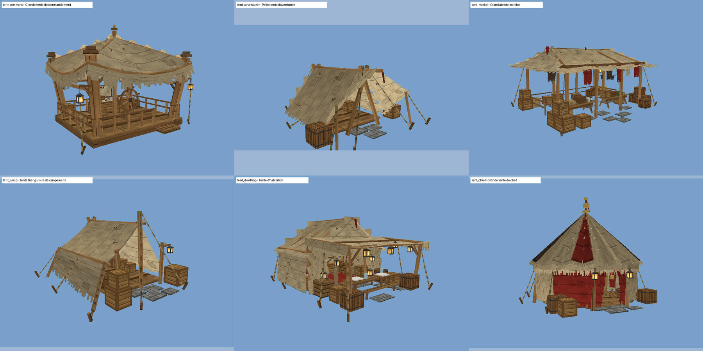

# Tentes médiévales (un bloc = une tente)

Six tentes de décor pour les camps (orcs, trolls, bandits), marchés, ports, camps militaires, zones de quête et
villages. **Chaque tente est UN seul bloc** : on pose le bloc, la tente entière (toile, poteaux, cordes, plancher,
rambardes, lanternes et meubles) est dessinée à partir de lui, comme les navires sont dessinés à partir de leur
entité. Rien n'est posé autour, rien ne « tick », rien ne tourne côté serveur une fois la tente posée.



| id | nom | emprise (l × h × p, blocs) | cubes | générateur |
|----|-----|-----|-----|-----|
| `tent_command` | Grande tente de commandement | 10,5 × 8,3 × 8,4 | 449 | `tools/tents/generate_tent_command.py` |
| `tent_adventurer` | Petite tente d'aventurier | 8,3 × 3,8 × 8,8 | 154 | `tools/tents/generate_tent_adventurer.py` |
| `tent_market` | Grand abri de marché | 11,5 × 5,7 × 10,7 | 318 | `tools/tents/generate_tent_market.py` |
| `tent_camp` | Tente triangulaire de campement | 7,7 × 4,3 × 8,4 | 153 | `tools/tents/generate_tent_camp.py` |
| `tent_dwelling` | Tente d'habitation | 7,9 × 4,8 × 9,7 | 441 | `tools/tents/generate_tent_dwelling.py` |
| `tent_chief` | Grande tente de chef | 10,3 × 8,1 × 10,0 | 673 | `tools/tents/generate_tent_chief.py` |

L'emprise est centrée sur le bloc d'ancrage (largeur et profondeur réparties de part et d'autre ; la profondeur
compte les cordes et piquets devant et derrière). Les six objets sont dans l'onglet créatif **Tentes**.

- **Grande tente de commandement** : grand toit de toile beige usée aux bords déchirés, quatre gros poteaux
  légèrement penchés, structure ouverte à rambardes, cordes et contreventements, lanternes suspendues, grande roue
  de navire au centre, plancher de bois ; bureau-table de stratégie, chaise, banc, tabourets, livres, coffre.
- **Petite tente d'aventurier** : petite tente beige en A, toit un peu irrégulier, deux pans ouverts devant,
  piquets et cordes ; caisses, sac, tonneaux et un couchage (paillasse + couverture, dans le modèle).
- **Grand abri de marché** : grande toile beige sur plusieurs poteaux, bords irréguliers déchirés, pièces de tissu
  et fanions rouges, tables et étals de bois, tonneaux, caisses, marchandises (paniers, caisses de légumes, tartes,
  jambon, poulet rôti, amphores), lanternes.
- **Tente triangulaire de campement** : tente en A rustique, toile beige en pente, entrée ouverte, perches et
  cordes ; couchage, caisses, panier, sac, tonneau, lanterne.
- **Tente d'habitation** : toit de toile beige vieillie, intérieur praticable au tapis rouge, lit, petite table,
  coffre et rangements, lanternes qui éclairent l'intérieur ; devant, le pavillon à tables, bancs, tonneaux et
  bouteilles de la seconde image de référence.
- **Grande tente de chef** : plan polygonal, haut toit pointu en cône rayé beige / rouge / sombre, entrée ouverte,
  plusieurs piliers de bois, tapis, bibliothèque, tables, chaises, coffre, tonneaux, lanternes.

## Poser, orienter, retirer

- **Poser** : clic droit au sol avec l'objet. L'entrée de la tente fait face au joueur (état de bloc `facing`,
  quatre directions : le modèle et les boîtes de collision tournent d'un quart de tour avec lui).
- **Vérification de place** : avant de poser, le jeu vérifie que toute l'emprise de la tente (tournée selon
  l'orientation) est libre — air, herbes, fleurs, neige, plantes remplaçables — et que le sol est assez plein sous
  l'emprise ; sinon un message rouge en français (ce qui gêne, et où) et rien n'est posé. Une tente n'écrase
  **jamais** une construction existante.
- **Retirer** : casser le bloc d'ancrage (le bloc au centre, au sol : visez-le, son contour est un bloc entier). En
  survie il rend l'objet. Ou `/tent remove`. Il n'y a rien d'autre à nettoyer : rien d'autre n'a été posé.
- **Marcher dedans** : la toile et les cordes ne bloquent pas (on entre et sort librement) ; les poteaux, planchers,
  rambardes et meubles pleins ont des boîtes de collision statiques, ajoutées aux collisions des entités proches par
  le mixin de collision des navires (`EntityCollisionMixin` → `ShipCollisions.withHulls` → `TentCollisions`).
- **Eau** : le bloc d'ancrage est déclaré plein (`solid`) : l'eau qui coule dessus (rive, marée d'un seau) ne
  l'emporte pas, contrairement à un bloc fin ordinaire.
- **Meubles** : purement visuels (pas de coffre ouvrable, pas de lit utilisable, pas de siège). Voir la liste
  ci-dessous.
- **Persistance** : c'est un bloc avec son entité de bloc, dans le chunk. Multijoueur et serveur dédié : rien de
  spécial, le rendu est côté client uniquement ; le serveur ne garde que l'orientation et les boîtes de collision
  (remplies au chargement du chunk, oubliées à son déchargement, sans balayage ni tick).

## Commandes (admin, mêmes permissions que `/ship`)

- `/tent give <id> [joueurs]` — donne l'objet (`/ship give <id>` marche aussi pour les six tentes).
- `/tent place <id> [x y z] [south|west|north|east]` — pose la tente à la position (ou celle de l'exécutant),
  entrée vers la direction donnée (ou vers l'exécutant). Même vérification de place libre que l'objet.
- `/tent remove [nearest|x y z]` — retire la tente la plus proche, ou celle dont l'ancrage est en x y z.
- `/tent list` — les tentes chargées de ce monde, de la plus proche à la plus lointaine.
- `/tent types` — les ids de tous les objets en un bloc (six tentes, et depuis 1.12.0 / 1.13.0 / 1.14.0 les huit
  [charrettes](CHARRETTES.md), les sept [ateliers](ATELIERS.md) et les six
  [tentes de marchands](#tentes-de-marchands-1140) ; depuis 1.18.0 les trois
  [aires d'entraînement](ENTRAINEMENT.md)).

## Meubles par tente (mods source, substituts)

Les meubles viennent des mods de décoration du serveur : **Furnish** (`furnish:`), **Farmer's Delight**
(`farmersdelight:`), **Farmhouse Decorations** (`farmhouse_decorations:`), **Lands of Icaria** (`landsoficaria:`),
**Mebahel Dwarven** (`mebahelcreaturesdwarven:`). Chaque id a été vérifié dans les fichiers des mods. Le modèle de
bloc du mod est dessiné en place quand le mod est installé sur le client ; si le mod manque, le bloc vanilla
indiqué (`→`) est dessiné à la place, et à défaut une boîte de substitution peinte dans le modèle de la tente. Dans
tous les cas le serveur n'a pas besoin des mods : il ne manque jamais rien et rien ne plante. Les meubles sont
**visuels** : on ne peut pas les ouvrir ni s'y asseoir.

- **Grande tente de commandement** (12) : `farmhouse_decorations:desk` (table de stratégie),
  `farmhouse_decorations:pile_of_books`, `furnish:book_pile` (cartes et livres), `furnish:spruce_chair`,
  `furnish:spruce_bench`, `furnish:spruce_stool` ×2 (sièges), `furnish:spruce_crate`,
  `mebahelcreaturesdwarven:dwemer_chest` → `minecraft:chest`, `landsoficaria:cypress_barrel` → `minecraft:barrel`,
  `farmhouse_decorations:chained_kerosene_lantern` (suspendue, lumineuse), `farmhouse_decorations:kerosene_lantern`
  → `minecraft:lantern`.
- **Petite tente d'aventurier** (7) : `furnish:spruce_crate`, `furnish:oak_crate`, `farmersdelight:rice_bag`,
  `farmersdelight:carrot_crate` (dehors), `landsoficaria:cypress_barrel` ×2 → `minecraft:barrel`,
  `farmhouse_decorations:chained_kerosene_lantern` (lumineuse) ; le couchage fait partie du modèle.
- **Grand abri de marché** (33) : étals `furnish:spruce_bench`, caisses `furnish:oak_crate` ×2,
  `furnish:spruce_crate` ×2, marchandises `farmersdelight:carrot_crate`, `cabbage_crate`, `onion_crate`,
  `tomato_crate`, `rice_bag` ×2, `bamboo_basket`, `wooden_basket`, `straw_bale`, `apple_pie`, `pumpkin_pie`,
  `sweet_berry_cheesecake`, `honey_glazed_ham_block`, `roast_chicken_block`, `furnish:book_pile`,
  `farmhouse_decorations:wine_bottle`, `red_wine_bottle`, `furnish:amphora` → `minecraft:decorated_pot`,
  `landsoficaria:storage_vase` → `minecraft:decorated_pot`, tonneaux `landsoficaria:cypress_barrel`,
  `loaded_cypress_barrel` ×3 → `minecraft:barrel`, lanternes `farmhouse_decorations:chained_kerosene_lantern` ×4,
  `kerosene_lantern`.
- **Tente triangulaire de campement** (9) : `furnish:spruce_crate` ×2, `furnish:oak_crate`,
  `furnish:dark_oak_crate`, `farmersdelight:potato_crate`, `farmersdelight:wooden_basket`,
  `farmersdelight:rice_bag`, `landsoficaria:cypress_barrel` → `minecraft:barrel`,
  `farmhouse_decorations:chained_kerosene_lantern` (lumineuse) ; le couchage fait partie du modèle.
- **Tente d'habitation** (31) : `farmhouse_decorations:rug_3x_3` → `minecraft:red_carpet` (tapis rouge),
  `farmhouse_decorations:single_bed` (lit), `furnish:spruce_square_table`, `furnish:spruce_table`,
  `furnish:spruce_stool`, `furnish:plate` ×2, `farmersdelight:spruce_cabinet`,
  `mebahelcreaturesdwarven:dwemer_chest`, `furnish:spruce_crate` ×2, `furnish:dark_oak_crate`,
  `farmersdelight:carrot_crate`, `farmersdelight:rice_bag`, `landsoficaria:cypress_barrel` ×2,
  `loaded_cypress_barrel` → `minecraft:barrel`, `farmhouse_decorations:wine_bottle`, `red_wine_bottle`, lanternes
  `farmhouse_decorations:chained_kerosene_lantern` ×9 et `kerosene_lantern` ×3 (lumineuses, dedans et sous le
  pavillon).
- **Grande tente de chef** (17) : `farmhouse_decorations:rug_3x_3` → `minecraft:red_carpet`,
  `farmhouse_decorations:tall_bookshelf` → `minecraft:bookshelf`, `furnish:dark_oak_table` ×2,
  `furnish:dark_oak_chair`, `furnish:dark_oak_stool`, `furnish:spruce_chair` ×2,
  `mebahelcreaturesdwarven:dwemer_chest`, `furnish:spruce_crate`, `furnish:oak_crate`,
  `farmersdelight:carrot_crate`, `farmersdelight:rice_bag`, `landsoficaria:cypress_barrel` ×2 → `minecraft:barrel`,
  `farmhouse_decorations:chained_kerosene_lantern` ×2 (lumineuses).

Les fichiers exacts : `assets/medievalships/interiors/<id>_decor.json` (positions, orientation, échelle, `glow`,
`alt`, bone de substitution `fallback`).

## Tentes de marchands (1.14.0)

Six grandes tentes d'étal, posées comme les six autres (un bloc, même bloc / entité de bloc / rendu / collisions /
commandes), rangées dans le même onglet créatif **Tentes**, après les six premières. Elles partagent le même
pavillon (`tools/merchant/merchantlib.py`, fonction `pavilion`) : carré d'environ 6,5 × 6 blocs ouvert devant et sur
l'avant des côtés, quatre gros poteaux sculptés (bois sombre, frettes de fer, chapiteau, fleuron doré), poutres
d'avant-toit à 3,4 blocs, haut toit à quatre pans légèrement creusés jusqu'à 6,6 blocs avec un épi doré, rayures
couleur / beige, lambrequin à dents carrées bordé d'or, mât à drapeau à queue d'aronde à l'arrière gauche (et un
petit drapeau à l'arrière droit, guirlande de fanions vers le sommet), grande bannière à l'emblème au milieu de
l'avant, lanternes allumées sur les poteaux avant, tapis à l'emblème devant l'entrée, comptoir en L, étagères du
fond, toile de fond et de l'arrière des côtés. Chaque tente a son propre atlas (`textures/entity/<id>.png`).

| id | nom | couleur / emblème | emprise (l × h × p, blocs) | cubes | générateur |
|----|-----|-----|-----|-----|-----|
| `tente_armurier` | Tente du marchand d'armes et d'armures | rouge / épées croisées | 8,5 × 8,2 × 8,7 | 620 | `tools/merchant/generate_tente_armurier.py` |
| `tente_alchimiste` | Tente du marchand d'alchimie | violet, bords dorés / fiole | 8,4 × 8,2 × 8,7 | 762 | `tools/merchant/generate_tente_alchimiste.py` |
| `tente_herboriste` | Tente de l'herboriste | vert, lierre / feuille | 8,4 × 8,2 × 8,7 | 816 | `tools/merchant/generate_tente_herboriste.py` |
| `tente_forgeron` | Tente du forgeron | bleu marine / enclume | 8,4 × 8,2 × 8,7 | 644 | `tools/merchant/generate_tente_forgeron.py` |
| `tente_nourriture` | Tente du marchand de nourriture | jaune ocre / fromage | 8,4 × 8,2 × 8,7 | 681 | `tools/merchant/generate_tente_nourriture.py` |
| `tente_tissus` | Tente du marchand de tissus | turquoise / parchemin | 8,8 × 8,2 × 8,7 | 660 | `tools/merchant/generate_tente_tissus.py` |

L'emprise compte le drapeau qui dépasse à l'arrière gauche (jusqu'à 4,5 blocs du centre) et le **tapis devant
l'entrée** (jusqu'à 5,4 blocs devant le centre) : il faut cette place libre devant la tente pour la poser.

**Obtenir / poser** : `/give @p medievalships:tente_armurier` (de même `tente_alchimiste`, `tente_herboriste`,
`tente_forgeron`, `tente_nourriture`, `tente_tissus`), ou `/tent give tente_armurier`, ou dans l'onglet Tentes.
Clic droit au sol : l'entrée fait face au joueur. `/tent place armurier` (le nom court sans `tente_` marche aussi),
`/tent remove`, casser le bloc d'ancrage (au centre, au sol) : comme les autres tentes.

**Ce qu'on y trouve** (tout est dans le modèle sauf les meubles des mods, listés ensuite) :

- **Marchand d'armes et d'armures** : bannières rouges aux épées croisées (devant, avant droit, côté gauche),
  râtelier d'épées, haches et lances le long du côté gauche, second râtelier d'épées et de lances au fond, deux
  armures de plates complètes sur leurs supports derrière le comptoir, heaumes, rondaches et lingots sur les
  étagères et le comptoir, une épée posée, lances dans un tonneau, l'écu au lion d'or appuyé sur une caisse devant,
  caisses cerclées de fer.
- **Marchand d'alchimie** : étagères pleines de fioles de couleur, chaudron violet bouillonnant avec un cristal
  d'améthyste lumineux à l'avant gauche, grosses fioles sur le comptoir gauche, livre ouvert sur une nappe violette
  à franges dorées, bougies, bocaux, parchemin, bouquets d'herbes suspendus.
- **Herboriste** : lierre sur le toit, le lambrequin et les poteaux, bouquets d'herbes séchées et de lavande
  suspendus, pots de fleurs (blanches, violettes, rouges) et pousses sur les comptoirs et les étagères, caisses
  moussues, caisses de récolte, paniers.
- **Forgeron** : forge de pierre au foyer rougeoyant au fond à gauche, grosse enclume grise sur un bloc de pierre
  devant, râtelier d'épées, heaumes, boucliers, outils et lingots ; la forge émet de temps en temps une flamme et
  une fumée (particules vanilla des « random display ticks » du bloc, comme les ateliers : rien de permanent).
- **Marchand de nourriture** : table de présentation sous une nappe jaune avec une pyramide de fromages, meules et
  pains sur les étagères, comptoir de tomates, pommes, petits pains et légumes, jambons et saucissons pendus à la
  poutre avant, paniers, sacs, tonneaux.
- **Marchand de tissus** : grand casier de rouleaux de tissu (crème, bleu, lilas, violet, jaune, or, rouge), comptoir
  du fond avec une pyramide de coupons, tissus suspendus, étagère de linge plié, tringle de tissus pendus au-dessus
  du comptoir gauche, mannequin en robe crème à l'avant gauche, comptoir droit sous une nappe turquoise bordée d'or,
  rideau turquoise au poteau avant droit.

**Meubles des mods** (même principe que plus haut : le bloc du mod s'il est installé, sinon le bloc vanilla
indiqué `→`, sinon une boîte de substitution du modèle ; purement visuels) :

- **Armes et armures** (7) : `landsoficaria:cypress_barrel` ×2 → `minecraft:barrel`, `furnish:spruce_crate` ×3,
  `furnish:dark_oak_crate`, `farmhouse_decorations:kerosene_lantern` (sur le comptoir, lumineuse).
- **Alchimie** (4) : `landsoficaria:cypress_barrel` ×2 → `minecraft:barrel`, `furnish:spruce_crate`,
  `farmhouse_decorations:pile_of_books`.
- **Herboriste** (5) : `landsoficaria:cypress_barrel` → `minecraft:barrel`, `farmersdelight:cabbage_crate`,
  `farmersdelight:carrot_crate`, `farmersdelight:onion_crate`, `farmersdelight:wooden_basket`.
- **Forgeron** (5) : `landsoficaria:cypress_barrel` → `minecraft:barrel`, `furnish:spruce_crate` ×3,
  `farmhouse_decorations:tool_board` (panneau à outils sur le côté droit).
- **Nourriture** (6) : `farmersdelight:tomato_crate`, `farmersdelight:cabbage_crate`, `farmersdelight:potato_crate`,
  `farmersdelight:wooden_basket`, `farmersdelight:rice_bag`, `landsoficaria:cypress_barrel` → `minecraft:barrel`.
- **Tissus** (5) : `furnish:spruce_crate` ×5 → `minecraft:barrel`.

Les bannières, emblèmes, armures, fioles, rouleaux de tissu, fromages, l'enclume et la forge sont modélisés (aucun
meuble de mod ne les représente). **Collisions** : poteaux, comptoirs, étagères, râteliers, tonneaux et caisses,
enclume, forge, chaudron ; la toile, les bannières et le tapis ne bloquent pas, l'entrée au milieu de l'avant reste
libre.

**Pour les développeurs** : `merchantlib.py` donne `setup`, `Atlas(id, colour)` (+ `atlas.add(nom, l, h, peintre)`
pour les régions propres à une tente), `pavilion(...)` (options : emblème, coin du drapeau, bannières de côté,
lanternes, comptoir, étagères, lierre ; renvoie la disposition : hauteurs, dessus des comptoirs, niveaux des
étagères, sol libre, places près des poteaux avant, bone `detail`), des accessoires (`barrel`, `crate`, `sack`,
`basket`, `bottle`, `hanging_bunch`, `weapon_rack`, `sword`, `axe`, `spear`, `counter`, `shelf_unit`,
`table_cloth`, `banner`, `rug`, `vine`, `lantern`), `Decor` et `export` (écrit `tents/<id>.json` avec sa
`"texture"`, le modèle, l'atlas, l'icône, le décor). Relancer un générateur réécrit tous les fichiers de sa tente.

**Limites connues / non vérifié** :

- Le test en jeu des six tentes de marchands (`TentGameTest`, ci-dessous) est écrit mais n'a pas encore tourné en
  CI au moment de la 1.14.0 (exécutions annulées pour libérer les machines) : la pose, les collisions et le rendu en
  jeu ne sont vérifiés que par les tests JUnit et les rendus hors jeu (`tools/preview.py`).
- Les rayures du toit sont dessinées par facettes : leurs bords font de petites marches d'une rangée à l'autre au
  lieu d'une ligne droite.
- Le rendu réel des meubles des mods (seulement dans la variante « decor » du test en jeu) et des particules de la
  forge n'ont pas été vus.

## Tentes de marchands II (1.15.0)

Cinq tentes d'étal de plus, du même système que les six de la 1.14.0 (un bloc = toute la tente, modèle statique,
boîtes de collision, niveaux de détail, aucun tick, aucune particule permanente), du même pavillon
(`merchantlib.pavilion`) et à la même échelle, rangées dans l'onglet **Tentes** après les six premières
(`TentTypes.MERCHANTS2`). Chacune a son atlas (`textures/entity/<id>.png`).

| id | nom | couleur / emblème de la bannière | générateur |
|----|-----|-----|-----|
| `tente_barde` | Tente du vendeur de barde | bordeaux et beige / lyre d'or sur bannière violette | `tools/merchant/generate_tente_barde.py` |
| `tente_fusils` | Tente du vendeur de fusils | rouge sombre et beige / mousquets croisés sur bannière sombre | `tools/merchant/generate_tente_fusils.py` |
| `tente_archer` | Tente du vendeur d'archerie | vert et beige, toit plus bas / arc et flèche | `tools/merchant/generate_tente_archer.py` |
| `tente_mage` | Tente du vendeur de mage | violet et beige, ornements dorés / étoile d'or | `tools/merchant/generate_tente_mage.py` |
| `tente_armures` | Tente du vendeur d'armures | bleu marine et beige / écu héraldique | `tools/merchant/generate_tente_armures.py` |

**Obtenir / poser** : `/give @p medievalships:tente_barde` (de même `tente_fusils`, `tente_archer`, `tente_mage`,
`tente_armures`), ou `/tent give tente_barde`, ou dans l'onglet Tentes. Clic droit au sol : l'entrée fait face au
joueur. `/tent place barde` (nom court sans `tente_`, ici `barde`, `fusils`, `archer`, `mage`, `armures` ; attention,
`armurier` reste la tente d'armes et d'armures de la 1.14.0), `/tent remove`, casser le bloc d'ancrage : comme les
autres tentes. Comme pour la 1.14.0, il faut de la place libre devant l'entrée pour le tapis.

**Pour un PNJ marchand (EasyNPC) et les joueurs** : chaque tente garde à l'intérieur, derrière le comptoir
principal, une place libre d'au moins 1 × 1 × 2,2 blocs (sans boîte de collision) où poser le PNJ ; l'entrée au
milieu de l'avant et le tapis devant restent libres (le tapis est plat, sans collision).

**Ce qu'on y trouve** (d'après l'image de référence ; tout est modélisé dans la tente sauf les meubles des mods) :

- **Vendeur de barde** : luths et guitares et petits instruments accrochés au fond, grande harpe dorée, tambours
  (rouge à cordage doré, naturel), livres de musique et partitions, livre ouvert sur un lutrin, flûtes dans un
  tonneau, étagères et comptoirs, rideaux bordeaux sur les côtés, tapis violet bordé d'or, lanternes.
- **Vendeur de fusils** : râtelier de fusils et de mousquets debout le long du fond, long comptoir sous un chemin
  de table rouge à dents dorées avec un long fusil et un pistolet à barillet, caisses de munitions, petites pièces
  mécaniques et laiton, tonneaux de poudre, lanternes.
- **Vendeur d'archerie** : arcs exposés au fond, carquois pleins de flèches à l'empennage blanc, fagots de flèches,
  arbalètes sur le comptoir drapé de vert, caisses, la **cible ronde d'entraînement** sur son chevalet devant la
  tente, tapis vert, lanternes ; toit plus bas que les autres pavillons.
- **Vendeur de mage** : étagères de cristaux bleus et violets et de potions qui luisent (dessinés en pleine
  lumière, sans particules), bâtons de mage à tête de cristal debout à droite, orbe lumineux sur son support,
  grimoires ouverts sur le comptoir central drapé de violet à dents dorées, caisses, coffre, tapis violet, lanternes.
- **Vendeur d'armures** : plusieurs mannequins d'armures de styles différents (chevalier en plates d'argent,
  soldat plus simple, armure lourde d'acier sombre, armure d'apparat dorée), heaumes de formes variées sur les
  étagères, cuirasses, grand bouclier bleu à l'aigle d'or devant, coffres et caisses, tapis bleu, lanternes.

**Meubles des mods** : chaque générateur pose ses meubles (caisses, tonneaux, étagères, lanternes, livres...)
par `Decor` (`interiors/<id>_decor.json`) : le bloc du mod s'il est installé, sinon le bloc vanilla indiqué, sinon
une boîte de substitution ; ids vérifiés dans le catalogue des mods. Les armes, armures, bâtons, instruments et
fusils n'existent dans les mods que comme objets (pas comme blocs) : ils sont modélisés dans la tente.

**Pour les développeurs** (ajouts rétrocompatibles de `merchantlib.py`, les six tentes de la 1.14.0 se
régénèrent à l'identique) : couleurs `burgundy`, `darkred`, `navy`, `charcoal` ; emblèmes `lyre`, `muskets`, `bow`,
`star`, `shield` (et `cannon`, inutilisé) ; `Atlas(id, colour, banner_colour=..., rug_colour=...)` pour une bannière
(et le drapeau, les fanions) ou un tapis d'une autre couleur que la toile ; `pavilion(..., roof_rise=2.2)` pour un
toit plus bas (hauteur du sommet au-dessus des avant-toits, 3,2 par défaut).

**Limites connues / non vérifié** :

- Le test en jeu (`TentGameTest`) pose aussi ces cinq tentes une fois chacune (emprise vérifiée dans la plateforme
  dégagée) ; son passage en CI n'est pas garanti au moment de l'écriture.
- Le rendu réel des meubles des mods n'est visible que dans la variante « decor » du test en jeu.
- Les PNJ EasyNPC ne sont pas fournis : la place est prévue, le PNJ se pose à la main.

## Tentes de marchands III et canon (1.16.0)

Deux étals de plus, du même système que les onze tentes de marchands (un bloc = toute la tente, modèle statique,
boîtes de collision, niveaux de détail, aucun tick), mais en **étal à toit à deux pans** (faîtage de gauche à
droite, deux pans légèrement incurvés devant et derrière, rayures qui descendent les pans) au lieu du pavillon
pointu ; rangés dans l'onglet **Tentes** après les onze autres (`TentTypes.MERCHANTS3`), chacun avec son atlas.
Et un objet nouveau, indépendant : le **canon médiéval**, dans un onglet à lui, **Artillerie**.

| id | nom | onglet | générateur |
|----|-----|-----|-----|
| `tente_poison` | Tente du vendeur de poisons | Tentes | `tools/merchant/generate_tente_poison.py` |
| `tente_boucher` | Tente du boucher | Tentes | `tools/merchant/generate_tente_boucher.py` |
| `canon_medieval` | Canon médiéval | Artillerie | `tools/merchant/generate_canon_medieval.py` |

**Obtenir / poser** : `/give @p medievalships:tente_poison` (de même `tente_boucher`, `canon_medieval`), ou
`/tent give canon_medieval`, ou dans les onglets Tentes et Artillerie. Noms courts pour `/tent place` : `poison`,
`boucher`, et `canon` (ou `cannon`, `medieval`). Clic droit au sol : l'entrée d'une tente fait face au joueur ;
pour le canon, c'est la **culasse** qui fait face au joueur, la **gueule pointe là où il regardait** (il se pose
comme on le servirait, depuis l'arrière). `/tent remove`, casser le bloc d'ancrage (le canon rend son objet) :
comme les autres.

**Ce qu'on y trouve** (d'après les images de référence) :

- **Vendeur de poisons** : étal violet et beige à franges dentelées bordées d'or, quatre poteaux à chapiteaux
  dorés, lanternes aux deux poteaux avant, grande bannière violette au crâne au-dessus d'une fiole orange pendue à
  une tringle à l'avant gauche ; comptoir de bois avec un chemin de table violet à dents dorées, étagères du fond
  pleines de fioles rondes (violettes, vertes, rouges, orange) et de petites bouteilles, plantes toxiques et herbes
  séchées pendues au faîtage, champignons ; à l'avant gauche un **chaudron noir sur une caisse au liquide vert
  bouillonnant et lumineux** ; tonneaux et caisses. Ambiance mystérieuse et dangereuse.
- **Boucher** : même étal en rouge et beige, bannière rouge aux deux **couperets croisés**, lanternes ; quartiers
  de viande pendus aux crochets du faîtage (jambons, demi-carcasse / carré de côtes, chapelets de saucisses),
  comptoir couvert de pièces crues et d'une nappe crème à dents rouges, gros **billot rond** avec un couperet planté
  à l'avant, tonneau surmonté de viande, caisses de viande, étagères, tonneaux.
- **Canon médiéval** (432 cubes, environ 4 blocs de long × 2,4 de large × 2,1 de haut) : long fût de fonte noire à
  seize pans avec ses renforts (anneaux), gueule évasée à bourrelet épais autour de l'âme visible, gros anneau de
  culasse, culasse bombée et lourd bouton de culasse, anse de levage et lumière sur le dessus ; tourillons posés dans
  un affût de chêne massif : deux flasques en gradins cerclées de bandes de fer boulonnées, sus-bandes de fer sur
  les tourillons, entretoises avant, milieu et crosse, semelle et coin de mire en bois sous la culasse, crosse
  posée au sol avec son sabot de fer ; deux grandes roues à huit rayons (jantes rondes à seize segments, bandages
  de fer rivetés, moyeux cerclés) sur un essieu à fusées de fer ; une petite pile de quatre boulets au sol sous la
  volée, dans l'emprise (pas de caisses : il doit tenir sur un rempart ou dans un fort). Atlas à lui
  (`textures/entity/canon_medieval.png`).

**Collisions du canon** : huit boîtes au plus près du modèle (l'affût en quatre gradins, le fût en une boîte au-dessus
de l'affût, chaque roue, la pile de boulets) : pas de mur invisible, on en fait le tour à pied ; on ne passe pas sous
la volée (moins de 1,3 bloc). Pour une tente : comme les autres, une place libre d'au moins 1 × 1 × 2,2 blocs
derrière le comptoir pour un PNJ marchand (EasyNPC), l'avant reste praticable.

**Où poser le canon** : sur la terre ferme et les ouvrages — remparts, chemins de ronde, tours, forts, quais, cours de
château (sol plein sous au moins 60 % de l'emprise, place libre de 3 × 5 blocs sur 3 de haut). **Un bloc ne
peut pas être posé SUR un navire en mouvement** : les navires du mod sont des entités, pas des blocs ; le canon se
pose donc sur un rempart, un fort, un quai, pas sur un pont de navire. Un canon de bord serait un « équipement de
navire » (pièce du modèle du navire, comme ses sièges et ses lanternes) : travail futur.

### Canon médiéval : architecture du tir

Le tir **n'est pas encore écrit** (clic droit : rien ; aucun ticker ; aucun son ni particule). Tout est préparé
pour l'ajouter sans toucher au reste :

- **Bloc** : `tent/CannonBlock` (sous-classe de `TentBlock` : même dessin, mêmes collisions `TentCollisions`, même
  pose et même casse ; `FACING` = côté culasse). Son entité de bloc est un `CannonBlockEntity`.
- **Entité de bloc** : `tent/CannonBlockEntity`, type à part `medievalships:cannon` (`Tents.CANNON_BLOCK_ENTITY`),
  dessinée par le même `TentBlockEntityRenderer` que les tentes. Elle garde un `core/CannonState` (immuable, testé
  en JUnit) : `loaded` (boulet chargé), `powder` (charges de poudre, 0 à 3), `fuseTicks` (mèche allumée : ticks
  restants, 0 à 200), `lastShotTime` (heure de jeu du dernier tir, -1 = jamais). Sauvé / relu avec l'API de données
  d'entité de bloc de la 1.21.11 (`writeData(WriteView)` / `readData(ReadView)`, clés `Loaded`, `Powder`,
  `FuseTicks`, `LastShot`) ; un canon vide n'écrit **aucune** clé. `setCannonState(...)` marque le chunk à sauver.
- **Bouche** : le JSON `artillery/canon_medieval.json` a, en plus de l'emprise et des boîtes, `"muzzle": [x, y, z]`
  (le centre de la bouche de l'âme, repère du canon posé face au sud) et `"muzzle_dir": [dx, dy, dz]` (l'axe du fût
  vers la bouche, normalisé, 5° de hausse), lus par `TentType.muzzle()` (`TentType.Muzzle`, tourné avec
  l'orientation comme les boîtes : `muzzle(quart)`) ; en monde : `CannonBlockEntity.muzzle()` et
  `muzzleDirection()`. Champ optionnel : les tentes n'en ont pas.
- **Bones du modèle** (pour l'animation de recul et de hausse) : `carriage` (pivot sur l'essieu : tout le canon
  recule avec lui), dessous `barrel` (pivot = axe des tourillons : hausse, recul du fût), `wheel_left` et
  `wheel_right` (pivot = leur moyeu : elles roulent au recul ; gauche / droite vues par le canonnier derrière la
  culasse, gauche = -x), `detail` (boulons, bandes : caché au-delà de `tentDecorDistance`) ; sous la racine,
  `furniture` (les boulets).

Où brancher la suite :

1. **Charger / bourrer / allumer** : `CannonBlock.onUse` (aujourd'hui `PASS`) — un boulet en main → `loaded`, de la
   poudre → `powder + 1`, un briquet → `fuseTicks` ; tout passe par `CannonBlockEntity.setCannonState`.
2. **Mèche** : surcharger `getTicker` dans `CannonBlock` pour ne rendre un ticker serveur que si la mèche brûle
   (`CannonState.lit()`) — un canon au repos ne coûte toujours rien par tick ; le ticker décompte `fuseTicks` puis
   appelle un `fire()` de `CannonBlockEntity`.
3. **Tir** (`fire()`) : fumée et éclair (particules) et son à `muzzle()`, projectile (entité boulet) lancé le long
   de `muzzleDirection()` avec une vitesse selon `powder`, puis `state.fired(heure)`.
4. **Recul côté client** : envoyer l'état au client (`toInitialChunkDataNbt` / `toUpdatePacket`, pas encore écrits),
   puis une pose du modèle dans `TentBlockEntityRenderer` qui déplace `carriage`, tourne les roues et le fût.

**Pour les développeurs** : la bibliothèque du canon est `tools/merchant/artillery.py` (rien n'a été ajouté à
`merchantlib.py`) : son atlas (`Atlas`), `lathe` (corps de révolution à pans en douves inclinées, avec l'âme),
`disc`, `cylinder_x`, `ball` / `ball_pile`, et `export` (écrit `artillery/<id>.json` avec `muzzle` et
`muzzle_dir`) ; les roues et l'essieu viennent de `tools/carts/cartlib.py` (`wheel`, `axle`). Java : groupe
`TentType.ARTILLERY` (dossier `artillery/`), liste `TentTypes.ARTILLERY` (dernière dans `PROPS`), onglet
`itemGroup.medievalships.artillery`.

**Limites connues / non vérifié** :

- Le tir n'existe pas encore (voir ci-dessus) ; rien ne modifie l'état d'un canon en jeu hors du test.
- Pas de canon de navire (voir « Où poser le canon »).
- L'image de référence montre les deux roues aux deux bouts du flanc (perspective incohérente d'une image
  générée) : le canon suit la description retenue, un affût de campagne à deux roues sur un essieu.
- Le test en jeu (`TentGameTest`) pose les trois objets une fois chacun et vérifie l'aller-retour NBT de l'état du
  canon ; son passage en CI n'est pas garanti au moment de l'écriture.

## Tentes de marchands IV (1.17.0)

Deux étals à deux pans de plus, du même système que ceux de la 1.16.0 (un bloc = tout l'étal, modèle statique,
boîtes de collision, niveaux de détail, aucun tick), rangés dans l'onglet **Tentes** après les dix-neuf autres
(`TentTypes.MERCHANTS4`), chacun avec son atlas. Nouveauté : **une bannière à chaque poteau avant** (au lieu
d'une seule).

| id | nom | onglet | générateur |
|----|-----|-----|-----|
| `tente_boulanger` | Tente du boulanger | Tentes | `tools/merchant/generate_tente_boulanger.py` (+ `props_m8.py`) |
| `tente_poissonnier` | Tente du poissonnier | Tentes | `tools/merchant/generate_tente_poissonnier.py` (+ `props_m9.py`) |

**Obtenir / poser** : `/give @p medievalships:tente_boulanger` (de même `tente_poissonnier`), ou dans l'onglet
Tentes. Noms courts pour `/tent place` : `boulanger`, `poissonnier` (`poison` reste le vendeur de poisons). Clic
droit au sol : l'entrée fait face au joueur ; `/tent remove`, casser le bloc d'ancrage : comme les autres.

**Ce qu'on y trouve** (d'après les images de référence) :

- **Boulanger** (473 cubes, environ 7,6 × 6,3 blocs, 5,2 de haut) : étal à **rayures brunes et beiges** qui
  descendent les deux pans, lambrequin dentelé bordé d'or, quatre poteaux à chapiteaux dorés, lanternes aux deux
  poteaux avant, **deux bannières brunes à l'épi de blé doré au-dessus d'une miche**, une à chaque poteau avant ;
  au fond, au milieu, le **four à pain en pierre** : socle, gueule en arc (claveaux sombres) **rougeoyante** avec des
  pains qui cuisent dedans, rebord de pierre, hotte en gradins qui monte jusque sous la toile ; à droite des
  **étagères pleines de miches rondes et de pains longs**, deux pots sur un petit meuble et la **pelle à pain** en
  bois appuyée devant ; une **tresse d'ail** et une **gerbe de blé** pendues à la tringle, une seconde tresse à
  droite ; le long comptoir avec de grosses miches dorées, un tas de petits pains et de brioches, un pain long, une
  **tarte aux baies** sur sa planche et un **gâteau** sur son plateau (blocs de mods, voir plus bas), la **nappe crème
  à l'épi de blé et aux dents dorées** qui pend devant ; à gauche une table basse avec un **sac d'épis de blé** et un
  plateau de petits pains, devant elle **deux sacs de grain ouverts** (grain visible, épi brodé) ; hors du poteau
  gauche un tonneau surmonté d'un **panier de baguettes**, un tonneau avec un panier de petits pains, des caisses ;
  hors du poteau droit un tonneau couvert de petits pains, une caisse avec un plateau de petits pains, une caisse
  surmontée d'un sac. Un **rare filet de fumée** sort de la gueule du four (particule `smoke`, chance 0,08).
- **Poissonnier** (étal plus long que les autres) : rayures **bleues et blanches**, lambrequin dentelé bordé d'or,
  poteaux à chapiteaux dorés et cordages, lanternes aux poteaux avant, **deux bannières bleues au poisson blanc
  au-dessus d'un hameçon** ; filet de pêche en festons sous l'avant-toit, poissons pendus à des chaînes, étal de
  **glace** avec saumons et morues, caisses de poissons sur la glace, caisse de crabes et homards, tonneaux de
  poissons, **casier à homards** à l'avant droit, **ancre** appuyée sur un tonneau à l'avant gauche, algues pendues,
  planche à découper avec une darne de saumon et un couperet, étagères de pots et de poissons au fond. (Modèle et
  détails : branche `merchant4-fish`.)

Pour les deux : l'avant est praticable (on atteint le comptoir), une place libre d'au moins 1 × 1 × 2,2 blocs
derrière le comptoir pour un PNJ marchand (EasyNPC), **et on peut y entrer à pied** (boulanger : par le passage entre
la table basse et le comptoir, à gauche). Pas de drapeaux ni de tapis (comme sur les images).

**Blocs de mods du boulanger** (dessinés s'ils sont installés, sinon un substitut dans le modèle) :
`farmersdelight:sweet_berry_cheesecake` (la tarte aux baies, substitut : boîte peinte de baies),
`landsoficaria:strawberry_cake` (le gâteau, substitut : boîte glacée blanche), `farmersdelight:rice_bag` (le sac au
fond à gauche et celui posé sur la caisse de droite, substitut : toile de jute), `furnish:spruce_crate` (quatre
caisses, substitut : caisse). Le four, les pains, les sacs de grain ouverts, la gerbe, l'ail, la pelle, les paniers
et les tonneaux sont modélisés (les blocs des mods n'ont pas ces formes : pas de four à pain en pierre, pas de pain
en bloc).

**Pour les développeurs** : `merchantlib.py` (rétrocompatible : les étals et tentes existants se régénèrent à
l'identique) gagne les couleurs `brown` et `seablue`, les emblèmes `bread` (épi au-dessus d'une miche) et `fish`
(poisson blanc au-dessus d'un hameçon), `stall(..., banner_side="both")` (une bannière par poteau avant, tournée
vers l'intérieur ; `L.banner_boxes`), la largeur d'un étal plus long par `half_w`, et `icon(..., shape="stall",
banners=2)`.

**Limites connues / non vérifié** :

- Les blocs de mods (tarte, gâteau, sacs, caisses) ne sont vus que dans la variante « decor » du test en jeu ; leur
  échelle et leur position sont calculées d'après le catalogue des mods, pas vérifiées à l'œil en jeu.
- Le four est un modèle (pleine lumière pour le feu et les pains qui cuisent), pas une source de lumière dans le
  monde, et ne cuit rien.
- Le test en jeu (`TentGameTest`) pose les deux étals une fois chacun ; son passage en CI n'est pas garanti au
  moment de l'écriture.

## Tente du joaillier (1.21.0)

Une tente de marchand de plus, du même système que les quinze autres (un bloc = toute la tente, modèle statique,
boîtes de collision, niveaux de détail, aucun tick, aucune entité), rangée dans l'onglet **Tentes** après les
autres (`TentTypes.MERCHANTS5`), avec son atlas (`textures/entity/tente_joaillier.png`).

| id | nom | onglet | emprise (l × h × p, blocs) | cubes | générateur |
|----|-----|-----|-----|-----|-----|
| `tente_joaillier` | Tente du joaillier (*Jeweller's Tent*) | Tentes | 9,4 × 7,2 × 6,5 | 490 | `tools/merchant/generate_tente_joaillier.py` (+ `props_m10.py`) |

**Obtenir / poser** : `/give @p medievalships:tente_joaillier`, ou `/tent give tente_joaillier`, ou dans l'onglet
Tentes. Nom court pour `/tent place` : `joaillier`. Clic droit au sol : l'entrée fait face au joueur ; `/tent remove`,
casser le bloc d'ancrage : comme les autres. L'emprise compte le bout gauche du toit qui descend plus bas, la caisse
de cristaux et le coffre posés devant.

**Ce qu'on y trouve** (d'après la description de l'image de référence) :

- Une tente rectangulaire plus large que profonde (environ 8 × 5,5 blocs), ouverte sur tout l'avant ; quatre gros
  poteaux de bois sombre cerclés de fer à chapiteaux dorés, la lourde poutre d'avant-toit à ferrures, deux poutres
  de travers et une **jambe de force** à l'intérieur à gauche.
- Le **toit à deux pans à rayures violettes et beiges** qui descendent les pentes, avec en son **milieu une partie
  surélevée et pointue** (un petit pavillon à quatre pans en fuseaux violets et beiges) coiffée d'un **épi en bois et
  or** ; le **bout gauche du toit descend plus bas** sur le côté gauche ; le lambrequin dentelé violet et beige bordé
  d'or tout autour.
- Les **côtés et le fond fermés par des rideaux drapés** en grands quartiers violets et beiges (en arlequin, galons
  dorés), des **draperies violettes** côté intérieur au fond, l'avant des côtés **relevé et noué** près des poteaux.
- **Deux bannières violettes à dents dorées et au diamant d'or** (pierre taillée) : la grande pendue à la potence du
  poteau avant gauche, une plus petite au poteau avant droit.
- Une **lanterne** sous la poutre près du poteau gauche, une au bras du poteau droit, une **petite lanterne à
  chaîne** à l'intérieur (bloc de mod) ; le bloc d'ancrage éclaire (lumière 12).
- À l'avant gauche, le **comptoir sous une nappe violette à dents dorées** avec **trois bustes de velours noir
  portant des colliers d'or** sertis d'un **rubis**, d'un **saphir** et d'une **émeraude**, deux **plateaux de
  bagues**, un coffret, et dessous des **tiroirs à loquets de fer**.
- Au fond au milieu, l'**étagère** : **coffrets à bijoux** (l'un ouvert sur un collier), **cristaux** de couleur, un
  **buste au collier d'or** en haut.
- Au fond à droite, le **comptoir** à nappe violette : un **plateau de pierres taillées** (rouges, vertes, bleues,
  violettes), un buste au collier, la **vitrine de verre** sur socle de bois avec la **couronne d'or sertie de
  rubis** sur son coussin ; au-dessus, la **balance de joaillier** dorée pendue à la poutre (une améthyste et une
  émeraude sur les plateaux).
- Dehors à l'avant gauche une **caisse de cristaux** (améthystes, cristaux verts et rouges), à l'avant droit un
  **gros coffre au trésor cerclé de fer** ; au milieu, le **tapis violet à bordure dorée et au diamant**.

**Accès, PNJ, collisions** : l'avant est grand ouvert et le milieu libre ; une **place libre de 1 × 1 × 2,2 blocs
derrière le comptoir de droite** (x 1,6 à 2,6, z −2,2 à −1,2) pour un marchand EasyNPC, qu'on rejoint à pied depuis
l'avant. Bloquent : les poteaux, les deux comptoirs, l'étagère, la vitrine, la caisse, le coffre, et les rideaux des
côtés et du fond (murs minces, seulement là où ils sont fermés) ; ni le tapis, ni les bannières, ni le toit, ni la
balance, ni les rideaux noués de l'avant. Pas de sièges.

**Blocs de mods** (dessinés s'ils sont installés, sinon un substitut dans le modèle) :
`farmhouse_decorations:chained_kerosene_lantern` (la petite lanterne à chaîne intérieure, lumineuse ; substitut :
lanterne), `furnish:spruce_crate` (la caisse de cristaux ; substitut : caisse), `minecraft:amethyst_cluster` ×2
(bloc vanilla posé dans la caisse, lumineux ; substitut : cristal violet). Les bustes, colliers, bagues, plateaux de
pierres, coffrets, la vitrine et sa couronne, la balance, le coffre au trésor, les bannières, le tapis et les rideaux
sont modélisés (la vitrine `furnish:<couleur>_showcase` est un cube de verre teinté sans socle de bois : la couronne
n'y serait pas lisible ; les coffres d'Icaria sont des entités de bloc non dessinables).

**Pour les développeurs** : `merchantlib.py` (rétrocompatible : les tentes existantes se régénèrent à l'identique)
gagne l'emblème `diamond` et `export(..., light=12)` (le champ JSON `"light"`, lu par `TentType` pour tous les
groupes) ; `props_m10.py` ajoute la partie pointée du toit (`peak`), le bout gauche en croupe (`hip_left`), les murs
de rideaux (`walls`), les plaques triangulaires découpées par leur texture (`tri_plate` : bords nets sans marches),
et les objets du joaillier (`bust`, `ring_tray`, `gem_tray`, `coffer`, `vitrine_crown`, `balance`,
`treasure_chest`, `jeweller_banner`).

**Limites connues / non vérifié** :

- Rendu vérifié hors jeu seulement (`tools/preview.py`) ; le test en jeu (`TentGameTest`) pose la tente une fois, son
  passage en CI n'est pas garanti au moment de l'écriture ; les blocs de mods ne sont vus que dans la variante
  « decor ».
- Les faces latérales du pavillon pointu traversent le toit : de l'intérieur, on en voit un petit triangle sous le
  faîtage, comme une ferme.
- L'image de référence n'était pas disponible : le modèle suit sa description écrite.

## Camp militaire (1.24.0)

Trois nouvelles tentes dans l'onglet **Tentes** (liste `TentTypes.CAMP_TENTS`, ajoutée à la fin de `ALL`), des modèles
**nouveaux**, différents de la « grande tente de commandement » (`tent_command`) et du « grand abri de marché »
(`tent_market`) qui restent inchangés. Même système que les autres tentes : un objet, un bloc d'ancrage, un modèle
statique, tournée vers le joueur qui la pose, persistante, retirée en cassant le bloc (rend l'objet) ou par commande.
Pour défendre le camp, voir aussi le [pieu défensif](DECORATIONS.md#pieu-défensif-1240) (onglet Décorations).

| id | nom | English | générateur |
|----|-----|---------|------------|
| `tente_militaire` | Tente militaire | Military Tent | `tools/tents/generate_tente_militaire.py` |
| `tente_commandement` | Tente de commandement militaire | Military Command Tent | `tools/tents/generate_tente_commandement.py` |
| `tente_marchande` | Tente marchande | Merchant Tent | `tools/tents/generate_tente_marchande.py` |

```
/give @p medievalships:tente_militaire        (ou tente_commandement, tente_marchande ; /tent give <id>)
/tent place tente_commandement ~ ~ ~ south
/tent remove nearest
```

Noms courts acceptés par les commandes : `militaire`, `commandement`, `marchande`.

### Tente militaire

**Tente militaire** (`tente_militaire`, `/give @p medievalships:tente_militaire`, 420 cubes, emprise 8,3 × 5,7 × 9,4
blocs avec cordes, piquets et sacs ; la tente seule fait 6,3 × 7,9 blocs, faîte à 4,7) : tente à faîtage en toile kaki
olive à taches de camouflage, deux pans affaissés à plis, murs bas évasés, intérieur plus sombre ; grande fenêtre à
croisillons de bois avec auvent de toile dans le mur gauche ; poteaux sombres à frettes de fer rivetées, poteaux de
faîte qui dépassent du toit, poutre de faîte en bois clair tenue par des sangles de toile, six grosses cordes de
haubanage vers des piquets à chapeau de fer. Entrée ouverte sous le pignon : festons de toile roulés sous le bord drapé
du toit, deux lourds rideaux à plis noués contre les poteaux, bannière verte à bordure crème et pointe à redans (épée
d'or pointe en bas entre deux branches de laurier), lanterne allumée (le bloc d'ancrage éclaire à 12). Dedans : lit
militaire à couverture verte au fond à droite, table avec carte, parchemin et dague, tabouret, deux caisses, tapis vert
bordé de beige qui déborde sur des planches devant l'entrée. Dehors : six sacs de jute, une caisse cerclée de fer avec
un rouleau de corde, un petit poteau sur socle de pierre.

- **Blocs de mods** : `furnish:spruce_crate` (→ `minecraft:barrel`), `furnish:spruce_stool` (boîte de substitution si
  le mod manque).
- **Collisions** : les murs de toile, les poteaux, le lit, la table, les caisses et les sacs (22 boîtes) ; l'entrée et
  l'allée centrale sont libres jusqu'à 2,2 blocs de haut (la pointe de la bannière est à 2,45).
- **Places PNJ** (deux, libres, 1 × 1 × 2,2) : au centre au fond (x −0,5..0,5, z −2,7..−1,7) et au milieu
  (x −0,5..0,5, z −0,6..0,4).
- **Limites** : purement décoratif (lit, caisses et tabouret non utilisables), pas de sol propre (l'herbe du terrain),
  il faut environ 1,4 bloc libre devant l'entrée pour les sacs, la caisse et les piquets.
- Générateur `tools/tents/generate_tente_militaire.py`, atlas propre `textures/entity/tente_militaire.png`, test JUnit
  `CampMilitaireTest`.

### Tente de commandement militaire

**Tente de commandement militaire** (`tente_commandement`, `/give @p medievalships:tente_commandement`, 606 cubes,
lumière 13) — grand chapiteau rectangulaire en toile olive marbrée (poteaux 9,8 × 11,8 blocs, murs 3,9, faîte à 6,9,
emprise avec haubans et mobilier extérieur 12,9 × 15,5 × 8,9) : toit à deux pans affaissés entre les chevrons, bandes
camouflage beige, kaki et olive en gros pixels aux bords en escalier, lambrequin dentelé tout autour et sous la poutre
avant, gros poteaux frettés de fer (angles, côtés, entrée), deux poinçons qui traversent le faîte, huit haubans épais
vers des blocs d'ancrage en pierre, grande entrée de 4,4 × 3,2 aux rideaux camouflage relevés (le gauche olive foncé),
trois bannières vertes aux épées croisées dans une couronne de laurier, lanternes allumées, fanion olive à queue
d'aronde au faîte. Intérieur : poste de commandement (table de stratégie avec carte, rouleaux, livres, plume et lampe ;
bibliothèques, caisses d'équipement, râtelier d'armes, tapis rouge orné). Dehors : grande table aux cartes et plumes,
caisses aux épées croisées avec un heaume, coffre, roue de charrette.

- **Blocs de mods** : farmhouse_decorations (`tall_bookshelf` → `minecraft:bookshelf`, `pile_of_books`,
  `kerosene_lantern` → `minecraft:lantern`) et furnish (`spruce_crate` → `minecraft:barrel`, `spruce_chair`,
  `spruce_stool`), avec repli vanilla ou cubes de remplacement.
- **Collisions** : 41 boîtes (poteaux, les cinq murs de toile, mobilier) ; l'entrée est ouverte et l'allée de l'entrée
  à la table est libre jusqu'à 2,2 blocs de haut.
- **Places PNJ** (cinq, libres, 1 × 1 × 2,2) : x −3,5..−2,5 et 2,5..3,5 pour z 0..1 et 2,5..3,5, plus devant la table
  (x −0,5..0,5, z −1,2..−0,2).
- **Limites** : décor statique, aucun PNJ fourni, il faut 13 × 16 blocs dégagés pour la poser.
- Générateur `tools/tents/generate_tente_commandement.py` (+ `props_tente_commandement.py`), atlas propre de 1024 px
  `textures/entity/tente_commandement.png`, test JUnit `CampCommandementTest`.

### Tente marchande

**Tente marchande** (`tente_marchande`, `/give @p medievalships:tente_marchande`, 731 cubes, atlas propre de 512 px) —
grand pavillon marchand d'environ 10 × 7,8 blocs, extensions, enseigne et tapis compris, drapeau à un peu plus de 7
blocs. Un grand toit à deux pans, à larges rayures rouge vif et crème pêche aux plis souples, finit par une retombée de
toile rayée au-dessus d'un lambrequin doré à grands créneaux. Le bâti est en bois chaud : de gros poteaux cerclés de fer
riveté, coiffés de gros chapeaux, et des blocs coiffés aux deux bouts du faîtage. Des cordes épaisses sont nouées aux
coins avant et descendent le long du pignon gauche. Sur le faîtage flotte un drapeau rouge et or à queue d'aronde. Une
enseigne aux pièces d'or pend d'une poutre partant du bout droit du faîtage, et une bannière rouge à la bourse dorée est
accrochée à droite du poteau avant gauche. Quatre lanternes allumées (deux aux poteaux avant, une à l'intérieur, une
sous l'extension droite) éclairent la tente, et le bloc d'ancrage émet une lumière de 13. Deux extensions couvertes
partent sous l'avant-toit : à gauche, un auvent rayé avec un coffre doré sur un support croisillonné, des caisses, un
tonneau, et un grand sac de toile noué devant ; à droite, un auvent crème sur des tonneaux et des caisses. À
l'intérieur : un comptoir sous une nappe rouge à bordure dorée (parchemins, caisse de fruits rouges, petites caisses),
des étagères à fond de bois avec potions, livres et tissus, des rideaux retroussés, et un tapis rouge et or devant.

- **Blocs de mods** : `furnish:spruce_crate` ×2 et `landsoficaria:cypress_barrel` ; sans ces mods, un tonneau vanilla
  ou des cubes de remplacement les remplacent.
- **Collisions** : 29 boîtes (poteaux ±0,34, poteaux des extensions ±0,24, comptoir, mur du fond…) ; l'avant est
  praticable jusqu'au comptoir.
- **Place du PNJ marchand** (EasyNPC) : 1 × 1 × 2,2 libre derrière le comptoir (x −0,2..0,8, z −1,25..−0,25 en
  coordonnées de la tente, avant = +z). On y accède par le passage entre le poteau avant gauche et le comptoir, sous la
  bannière.
- **Limites** : pas de système d'échange et rien ne tourne en tâche de fond.
- Générateur `tools/tents/generate_tente_marchande.py` (s'appuie sur `merchantlib` et `tentlib` sans les modifier),
  test JUnit `CampMarchandeTest`.

**Tests** :

- JUnit `CampMilitaireTest`, `CampCommandementTest`, `CampMarchandeTest` (une par tente) : le JSON se charge par
  `TentType.load` avec son atlas propre et sa lumière, le modèle et le décor se chargent, l'emprise et le nombre de
  cubes restent dans les bornes, le modèle est statique avec un bone `detail` et des lanternes lumineuses, les poteaux
  et les murs de toile pleins ont des collisions, l'entrée est ouverte et l'allée libre jusqu'à 2,2 blocs de haut, les
  places PNJ sont libres (et, pour la tente marchande, atteignables à pied depuis l'avant).
- `TentGameTest` pose chacune des trois tentes une fois (bloc, orientation, entité de bloc, boîtes de collision, tient
  sur la plateforme, capture, retrait) et place un villageois sur une place libre à l'intérieur (une colonne
  1 × 1 × 2,2 hors de toute boîte de collision, cherchée depuis le centre) : il n'est dans aucune boîte de collision et
  ne bouge pas.
- Les générateurs régénèrent leurs fichiers à l'identique (vérifié à l'intégration).

## Performances

- **Aucun tick** : l'entité de bloc n'a pas de ticker, pas de particules, pas d'animation ; le serveur ne fait rien
  pour une tente posée hormis ses boîtes de collision statiques (par chunk, consultées seulement pour les entités
  qui bougent dans l'emprise).
- **Rendu** : un `BlockEntityRenderer` qui réutilise le chemin statique du rendu des navires (`BbModel.renderStatic`,
  matrices des bones en cache) ; la boîte de rendu est l'emprise de la tente, donc le jeu l'élimine hors champ
  (frustum culling). Modèles modestes (153 à 816 cubes) : des centaines de tentes restent peu coûteuses.
- **Niveaux de détail** (`config/medievalships.json`, section `server`, lus par le client dans son propre fichier
  de configuration : ils ne sont pas synchronisés depuis le serveur) :
  `tentDecorDistance` (32 blocs) : en deçà, les meubles et petits détails sont dessinés ; entre cette distance et
  `tentRenderDistance` (64 blocs) seule la tente nue est dessinée ; au-delà, rien.
- **Lanternes** : les lanternes lumineuses sont dessinées en pleine lumière (`glow`), sans source de lumière dans le
  monde.

## WorldEdit, Axiom, structures

Une tente n'est qu'un bloc avec son état `facing` et une entité de bloc vide : copier / coller / tourner une zone
avec WorldEdit ou Axiom, ou l'enregistrer dans une structure, copie la tente avec son orientation (la rotation
d'une sélection tourne l'état `facing` comme pour n'importe quel bloc orienté). Rien à nettoyer, pas de doublon :
les boîtes de collision se reconstruisent au chargement du chunk.

## Tests faits

- JUnit `TentTest`, `TentMarketTest`, `TentCampTest` : rotation des emprises et des boîtes de collision selon
  l'orientation, lecture des six fichiers `tents/<id>.json`, des décors (ids de blocs de la forme `mod:bloc`,
  bones de substitution présents dans le modèle) et des modèles.
- Test en jeu `TentGameTest` (CI, appelé par `ShipClientGameTest`, variantes vanilla / Lithium / avec les mods de
  décoration) : la petite tente d'aventurier en détail (`/tent place`, bloc et orientation, refus d'une seconde
  tente par-dessus, un joueur en survie arrêté par un poteau avant et entrant librement par l'entrée, captures
  d'écran, `/tent remove`, bloc et collisions disparus), puis chacune des onze autres tentes une fois (les cinq
  autres tentes de camp et, depuis 1.14.0, les six tentes de marchands, dont l'emprise est d'abord vérifiée dans la
  plateforme dégagée) : posée, bloc, orientation, entité de bloc, une requête de collision sur sa première boîte
  pleine, une capture d'écran, retirée par `/tent remove x y z`.
- JUnit `MerchantTest` (1.14.0) : les six tentes de marchands dans `TentTypes.ALL` et `MERCHANTS`, groupe
  `tents`, noms courts (`/tent place armurier`), emprises à l'échelle, boîtes de collision dans l'emprise, quatre
  poteaux pleins, entrée libre, fichiers (langues, blockstate, objet, icône, modèle, atlas), modèles chargés.
- JUnit `Merchant2Test` (1.15.0) : les cinq tentes de `MERCHANTS2` après les douze premières, mêmes vérifications,
  plus une place libre de 1 × 1 × 2,2 blocs pour un PNJ, rien de solide sur le tapis, aucune particule ; le test en
  jeu pose désormais les seize autres tentes (les cinq de la 1.15.0 comprises).
- JUnit `Merchant3Test` (1.16.0) : les deux étals de `MERCHANTS3` après les dix-sept premières tentes, noms,
  emprises à l'échelle (toit à deux pans moins haut), quatre poteaux pleins, place libre pour un PNJ, avant
  praticable, fichiers, modèles chargés, au plus une particule rare et discrète.
- JUnit `CannonTest` (1.16.0) : le canon seul dans `TentTypes.ARTILLERY`, dernier de `PROPS`, noms courts, taille
  (3,4 à 4,2 de long, 1,8 à 2,6 de large, 1,8 à 2,4 de haut), boîtes de collision peu nombreuses (affût, fût, deux
  roues), rien hors de l'emprise, bouche à l'opposé de la culasse et tournée avec l'orientation, lecture du champ
  `muzzle` (normalisé, optionnel), bones `carriage`, `barrel`, `wheel_left`, `wheel_right` et leurs pivots,
  fichiers, langues et onglet, règles de `CannonState`. Le test en jeu pose aussi les deux étals et le canon (type
  d'entité de bloc `medievalships:cannon`, état écrit en NBT puis relu à l'identique par une nouvelle entité, bouche
  au nord pour un canon tourné au sud, captures).
- JUnit `Merchant4Test` (1.17.0) : les deux étals de `MERCHANTS4` après les dix-neuf premières tentes (21 dans
  l'onglet), noms (`Baker's Stall`, `Fishmonger's Stall`), noms courts, emprises à l'échelle (le poissonnier plus
  long), quatre poteaux pleins, place libre pour un PNJ, avant praticable, **chemin à pied** (recherche sur une
  grille de 0,1 bloc d'un joueur de 0,6 × 1,8 bloc) depuis l'avant jusqu'à une place libre dans la moitié arrière,
  fichiers, modèles chargés, au plus une particule rare. `MerchantModelsM8Test` : le modèle du boulanger (comptoir et
  four pleins, place du marchand entre eux, passage à gauche du comptoir, deux bannières, pas de drapeaux ni de
  tapis, feu et pains éclairés, le four, les pains, les sacs, le blé, l'ail, la pelle, la nappe, blocs de mods,
  au plus 900 cubes). Le test en jeu pose aussi les deux étals (emprise dans la plateforme dégagée vérifiée).

## Non vérifié

- La pose au clic droit par un vrai joueur (le test en jeu passe par `/tent place`, même code de vérification de
  place) ; la casse à la main du bloc d'ancrage en survie (le retrait est testé par commande).
- Les copies WorldEdit / Axiom (raisonnement ci-dessus, pas d'essai).
- Le rendu réel des meubles des mods n'est visible que dans la variante « decor » du test en jeu (captures) ;
  dans les autres variantes ce sont les substituts.

## Ajouter une tente (pour les développeurs)

1. `tools/tents/generate_<id>.py` sur le modèle des six existants : `tl.setup(id)`, un `tl.Bone` racine, les aides
   de `tentlib.py` (`post`, `pole`, `rope`, `guy`, `canvas_panel`, `cone_roof`, `pennant`, `platform`, `railing`,
   `bedroll`, `lantern`), `tl.collide(...)` pour toute boîte solide non couverte par les aides, un `tl.Decor()` pour
   les meubles des mods (`decor.block(id, x, y, z, facing, scale, glow, alt, fallback)` ; bornes des blocs dans
   `tentlib.BOUNDS` ou le catalogue des mods), `decor.fallbacks(root)`, puis `tl.export(root, id, decor, icon=...)`.
   Repère : y vers le haut, +z = l'entrée, le bloc d'ancrage en (0, 0, 0).
2. Lancer le générateur : il écrit le modèle (blockbench + assets), l'atlas partagé `textures/entity/tents.png`,
   l'icône, `interiors/<id>_decor.json` et `tents/<id>.json` (emprise + boîtes de collision), lus par `TentType`.
3. Java : une ligne `TentType.load("<id>", "nom fr", "English name")` dans `core/TentTypes.java` (et dans `ALL`),
   les noms dans `lang/fr_fr.json` et `lang/en_us.json` (`block.medievalships.<id>`), un blockstate
   `blockstates/<id>.json` (copie des existants), `items/<id>.json` et `models/item/<id>.json` (idem). Bloc, objet,
   entité de bloc, commandes, collisions et rendu sont génériques : rien d'autre à enregistrer.
